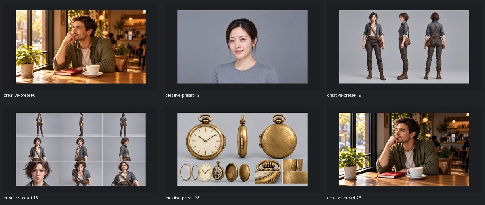

# DirectorX 任务五：预设配图候选

本包使用ChatGPT内置生图与图片编辑工具实际制作。共有 **43项独立原图、43张缩略图、5张共用底图**，另保留2次不理想的初版。先生成底图，再完成并查看指定6张代表图，随后完成其余P0，最后制作P1/P2。50次实际生图/编辑调用均有输出，没有收到额度不足错误。

| 优先级 | 清单项数 | 实际生成 | 其中待返修 |
|---|---:|---:|---:|
| P0 滤镜/质感与功能 | 27 | 27 | 13 |
| P1 摄影组合意图 | 4 | 4 | 1 |
| P2 同人像光线对照 | 12 | 12 | 2 |
| 合计 | 43 | 43 | 16 |

生成完成不等于视觉验收通过。`reviewed_candidate`为已查看的创意候选，`needs_revision`为有实际图片但存在明确问题的候选。没有未生成项。具体问题见[返修清单](UNFINISHED.md)和[视觉检查记录](results/visual-review.json)。

## 先看这6张



联系表仅供审查；每一项都另有独立PNG和640×360 WebP。其余预览：[滤镜/肤质](reviews/filters.jpg)、[功能](reviews/functions.jpg)、[摄影](reviews/camera.jpg)、[光线](reviews/lighting.jpg)。图片内不叠加预设标题或UI；联系表ID标签在审查版画面外。

## 文件与映射

- `bases/`：5张实际生成的共用底图。所有肤质与P2引用同一最终肖像；滤镜和光影校正引用同一咖啡馆图；角色/道具/动作各有固定底图。
- `masters/`：43个工具原始PNG，字节与工具落盘文件一致。普通原图1672×941；全景1774×887，原生2:1。
- `cards/`：1536×864 WebP衍生卡片，等比缩小并在外围留至少8%安全边距，质量94。无拉伸、裁侧或代码艺术滤镜。
- `thumbs/`：独立640×360 WebP，质量88，从上述等比留边卡片缩小；不是原生高清的替代声明。
- `comparisons/`：3组各自独立的before/after PNG：3秒后、5秒前、电影级光影校正。5秒前组的before是生成的更早状态，after是共用t0底图；3秒后组是t0→举杯。
- `attempts/`：首张肖像裁发顶、首版5秒前重复底图，均保留真实PNG与失败原因。肖像后由GPT扩大取景，5秒前后由GPT重试为双手下垂状态。
- `asset-map.json`：全部43项的原ID、target、原始提示词哈希、实际提示词、引用底图哈希、尺寸、SHA256、文件路径、归属、preview_kind和视觉备注。每个生成项目均为generated_by=ChatGPT。
- `prompts/`：附件意图生成的初始请求以及实际使用的提示词；以`*-actual.txt`和asset-map实际提示词为准，重试时会与初始请求不同。参考图顺序记录在results中。
- `results/`：每次选定输出的生成记录、结构校验快照、视觉检查与原图字节一致性记录。环境绝对输出路径只作历史凭据，不是下载后要访问的依赖。
- `reviews/`：联系表及全景边缘接合检查。不能用其替代独立素材。
- `brief/`：上传清单、库存、说明和原始MANIFEST的完整副本。无需访问用户本机或拉取项目源码。
- `tools/`：离线检查、等比衍生与打包脚本。脚本没有网络调用或生图API。

P0真实ID固定为creative-preset-0至26，逐字保留name、source_prompt与SHA256。摄影/光线的asset_id仅为包内文件标识；实际接入使用target.name或target.group/option，不把它们当成已有前端ID。完整逐项文件链接见[素材索引](ASSETS.md)。

## 实际检查与主要问题

已查看实际生成图和缩略图，并实际检查文件存在、非空、解码、尺寸、哈希、ID唯一、CSV/JSON映射、上传材料完整性、原图未改写、共用动作底图和前后文件复制一致性。结果见`results/structural-validation.json`；视觉检查单独记录，不能由结构通过推导视觉通过。

首轮校验器错误地直接读取P1/P2未提供的可选source_prompt字段而中止；第二轮因把日志直接重定向到正在检查的目录，触发了正在写入的空文件检查。已修正可选字段访问，改为先捕获完整stdout再写日志，重跑完整检查。两次记录保留在validation-attempt-1/2.json，不能误当作最终验收结果。

肤质六项保持同一脸，但缩略图区别较弱；多视图包带与局部服装仍有偏差；全景未通过无缝认定；道具拆解不是机械事实；角色衣领和微距机芯有微小伪标签/刻字。原图外边距偏紧的结果完整保留，卡片另做留边，内部构图问题仍需返修。失败初版没有被静默丢弃。

所有图片只是GPT效果/意图参考，**没有Qwen/Krea/H3/RH工作流实测**。胶片、镜头和照明名称不代表物理模拟已验证。3秒/5秒只是情境推演。没有修改画布、项目文件或宣称已接入上线。详细边界见[未验证清单](UNVERIFIED.md)。

## 离线校验

需要Python 3与Pillow；本次实际运行环境为Python 3.12.14、Pillow 12.3.0。已有环境无需联网。校验只读取包内文件：

```sh
python tools/verify.py
```

`MANIFEST.json`列出所有交付文件的大小与SHA256，仅自排除根目录的MANIFEST本身。`--tool-originals`只适合仍保留原会话环境输出文件时验证字节来源，下载者无需运行该选项。

重新生成布局衍生图需要原环境中的工具输出，故不建议下载后运行prepare_images；现成素材全部已包含。离线校验脚本可以直接运行，不需要密钥。若自行更改文件，原MANIFEST将准确报出差异。

## 下载与此前任务

本任务独立发布；GitHub固定commit的Download ZIP包含本目录全部文件，自动解压外层文件夹名称可能包含仓库名与commit。内部文件以MANIFEST校验。此前任务一、三、四的交付分支与ZIP保持原样，当前画布未修改。
