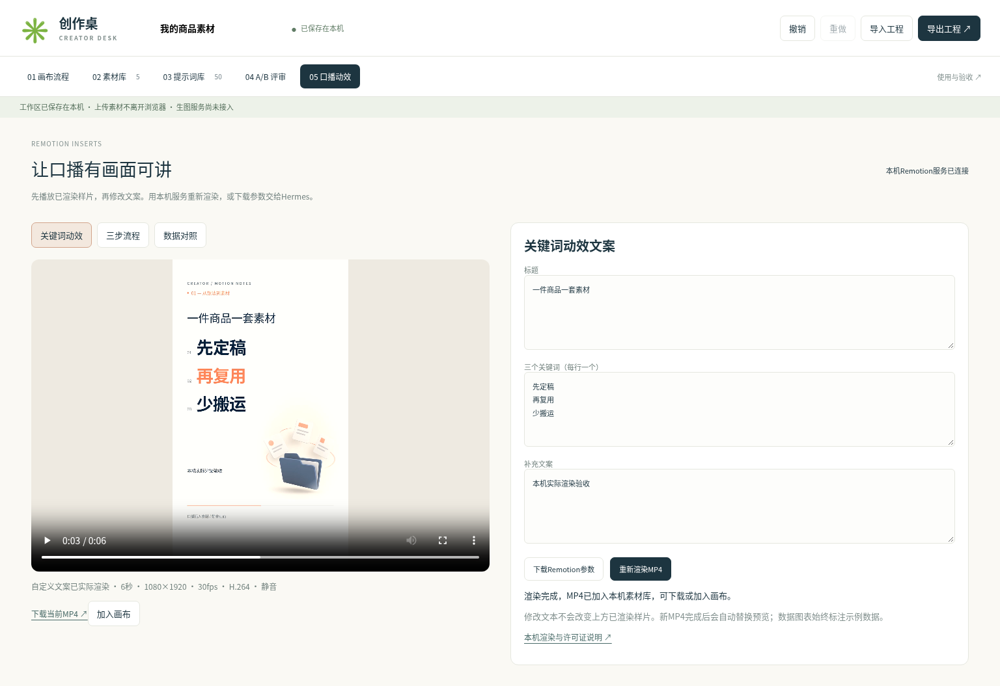

# 创作桌：AI画布研究、提示词与视频素材工具箱

为电商商品素材、影视分镜、5–10分钟AI长片和自媒体口播素材准备的研究与规划交付。包含三类项目榜单、分类提示词/Skill、可交互画布原型，以及实际生成的图片和Remotion样片。

**先看 [交付文档与Hermes验收](docs/交付文档-Hermes验收.md)** · [下载中文交付PDF](artifacts/交付文档-创作画布研究与规划.pdf) · [下载仓库ZIP](https://github.com/laoxuaichirou/prompt/archive/refs/heads/main.zip)

这是研究、规划与可运行样例。画布原型尚未接入真实付费生成接口；5/10分钟文件是镜头计划，三个MP4是6/8/6秒口播动效素材。

## 追加：素材与动效已串成一个工作台

```bash
python scripts/studio_server.py
# 浏览器打开 http://127.0.0.1:8765/prototype/index.html
```

五个页面包含：**画布流程 → 素材库 → 50条提示词/8个Skill → A/B评审 → 口播动效**。上传素材、填参、选版本、播放MP4、保存与导出都能直接操作。安装Remotion依赖后，可以在网页修改文字并本机重渲染新MP4。

本轮已实际跑通浏览器表单渲染、MP4回到画布、带素材工程导出与空白浏览器恢复；前端无构建与CDN依赖。在线生图/AI视频模型尚未接入。

[启动与Hermes验收](docs/06-创作桌工作台与Hermes验收.md) · [下载工作台交付PDF](artifacts/studio/工作台交付与Hermes验收.pdf) · [本机新渲染MP4](artifacts/studio/custom-kinetic.mp4) · [浏览器验收证据](artifacts/studio/workspace-test-report.json)



## 追加：生图与动效 A/B 实测

[并排查看原图](artifacts/ab-2026-10-23/README.md) · [完整测试报告](docs/05-生图与Remotion-AB测试报告.md) · [对照PDF](artifacts/ab-2026-10-23/AB对照报告.pdf)

新增5组生图、10张实际原件，以及1组Remotion素材对照、2条6秒MP4。背景和强调色替换基本可用；影视光线有语义漂移；透明PNG需按原文件合成复核；角色参考版仍需身份复核。失败样例全部保留。

每条件只有一次调用，没有固定seed；并非全部50条模板或8个Skill端到端通过。具体已测/未测见 [coverage.json](artifacts/ab-2026-10-23/coverage.json)。本轮按视觉步骤应用了电商、影视资产、Remotion三个Skill，并把发现的问题回写到验收要求。

追加独立验收：`python scripts/verify_ab_tests.py`，需要Pillow与ffprobe。它检查证据与实际alpha/视频，不把质量失败改成通过。

## 从这里开始

| 你要做什么 | 入口 |
|---|---|
| 理解课程 | [PDF课程整理](docs/01-PDF课程整理.md) |
| 看产品方案 | [画布工具产品规划](docs/02-画布工具产品规划.md) |
| 选画布技术/竞品 | [画布项目Top10](research/01-canvas-top10.md) |
| 找生图提示词/Skill | [生图Top10](research/02-image-top10.md) |
| 找视频提示词/Skill | [视频Top10](research/03-video-top10.md) |
| 找Remotion/上游资源 | [分类资源入口](research/04-upstream-resources.md) |
| 直接用模板 | [50条原创提示词](prompts/README.md) / [机器可读JSON](prompts/catalog.json) |
| 交给Hermes执行 | [8个原创技能](skills/README.md) |
| 阅读上游原文 | [选定MIT文本镜像](third_party/README.md) |
| 体验完整工作台 | 运行 `python scripts/studio_server.py`，见 [启动说明](prototype/README.md) |
| 复用口播动效 | [Remotion工程与重现步骤](remotion/README.md) |
| 检查实测结果 | [生图与动效测试记录](docs/03-生图与动效测试记录.md) |

## 画布交互原型


选择四类模板编辑卡片，支持拖动、引用连接、缩放、撤销重做、本机保存。素材、提示词、Skill、评审版本、视频均可加入画布；工程JSON带上上传素材与草稿。

前端没有构建依赖；“检查执行计划”只校验图结构。Remotion重新渲染在“口播动效”页面独立执行，需要本机服务及锁定依赖。图片卡片使用本次实际生图或你的上传素材。

## 初次单图测试（原件保留）

<table><tr><td></td><td></td><td></td></tr><tr><td>电商主图 · IMG-EC-01</td><td>影视关键帧 · IMG-FILM-03</td><td>口播插画 · IMG-FILM-08</td></tr></table>

三条均为原创提示词单次测试，完整调用文本、尺寸、哈希和观察局限见 [image-test-results.json](artifacts/image-test-results.json)。没有真实商品参考，不能据此认定实拍保真或跨镜头一致性。其他模板未逐条生成测试。

## Remotion真实样片

| 模板 | 文件 | 参数 |
|---|---|---|
| 关键词逐项进入 | [remotion-kinetic.mp4](artifacts/remotion-kinetic.mp4) | 6秒，180帧 |
| 三步流程卡片 | [remotion-steps.mp4](artifacts/remotion-steps.mp4) | 8秒，240帧 |
| 数据对照图 | [remotion-comparison.mp4](artifacts/remotion-comparison.mp4) | 6秒，180帧 |

均为1080×1920、30fps、H.264、静音；源文件、props和package-lock已保存。数据对照是明确标注的虚构示例。普通MP4不透明；配音和完整口播合成尚未制作。

## 排名和推荐

三类各10项，按**已检索并核验的相关候选**star降序排列，采集日期2026-10-23北京时间。保存65个成功检索页、405个去重搜索候选和30个固定文件入口校验。扩展搜索有429限流，不能证明全站穷尽；详见 [方法与排除规则](research/METHODOLOGY.md)。[CSV](research/top30.csv) / [JSON](research/top30.json)可供Hermes读取。

按你的用途，推荐优先研究React Flow编辑底座、Toonflow影视流程、商品图片排版子编辑器与Remotion；无限画布上的模型参数默认折叠。长片分章节、分镜头生产，角色/商品/场景先定稿，试产一镜后才批量。

## 本机验收

```bash
# 在仓库根目录，Python3 + ffprobe；无需模型密钥
python scripts/verify_delivery.py
node scripts/test_model.cjs
python scripts/verify_studio.py
node scripts/test_studio_model.cjs

# 可选：Python Playwright + 已安装Chrome/Chromium
python scripts/test_canvas.py

# 提示词查询
python scripts/prompt_cli.py list --kind image --category ecommerce
python scripts/prompt_cli.py show IMG-EC-01
```

浏览器默认使用系统Chromium，可用 `CANVAS_BROWSER_EXECUTABLE` 指定其他路径。Remotion重新渲染请看工程README。`SHA256SUMS`用于本次交付文件校验，不要求异平台重编码结果字节完全相同。

## 范围与许可

原创代码/技能为MIT，原创提示词与研究笔记为CC BY 4.0；第三方镜像保留原许可，其他上游只提供来源与分类。详情见 [LICENSE](LICENSE)。原始课程PDF未公开分发。模型服务、Remotion/tldraw等依赖保留各自条款。

本次没有实现云端生成队列、多人协作、真实供应商API、TTS或5–10分钟整片。后续实施范围、成本公式与验收门槛在产品规划和交付文档中逐项列明。
