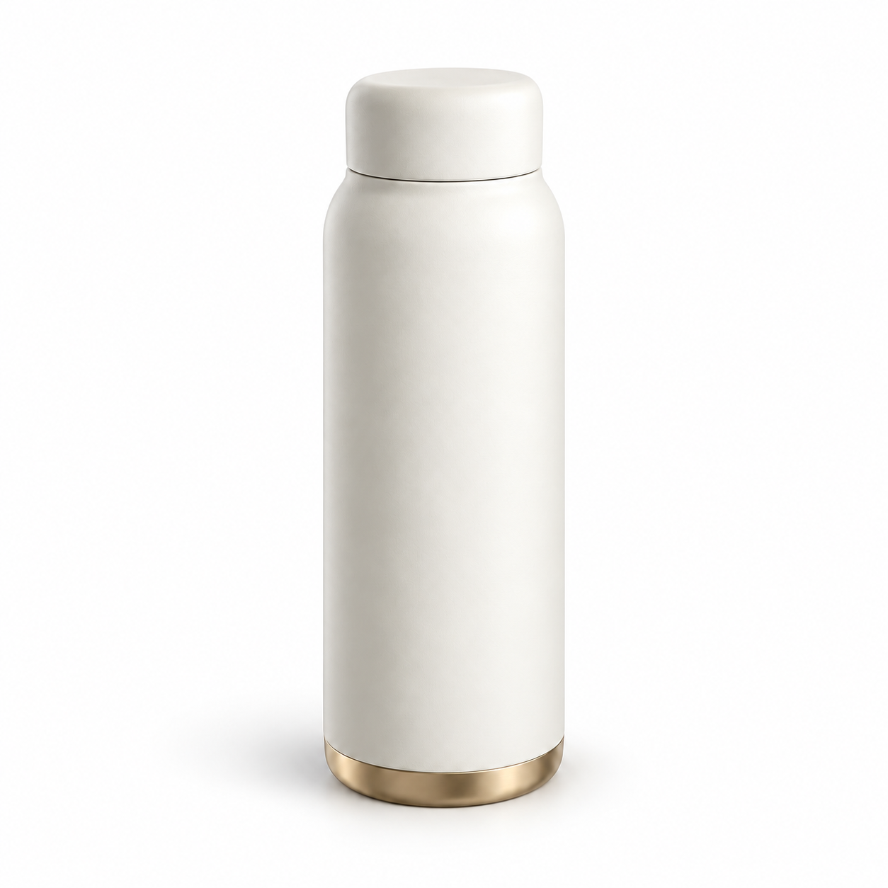
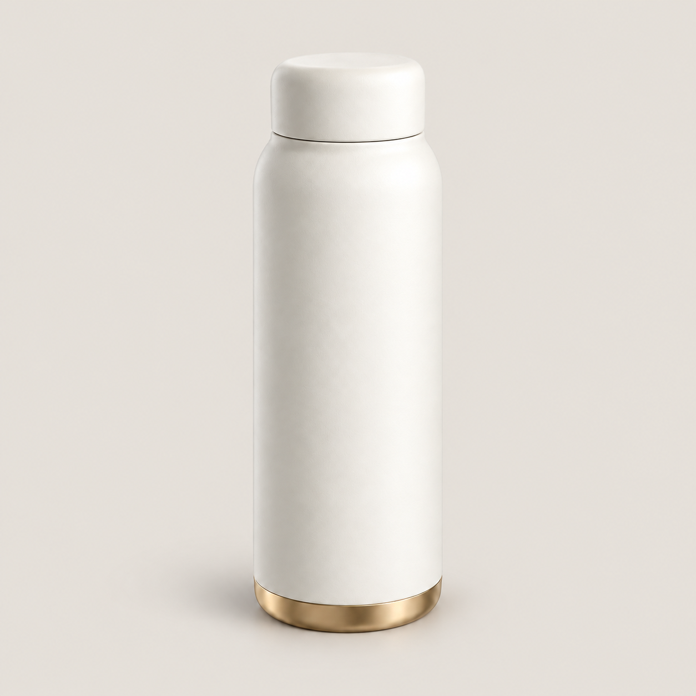
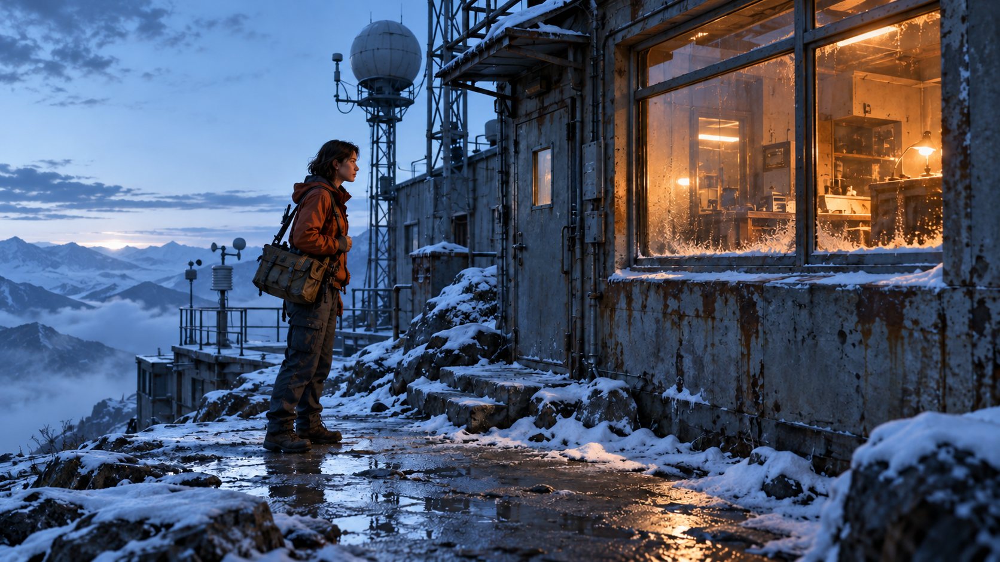
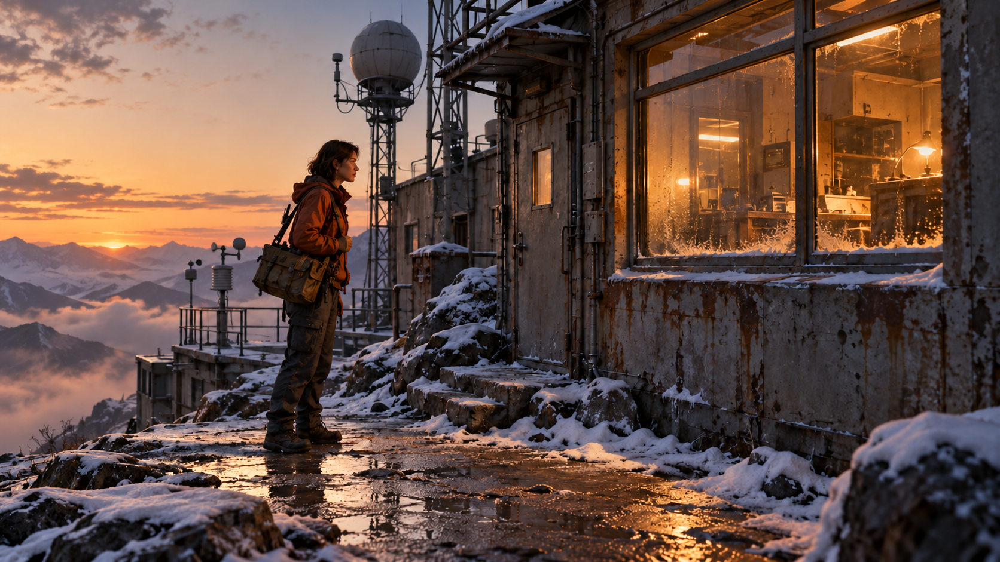
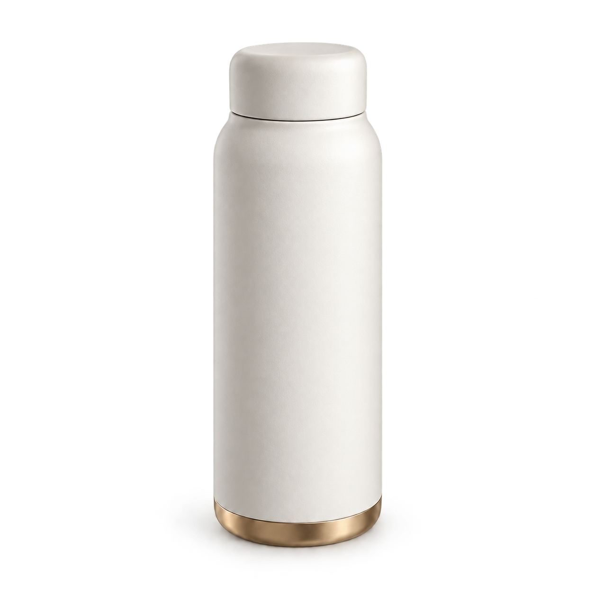
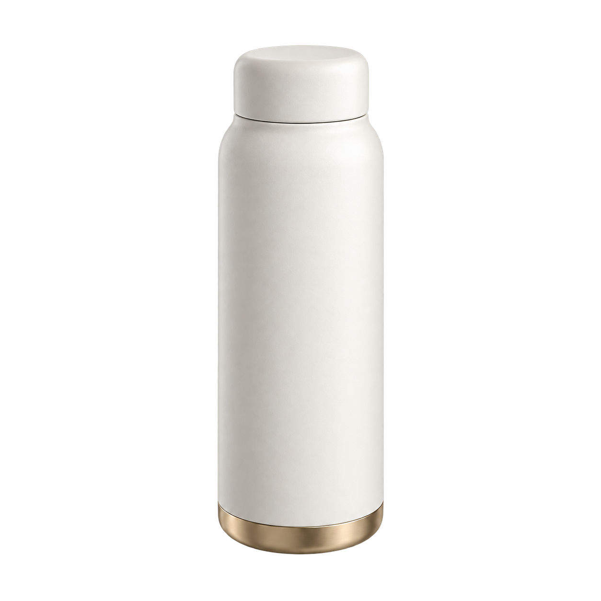
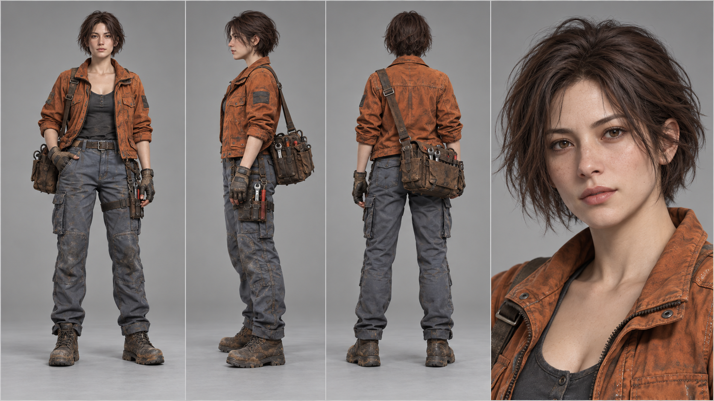
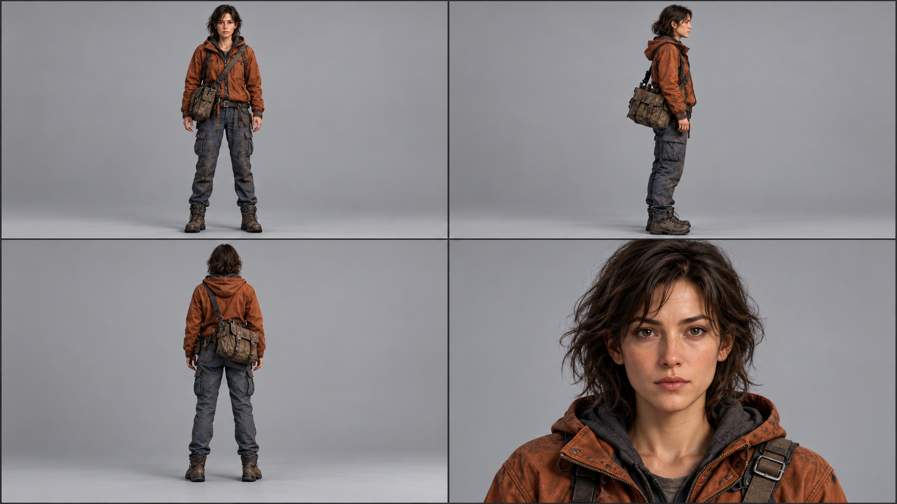
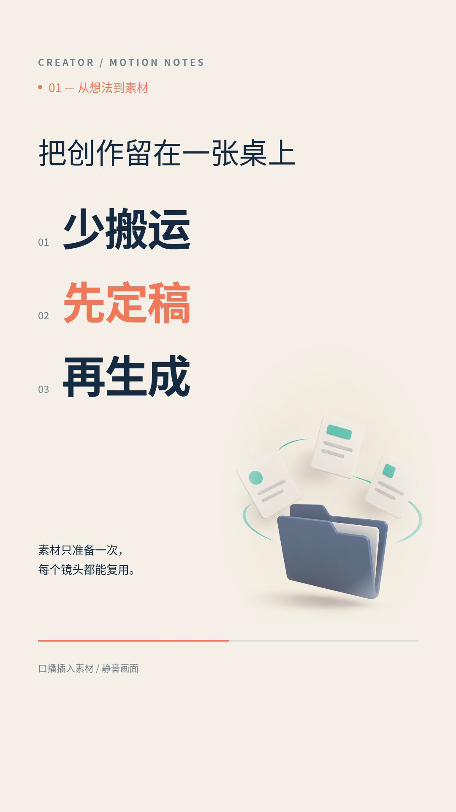

# 生图与Remotion A/B 实测

2026-10-23。五组生图、十次独立调用，加一组同组件Remotion素材A/B。没有固定seed，每条件仅一次，不能据此证明稳定优势。

[完整测试报告](../../docs/05-生图与Remotion-AB测试报告.md) · [离线对照网页](index.html) · [设置](plan.json) · [指标](image-metrics.json) · [覆盖清单](coverage.json)

GitHub可直接在下方并排看图；要切换透明素材底色、同步查看视频，请下载仓库后打开index.html。

## AB01 电商：白底与浅灰背景

唯一输入变量：背景颜色。**有备注通过**。

<table><tr><th>A：纯白色 #FFFFFF</th><th>B：浅暖灰色 #E7E3DC</th></tr><tr><td></td><td></td></tr></table>

背景替换有效，A适合白底主图，B适合有背景的创意商品图；两者不是优劣排名。

白底渠道选A；创意广告按版式选B。正式商品任务必须对照真实实拍。

## AB02 影视：室外主光冷暖

唯一输入变量：室外主光色温。**部分通过 / 需复核**。

<table><tr><th>A：6500K冷白色</th><th>B：3200K暖白色</th></tr><tr><td></td><td></td></tr></table>

冷暖风格可辨，但严格单变量控制未通过；B新增日出效果，改变了环境语义。

可用于探索调色方向；连续镜头优先锁定时间/太阳状态，必要时用传统调色保持结构。

## AB03 口播：强调色替换

唯一输入变量：强调色。**有备注通过**。

<table><tr><th>A：珊瑚橙 #F27858</th><th>B：青绿色 #21A89A</th></tr><tr><td></td><td></td></tr></table>

强调色替换可用，三张卡片、文件夹与顶部留白总体保留。

按品牌配色选择；精确品牌色及文字优先由代码/矢量层绘制。两图进入同一Remotion组件做素材对照。

## AB04 抠图：保留与去除投影

唯一输入变量：是否保留接地阴影（两组都开启真实透明输出）。**需按目标背景人工复核**。

<table><tr><th>A：保留商品下方原有的柔和接地阴影。</th><th>B：去掉商品下方原有的接地阴影，不保留任何投影。</th></tr><tr><td></td><td></td></tr></table>

真实alpha与投影控制已验证；预览白色毛刺在浏览器正确合成下不明显，不能仅凭预览判为生产失败。

A用于需要接地感的场景，B用于独立图层；正式投放前做目标背景与边缘人工复核。不要用预览异常代替原PNG验收。

## AB05 角色设定：仅文字与实际参考

唯一输入变量：是否实际附加角色参考图。**部分通过 / 需复核**。

<table><tr><th>A：仅文字，不附参考图</th><th>B：相同文字，实际附参考图</th></tr><tr><td></td><td></td></tr></table>

附参考图的B更接近原角色服装与袋型并符合2×2布局；不能据此保证身份一致。

采用实际参考图流程，但先补清晰正脸、服装和道具定稿，不将这张设定板直接当已验证角色圣经。

## AB06 相同Remotion动效素材对照

[A：珊瑚橙插画视频](remotion-A.mp4) · [B：青绿插画视频](remotion-B.mp4)；同为6秒静音竖屏，只有illustration参数不同。

<table><tr><th>A实际3秒帧</th><th>B实际3秒帧</th></tr><tr><td></td><td></td></tr></table>

这组检验图片素材进入代码动效的可用性，不检验视频生成模型。标题仍使用原组件橙色，B不代表整体品牌色统一。
