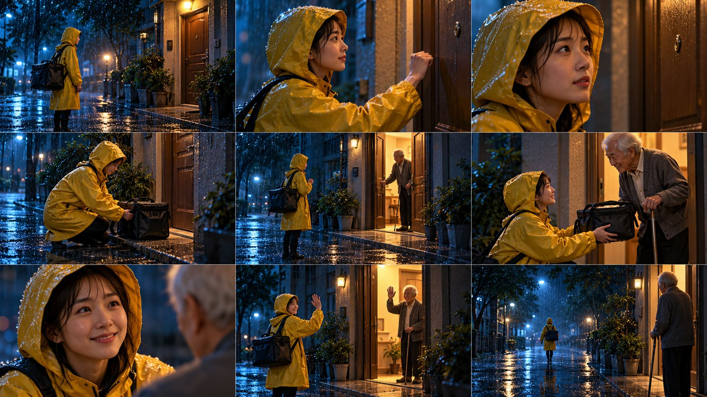
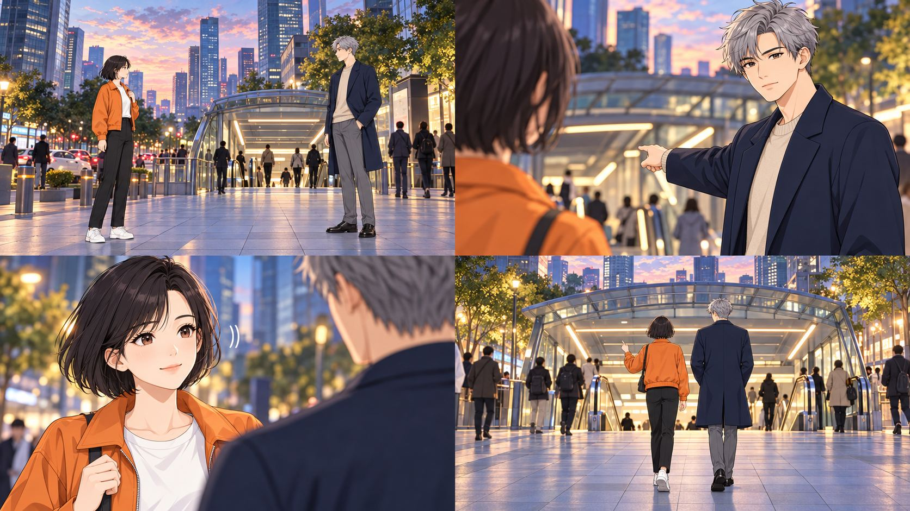
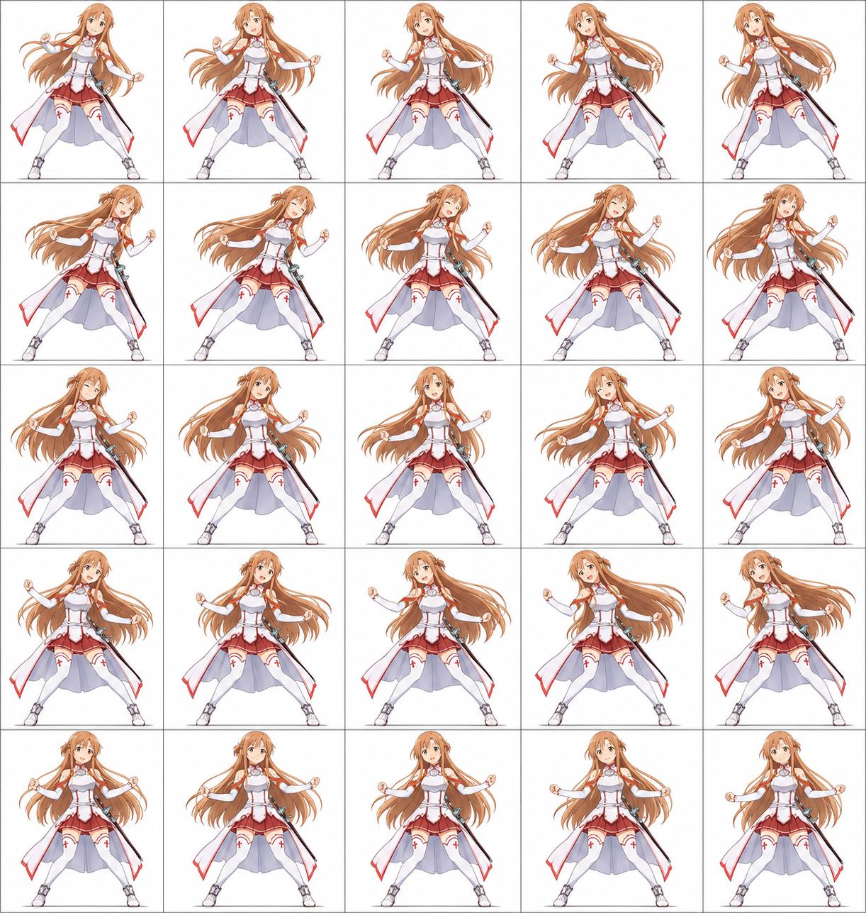

# 图片画廊 1

[返回交付目录](../README.md)

这些是原始测试输出的JPEG浏览转码副本。原PNG见原图分包；结论为模型初评。

## T001 固定人物多场景写真

存在问题

## T001 固定人物多场景写真

存在问题

## T001 固定人物多场景写真

存在问题

## T001 固定人物多场景写真

存在问题

## T001 固定人物多场景写真

存在问题

## T001 固定人物多场景写真

存在问题

## T002 NanoBananaPro 分镜拆解助手（未测试）

存在问题

## T003 LLM动作引擎（各类提示词示例）

存在问题

## T003 LLM动作引擎（各类提示词示例）

存在问题

## T003 LLM动作引擎（各类提示词示例）

存在问题

## T003 LLM动作引擎（各类提示词示例）

存在问题

## T003 LLM动作引擎（各类提示词示例）

存在问题

## T004 广告创意

存在问题

## T004 广告创意

存在问题

## T004 广告创意

存在问题

## T005 四宫格分镜

存在问题

## T006 JsonPromptMaker 身份锁定元提示词（原无标题）

存在问题

## T006 JsonPromptMaker 身份锁定元提示词（原无标题）

存在问题

## T007 商业广告25分镜

存在问题

## T009 GIF提示词（未测试）

存在问题

[画廊目录](./README.md) · [下一页](./gallery-02.md)
