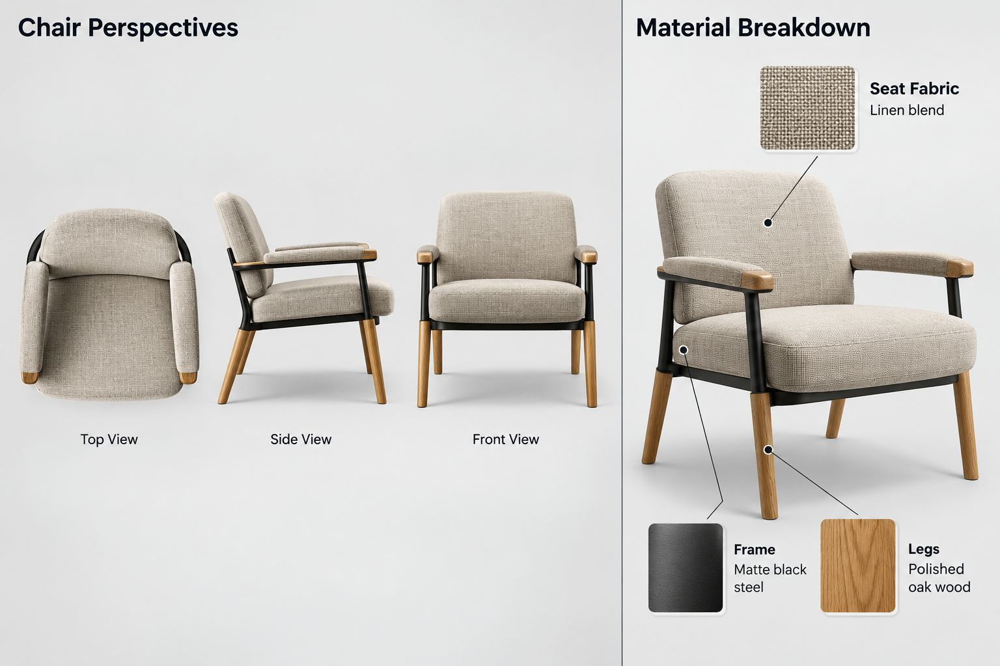
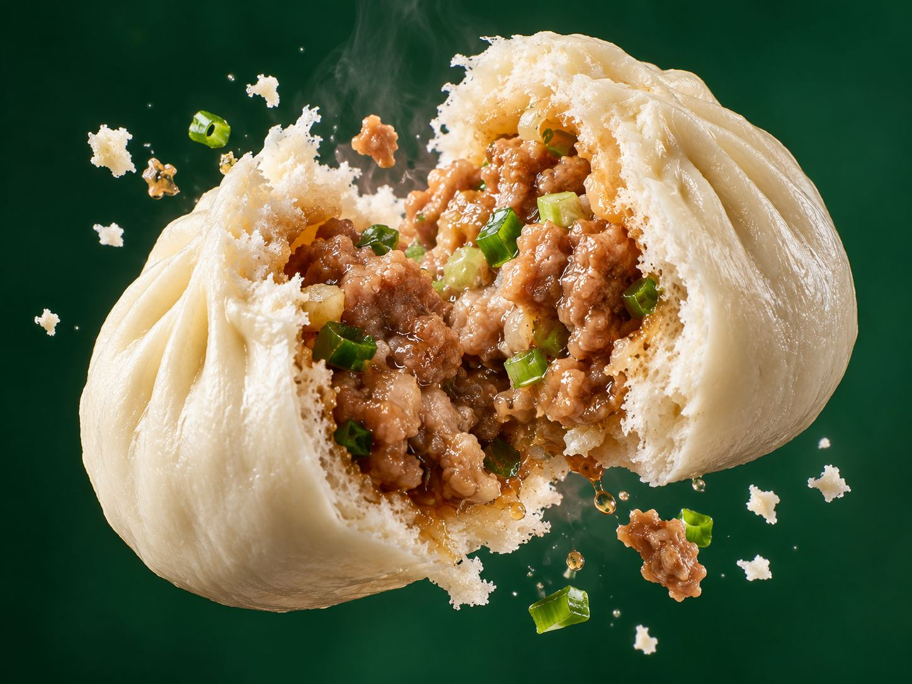
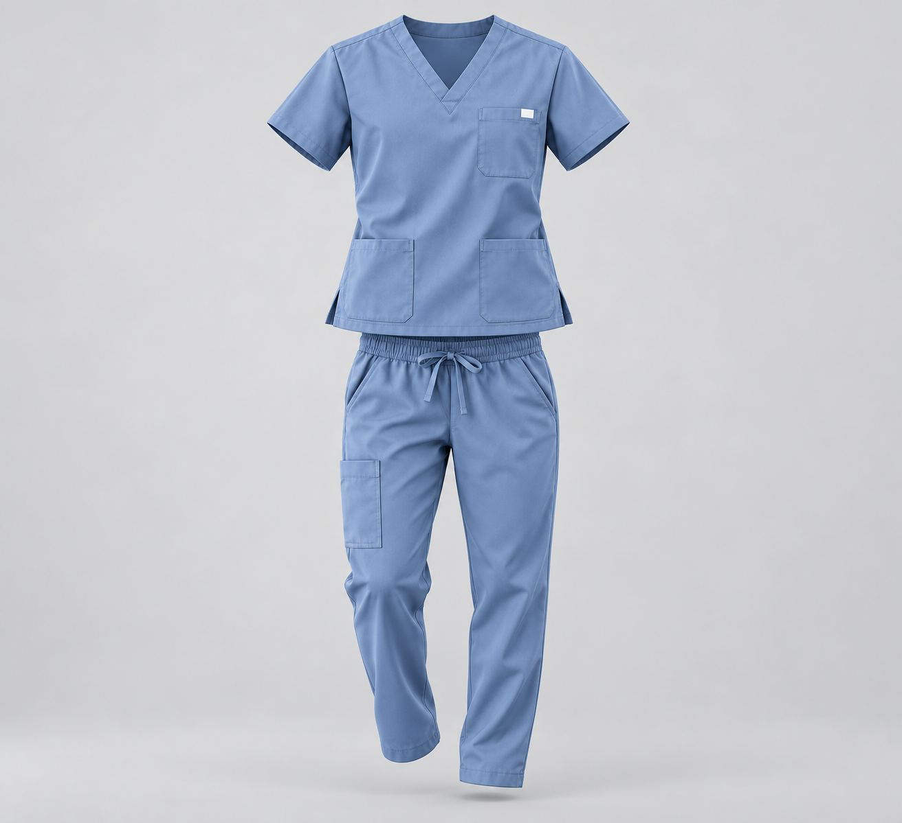
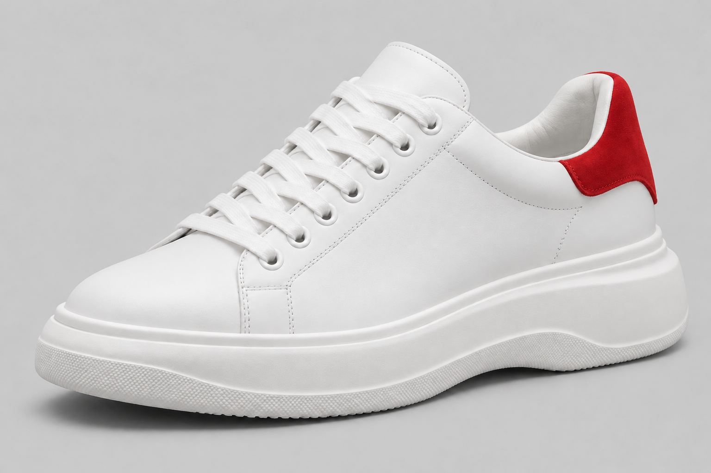

# 图片画廊 4

[返回交付目录](../README.md)

这些是原始测试输出的JPEG浏览转码副本。原PNG见原图分包；结论为模型初评。

## T045 元旦特辑-复古旗袍名媛风

存在问题

## T048 暖光工作室拉琴写真

存在问题

## T051 【元提示词】服装立体化lora：3Dghostmannequin

符合要求

## T052 多视角亚麻椅材质分解图

存在问题

## T053 奢华8K国家美食广告

存在问题

## T053 奢华8K国家美食广告

存在问题

## T054 戒指

存在问题

## T054 戒指

存在问题

## T055 衣服悬浮在空中

符合要求

## T056 图像 Prompt 改写专家丨三合一（喂给LLM）

符合要求

## T057 逆向提示词反推

存在问题

## T057 逆向提示词反推

存在问题

## T058 JSON提示词

存在问题

## T058 JSON提示词

存在问题

## T059 【LLM】元提示词模板

存在问题

## T059 【LLM】元提示词模板

存在问题

## T060 提示词增强

符合要求

## T062 【图片】提示词反推丨光影描绘丨通用模板：场景化 Agent 提示词” 的思路

存在问题

## T063 元提示词是什么

符合要求

## T065 提示词设计（教学用-反推部分修改）

符合要求

