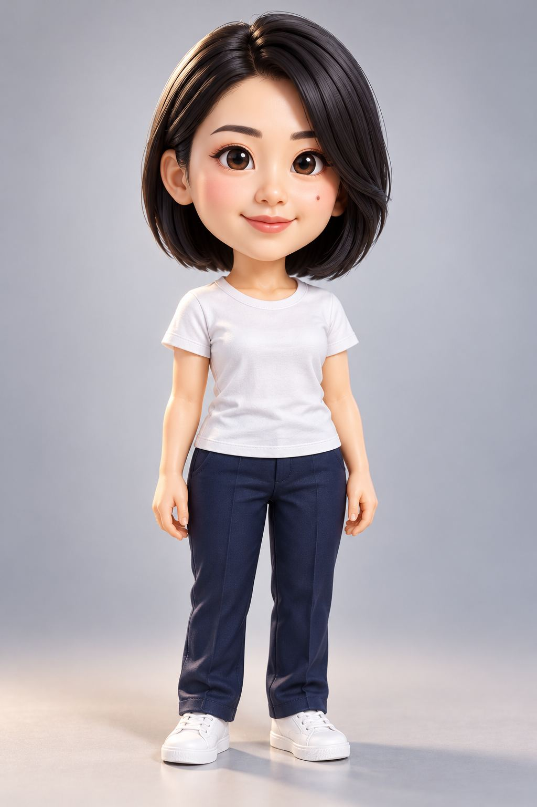

# 图片画廊 6

[返回交付目录](../README.md)

这些是原始测试输出的JPEG浏览转码副本。原PNG见原图分包；结论为模型初评。

## T087 AI视频广告创作栈：从零打造风格统一视频的8个提示框架

符合要求

## T087 AI视频广告创作栈：从零打造风格统一视频的8个提示框架

符合要求

## T088 卡通风格钥匙扣

存在问题

## T089 电商详情页 元提示词

符合要求

## T089 电商详情页 元提示词

符合要求

## T089 电商详情页 元提示词

符合要求

## T089 电商详情页 元提示词

符合要求

## T090 示例：2511产品展示分镜

存在问题

## T090 示例：2511产品展示分镜

存在问题

## T090 示例：2511产品展示分镜

存在问题

## T090 示例：2511产品展示分镜

存在问题

## T090 示例：2511产品展示分镜

存在问题

## T090 示例：2511产品展示分镜

存在问题

## T090 示例：2511产品展示分镜

存在问题

## T090 示例：2511产品展示分镜

存在问题

## T090 示例：2511产品展示分镜

存在问题

## T090 示例：2511产品展示分镜

存在问题

## T090 示例：2511产品展示分镜

存在问题

## T090 示例：2511产品展示分镜

存在问题

## T091 角色变成3D收藏级Q版人偶

存在问题

[上一页](./gallery-05.md) · [画廊目录](./README.md) · [下一页](./gallery-07.md)
