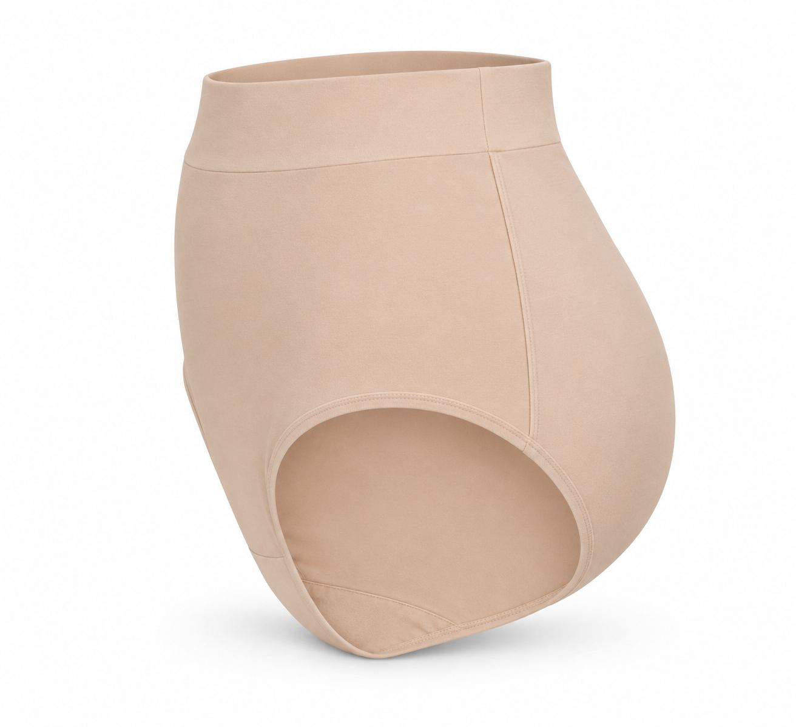
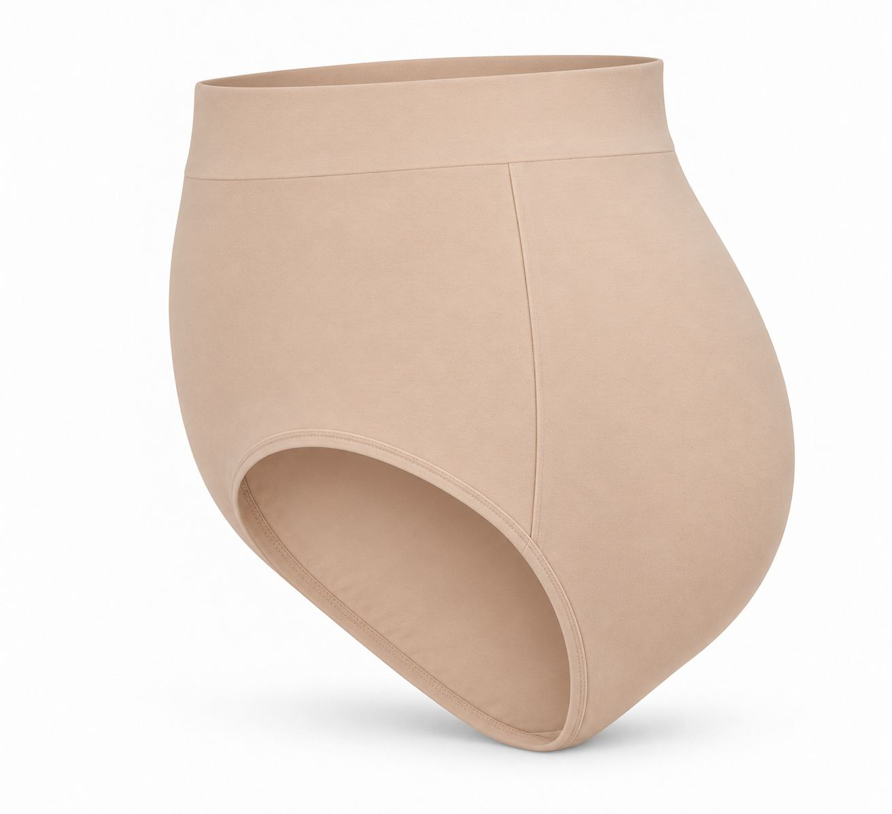

# 图片画廊 7

[返回交付目录](../README.md)

这些是原始测试输出的JPEG浏览转码副本。原PNG见原图分包；结论为模型初评。

## T092 96组角度提示词

存在问题

## T092 96组角度提示词

存在问题

## T092 96组角度提示词

存在问题

## T092 96组角度提示词

存在问题

## T092 96组角度提示词

存在问题

## T092 96组角度提示词

存在问题

## T092 96组角度提示词

存在问题

## T092 96组角度提示词

存在问题

## T093 动态光影超精细写真

符合要求

## T093 动态光影超精细写真

符合要求

## T094 预判前后时间的画面

存在问题

## T094 预判前后时间的画面

存在问题

## T094 预判前后时间的画面

存在问题

## T094 预判前后时间的画面

存在问题

## T095 【图片提示词】添加、删除、替换提示词增强

存在问题

## T095 【图片提示词】添加、删除、替换提示词增强

存在问题

## T095 【图片提示词】添加、删除、替换提示词增强

存在问题

## T096 与手机原图同框的铅笔肖像

存在问题

## T097 【电商】产品背景更换场景丨提示词优化

符合要求

## T098 制作大头贴

存在问题

