# 图片画廊 8

[返回交付目录](../README.md)

这些是原始测试输出的JPEG浏览转码副本。原PNG见原图分包；结论为模型初评。

## T099 换姿势

符合要求

## T100 铅笔风格的大头漫画

符合要求

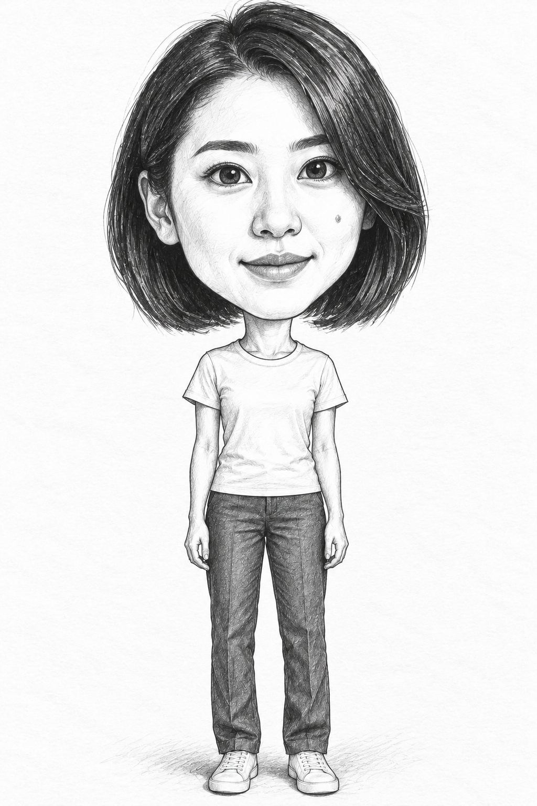

## T101 一位中年男子数字漫画

存在问题

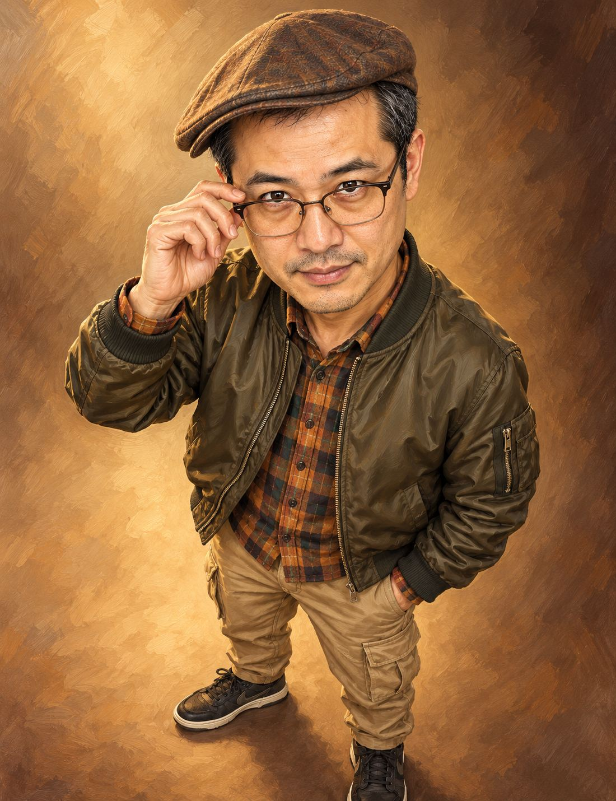

## T102 怪诞又梦幻的超现实插画

符合要求

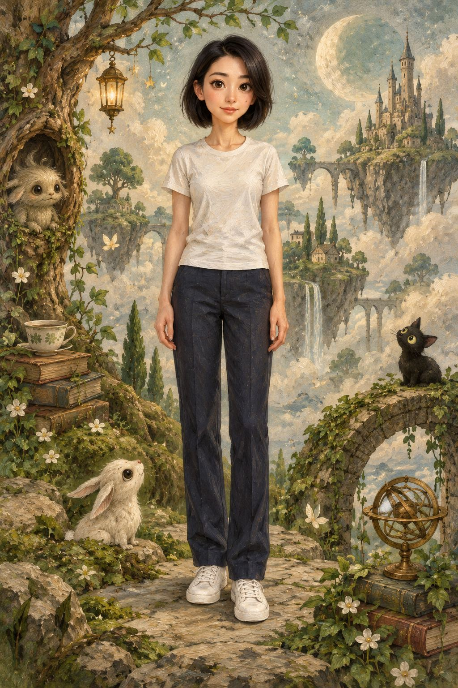

## T103 植发一年的改变图

存在问题

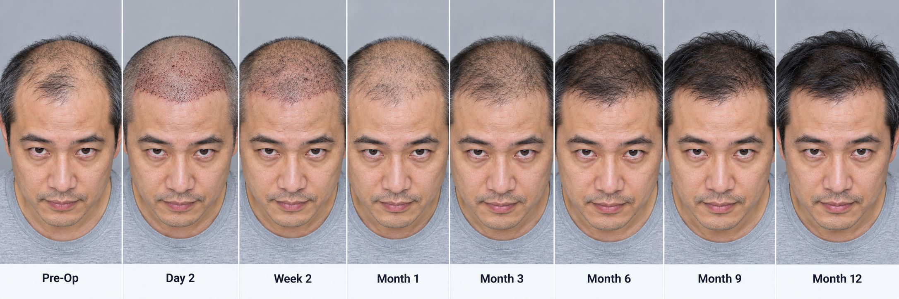

## T106 一框六格·风格女王

存在问题

## T107 夜间拖影快门曝光

符合要求

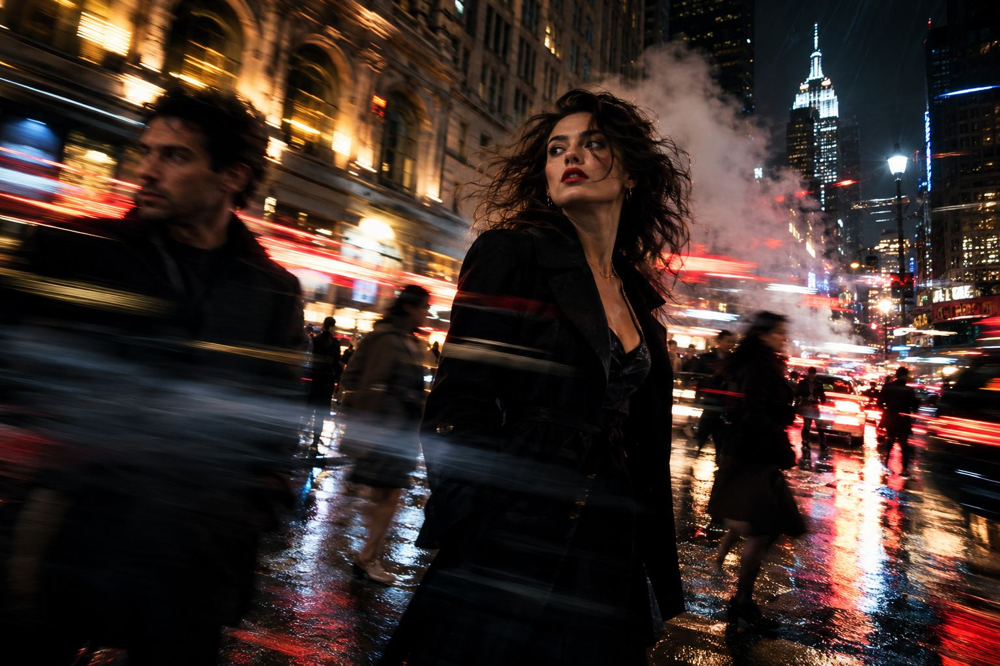

## T109 【图像】 人像摄影提示词丨NanoBananaPro

符合要求

## T110 人物多角度提示词（3+1版）

存在问题

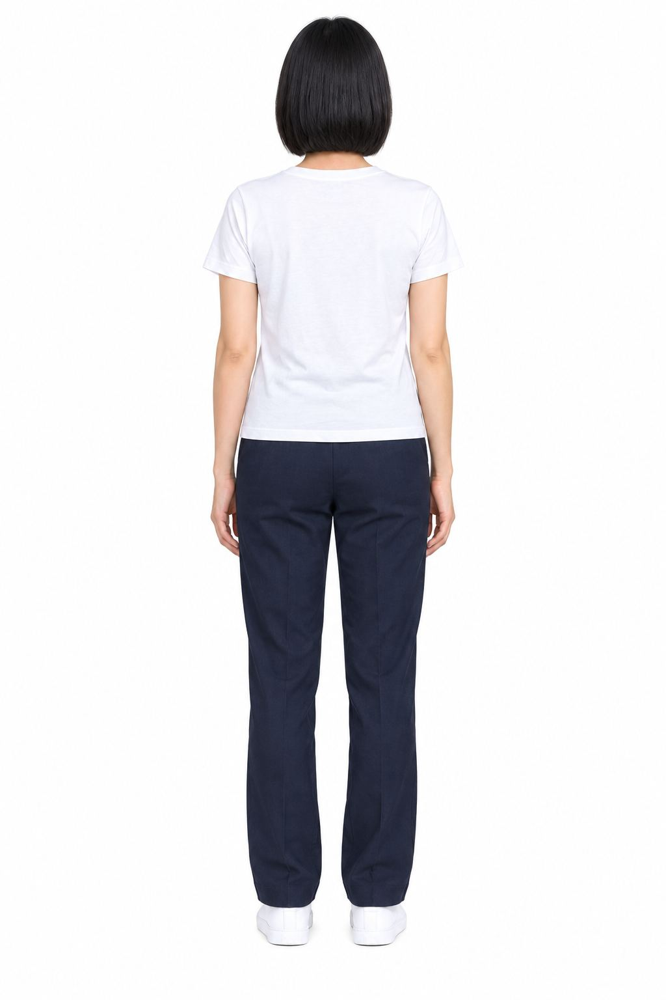

## T110 人物多角度提示词（3+1版）

存在问题

## T110 人物多角度提示词（3+1版）

存在问题

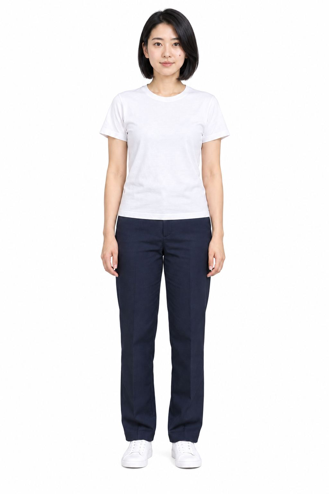

## T110 人物多角度提示词（3+1版）

存在问题

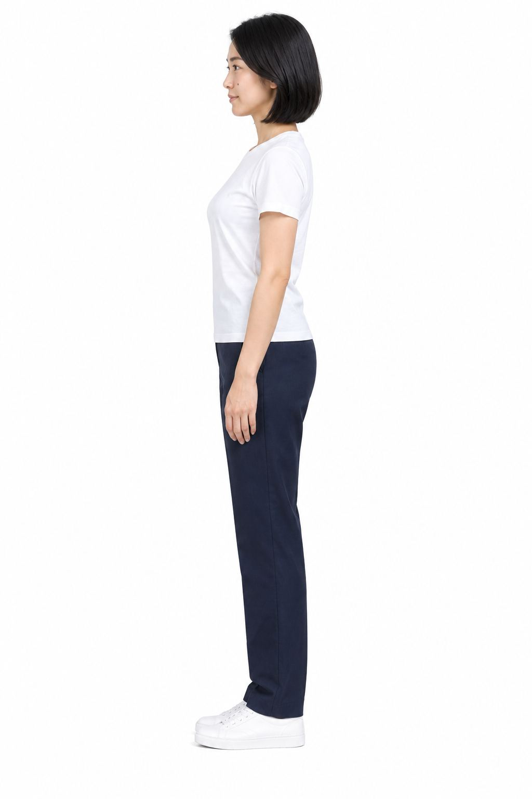

## T110 人物多角度提示词（3+1版）

存在问题

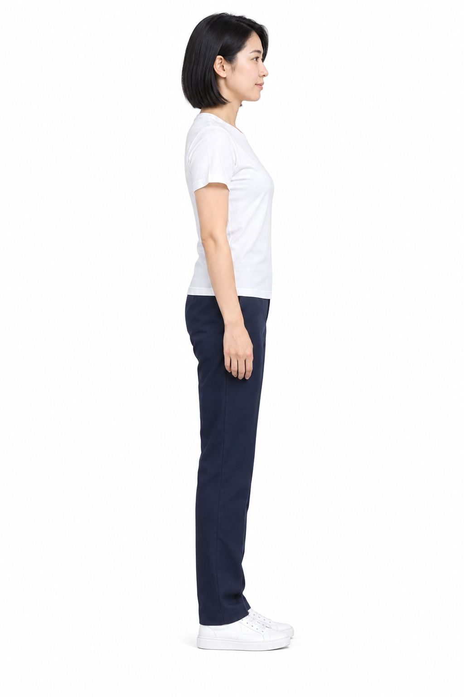

## T112 Q版小人

存在问题

## T113 【人像】3x3网格照片拼贴

存在问题

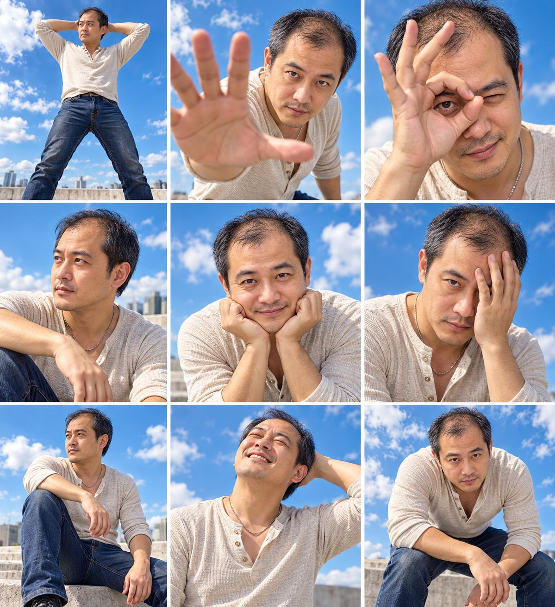

## T115 【示例】求婚场景（banana图生图）

存在问题

## T117 你抱着幼年版自己的复古风自拍

符合要求

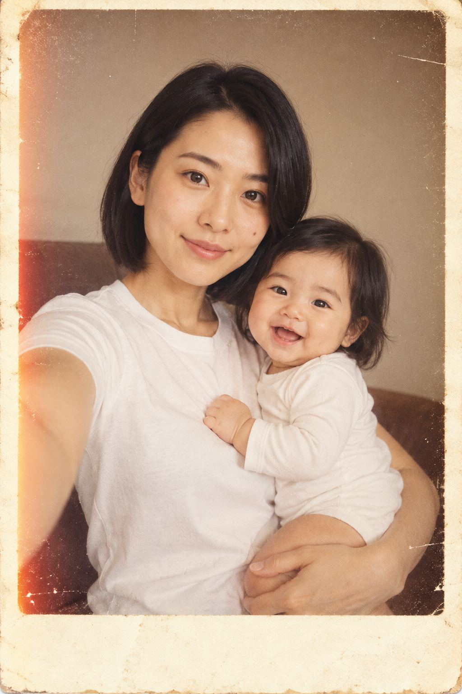

## T119 女性面部涂口红和唇彩效果的图像

存在问题

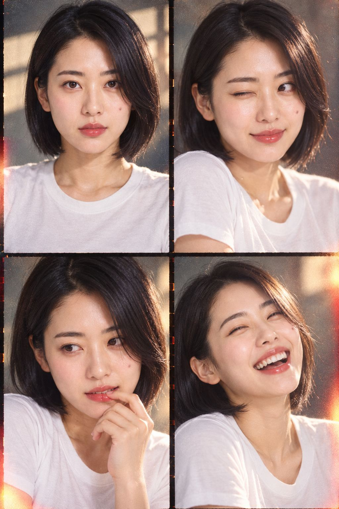

## T120 姿势提示词合集（原无标题）

符合要求

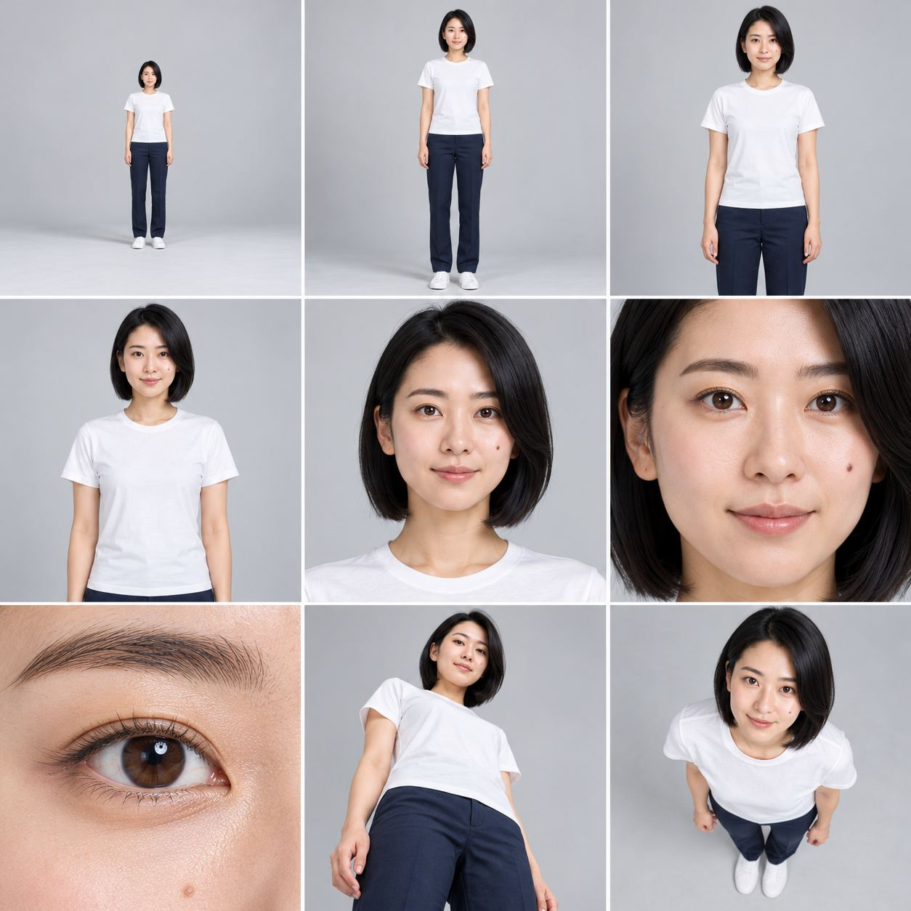

## T121 电影级手办创作瞬间

存在问题

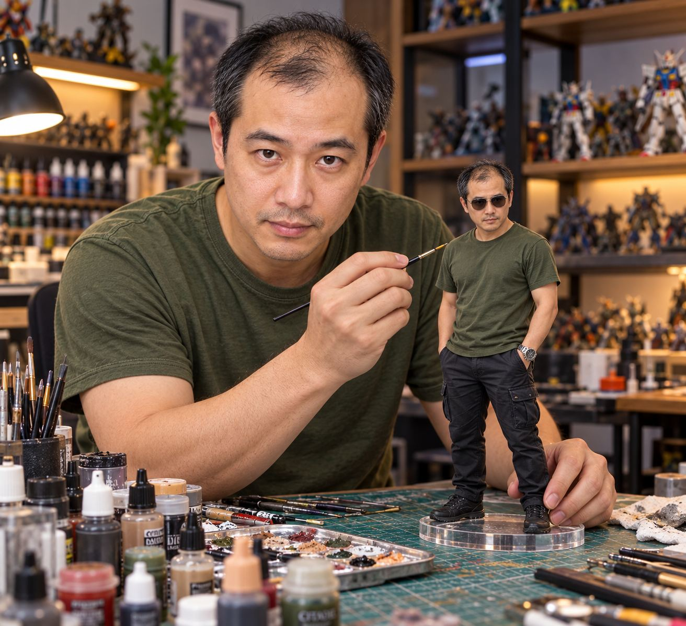

[上一页](./gallery-07.md) · [画廊目录](./README.md) · [下一页](./gallery-09.md)
