# 图片画廊 10

[返回交付目录](../README.md)

这些是原始测试输出的JPEG浏览转码副本。原PNG见原图分包；结论为模型初评。

## T142 套图写真：顶级商业人像摄影导演

存在问题

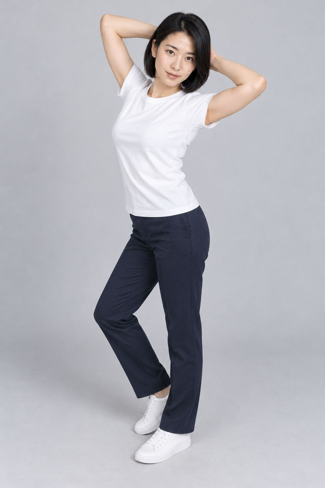

## T143 女性一生电影拼贴

符合要求

## T145 摆放着一个与本人相似的Q版模型

符合要求

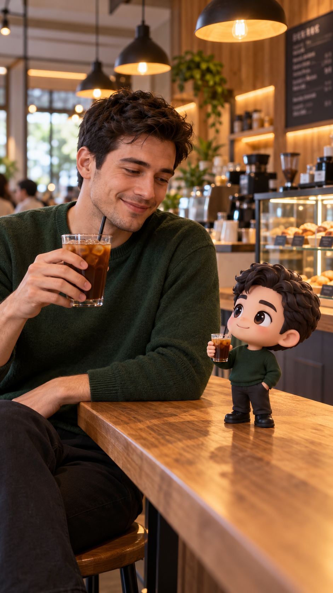

## T146 生成人物不同姿势九宫格

存在问题

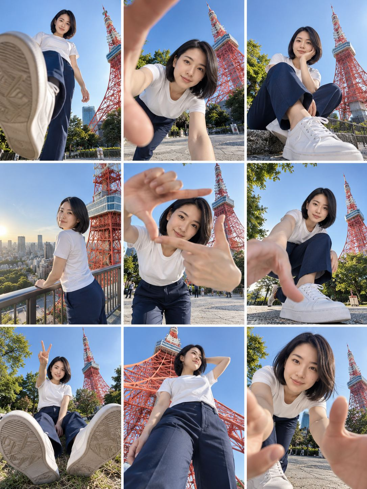

## T147 电影感十足的肖像摄影作品

符合要求

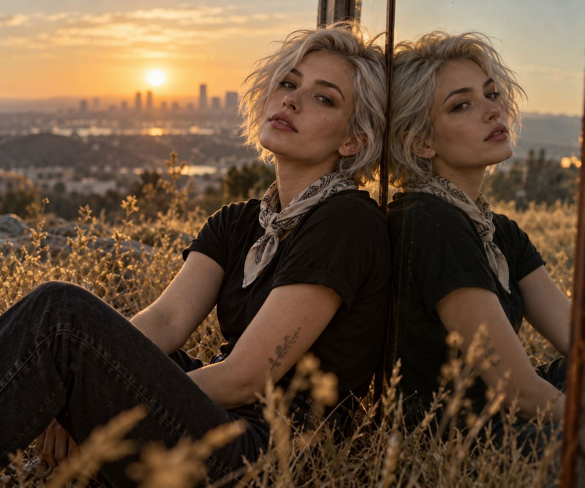

## T150 超写实3D漫画肖像

存在问题

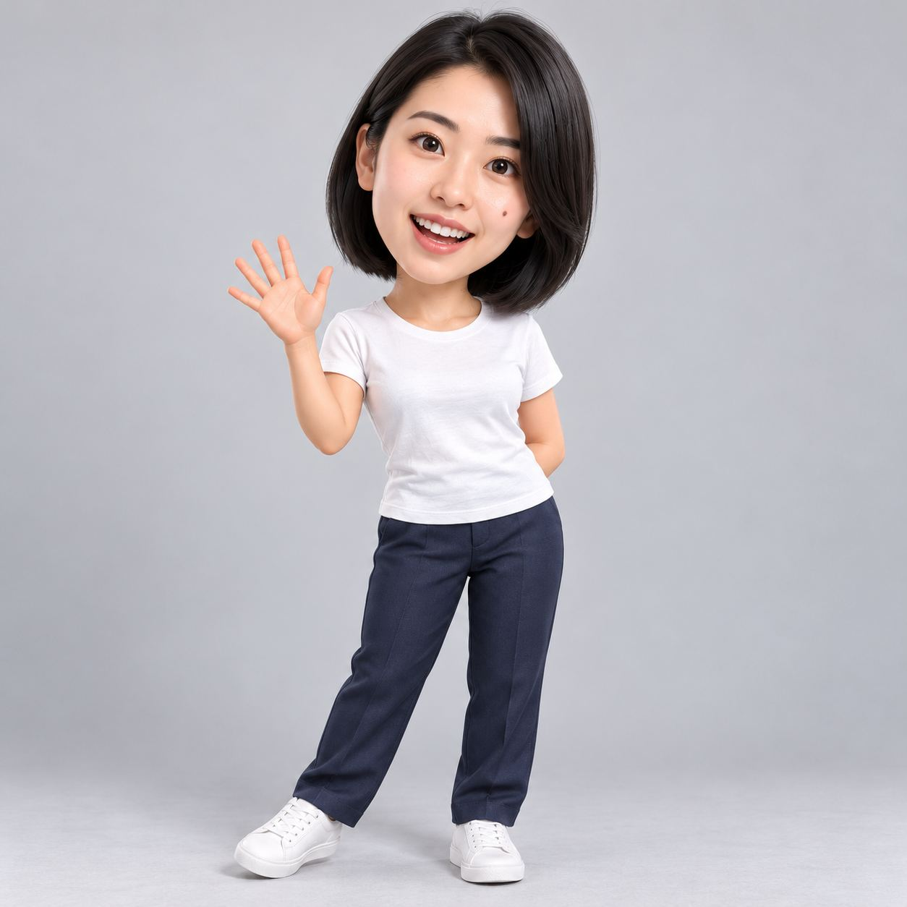

## T151 都市静影·人流穿梭

存在问题

## T153 青春波普贴纸秀

符合要求

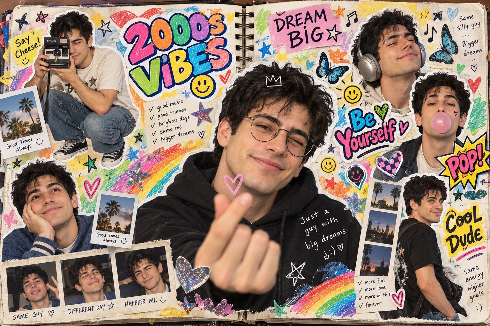

## T154 风格化的3D人物漫画

符合要求

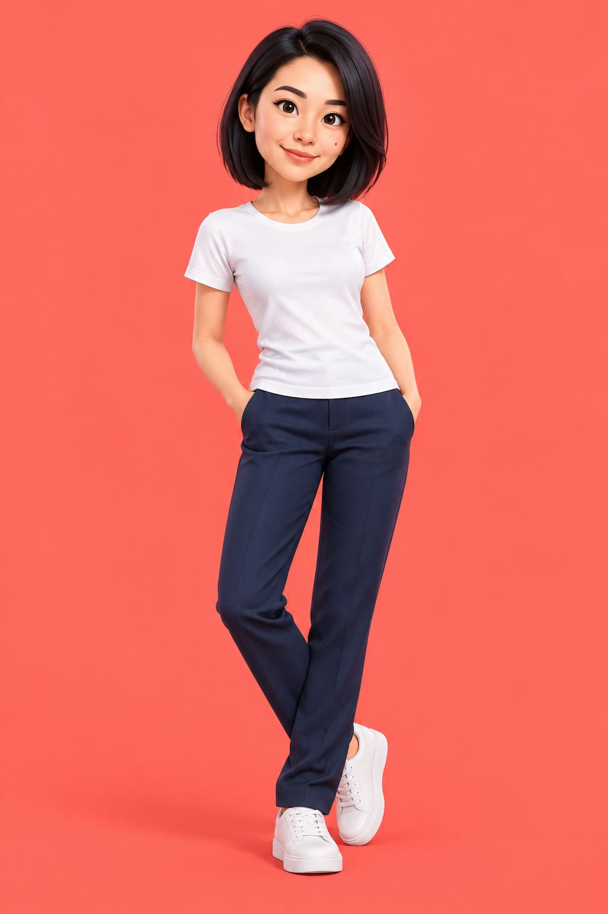

## T156 女子仿佛从刚冲洗出来的照片中浮现出来

存在问题

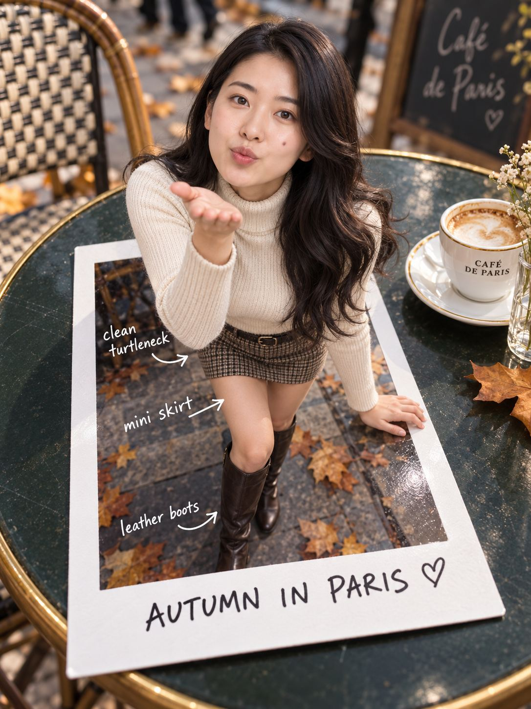

## T157 将明星变成趣味十足的3D卡通肖像

符合要求

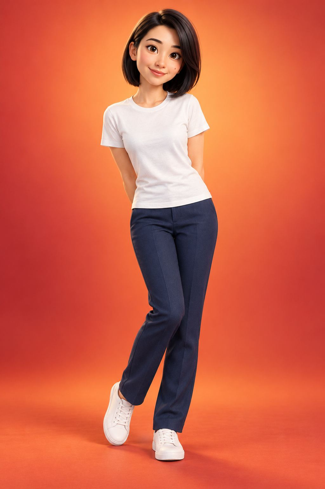

## T158 巨人指尖轻戳微缩世界超现实肖像

存在问题

## T159 干净柔和的米色工作室中的3x3照片

存在问题

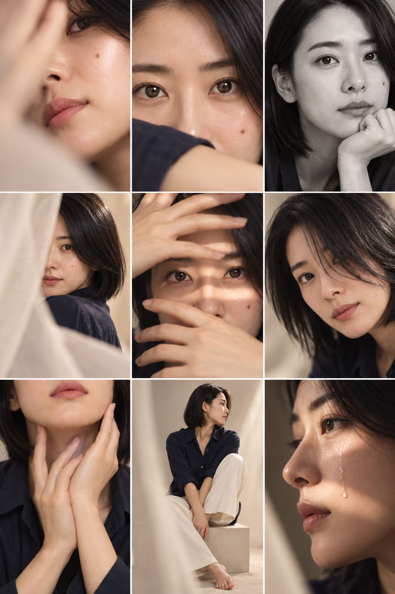

## T160 电影照片故事板

存在问题

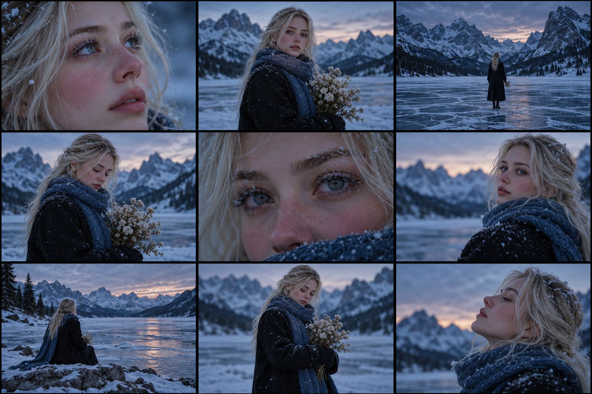

## T161 工业级影视生成流程

存在问题

## T161 工业级影视生成流程

存在问题

## T162 故事版提示词

符合要求

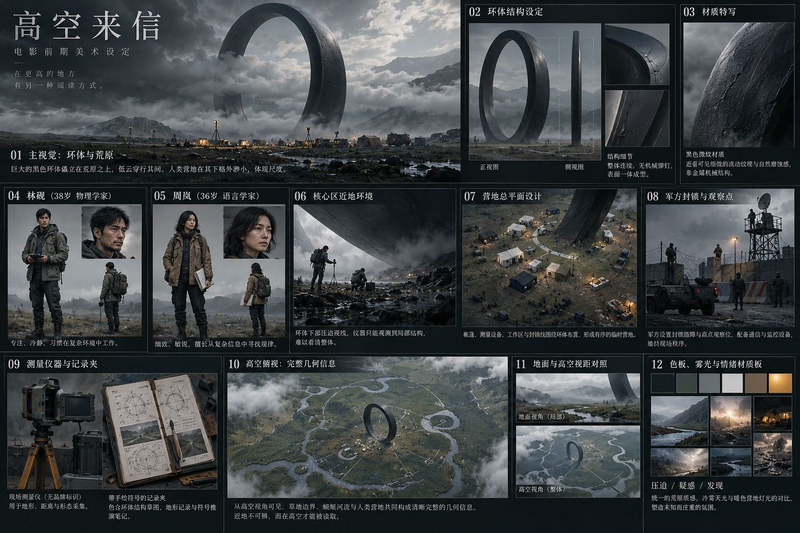

## T164 QWEN3分镜元提示词

存在问题

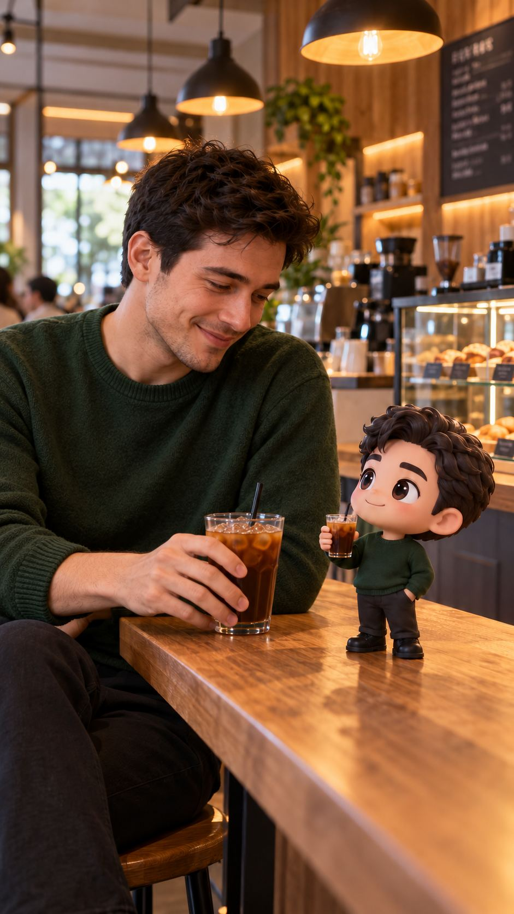

## T164 QWEN3分镜元提示词

存在问题

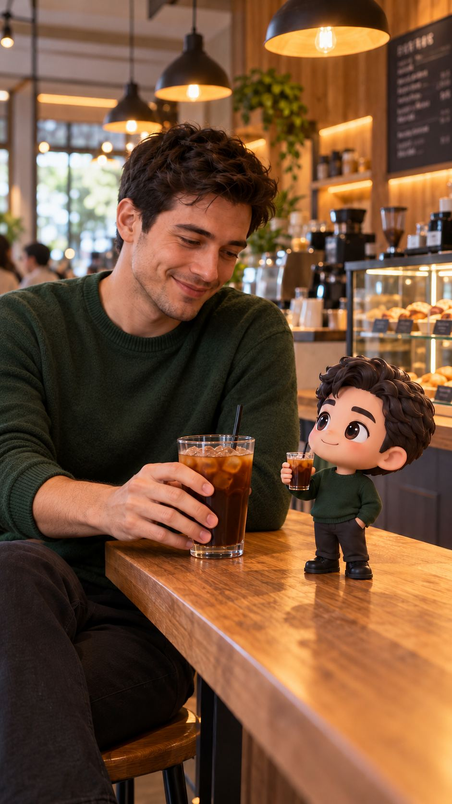

## T164 QWEN3分镜元提示词

存在问题

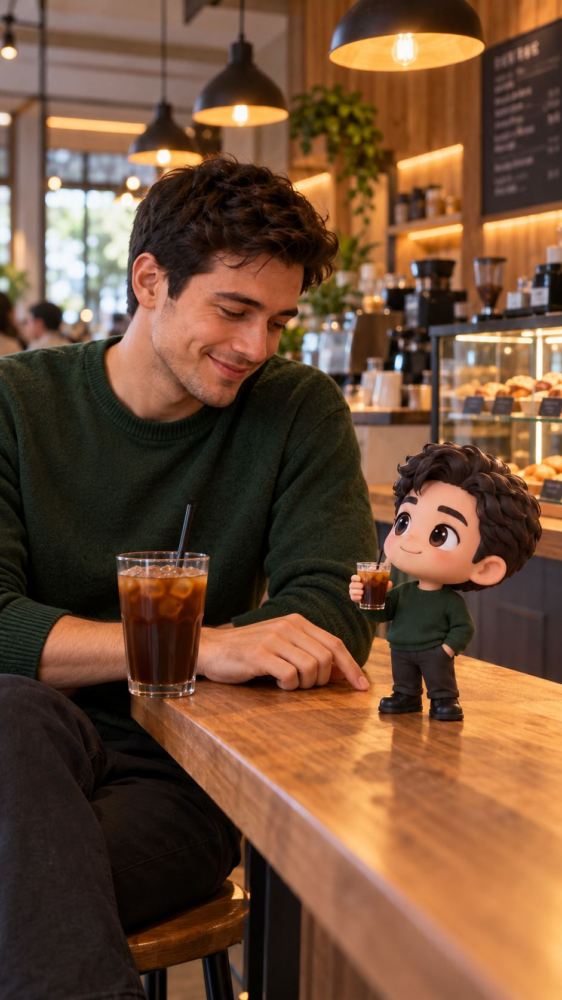

[上一页](./gallery-09.md) · [画廊目录](./README.md) · [下一页](./gallery-11.md)
