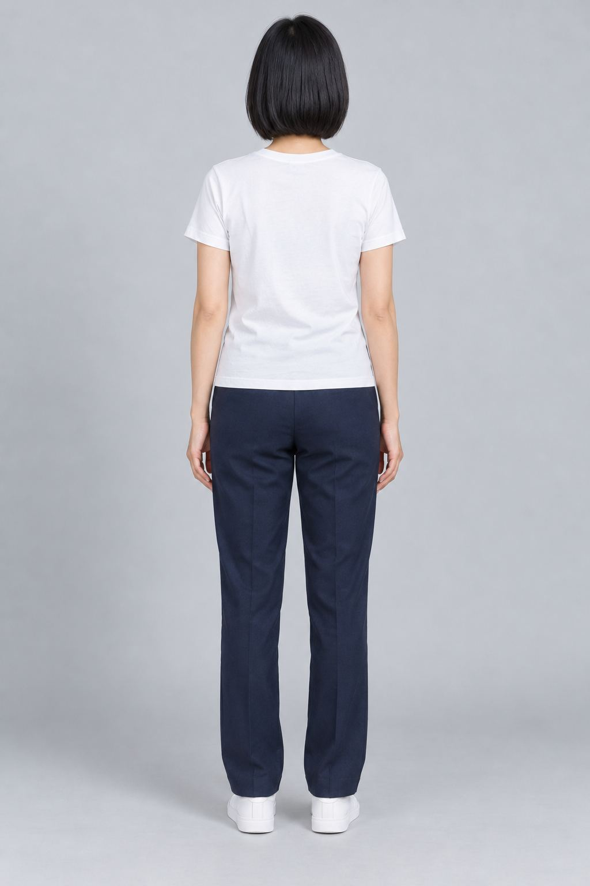
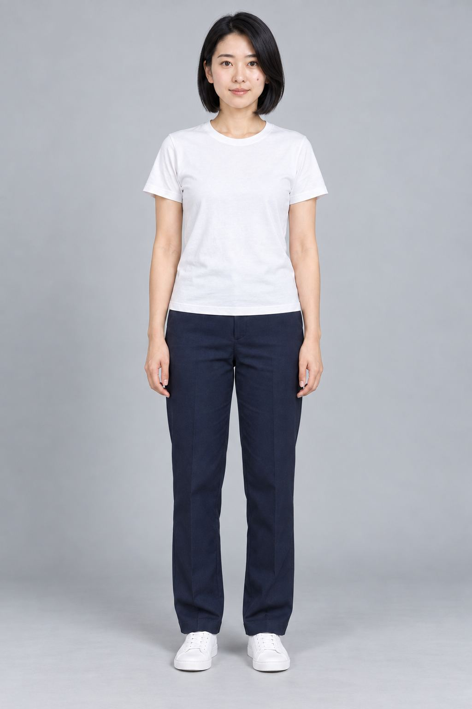
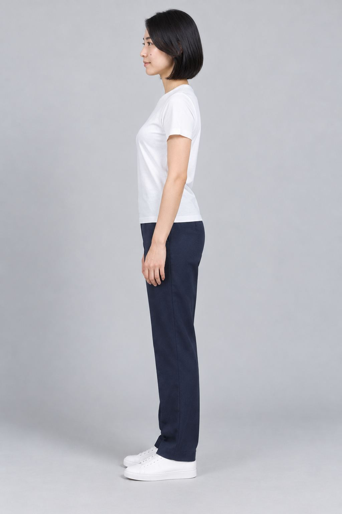
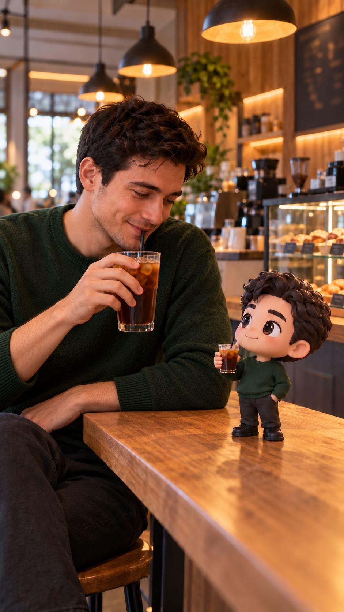
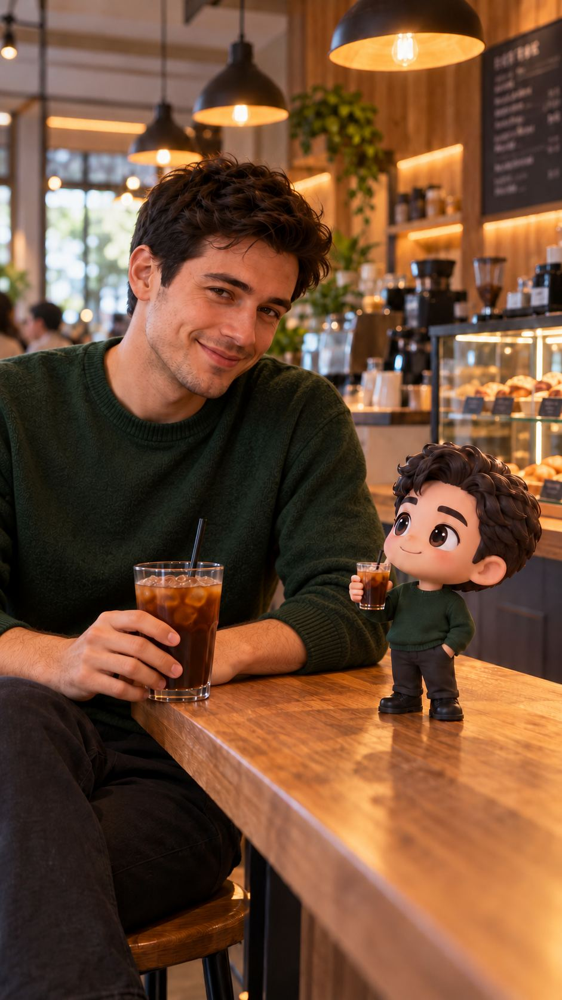
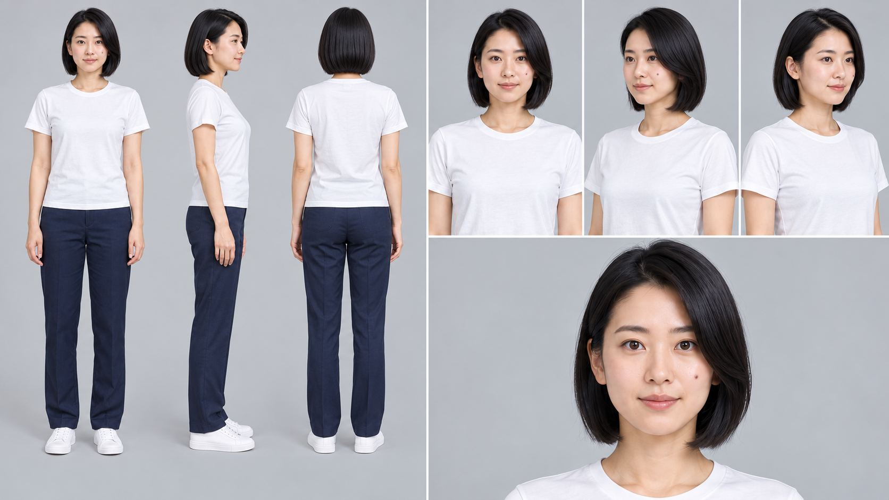
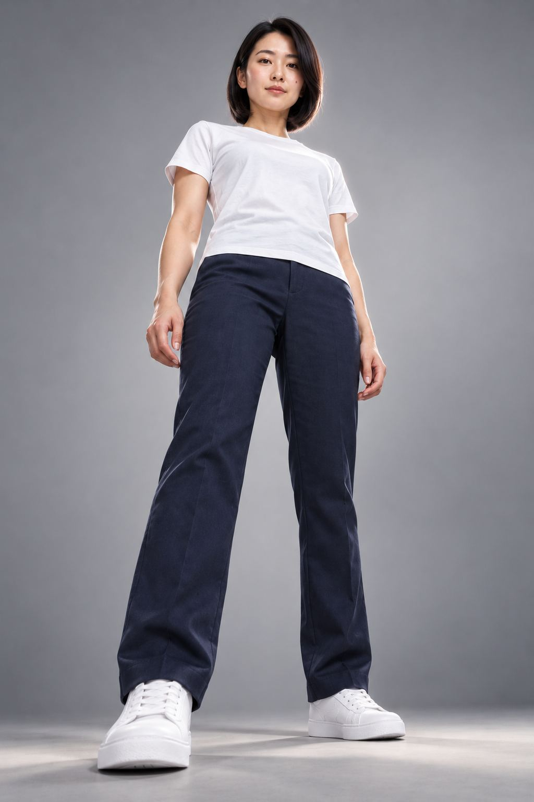
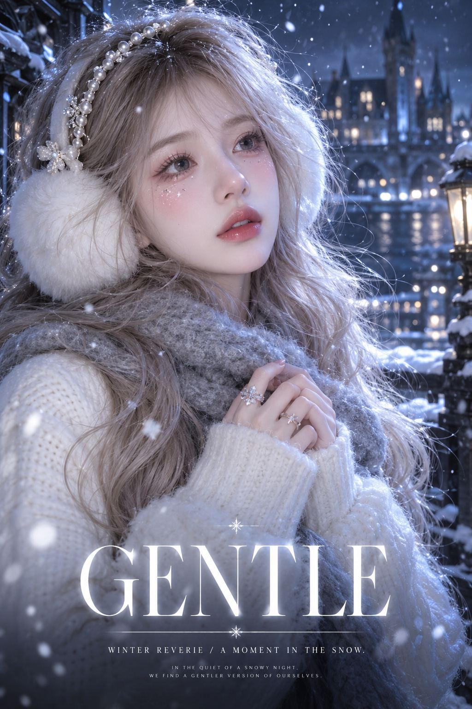
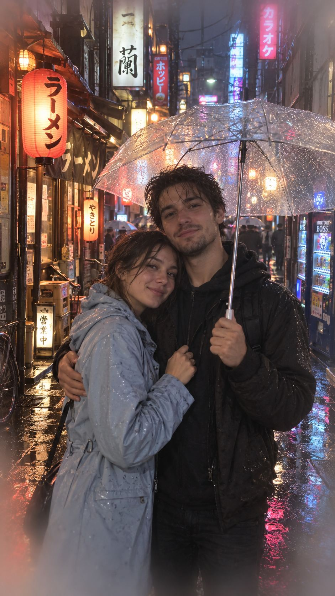

# 图片画廊 11

[返回交付目录](../README.md)

这些是原始测试输出的JPEG浏览转码副本。原PNG见原图分包；结论为模型初评。

## T165 未整理整套分镜提示词

符合要求

## T165 未整理整套分镜提示词

符合要求

## T165 未整理整套分镜提示词

符合要求

## T166 AI脚本分镜

存在问题

## T166 AI脚本分镜

存在问题

## T166 AI脚本分镜

存在问题

## T169 2509+WAN2.2，LLM

存在问题

## T169 2509+WAN2.2，LLM

存在问题

## T170 AI漫剧提示词

存在问题

## T171 【视频分镜】（测试过，还不错，不过只有单帧分镜）分镜连贯生成场景丨反推的聊天设置（喂给LLM的）

符合要求

## T171 【视频分镜】（测试过，还不错，不过只有单帧分镜）分镜连贯生成场景丨反推的聊天设置（喂给LLM的）

符合要求

## T172 小说转影视流程（初版）

存在问题

## T173 镜头角度与提示词：6 - Camera Angles & Movements

符合要求

## T173 镜头角度与提示词：6 - Camera Angles & Movements

符合要求

## T176 【示例】Sora2创建任务角色示例

符合要求

## T177 wan2.2文生图单个提示词

存在问题

## T178 世界杯

存在问题

