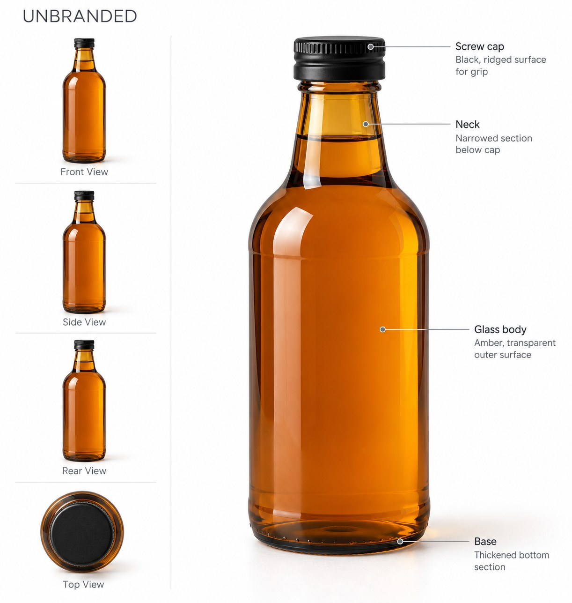
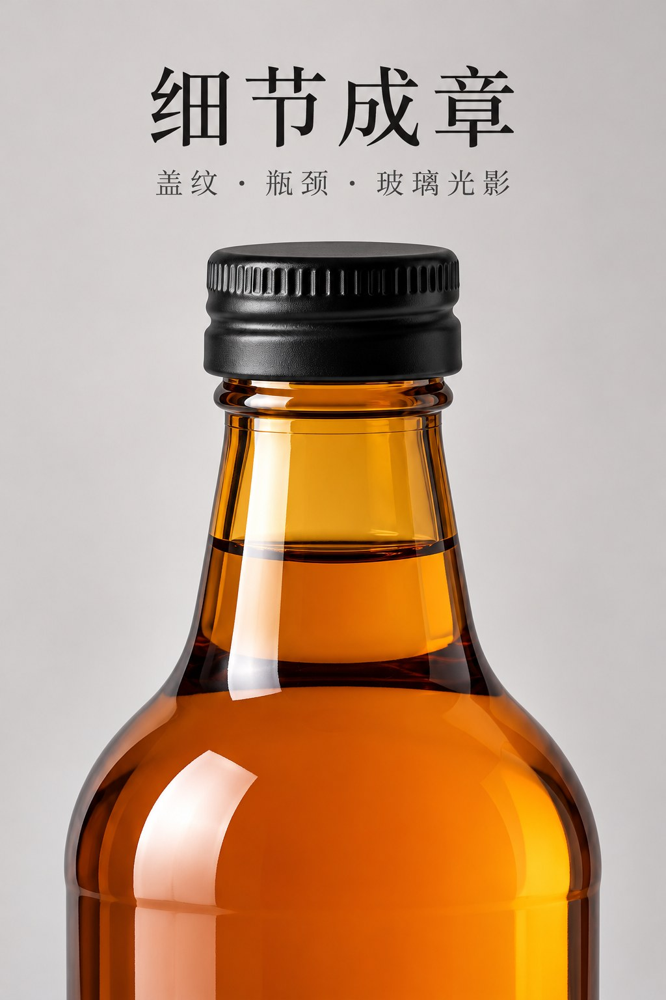

# 第1批：实际生成图片

[返回测试总览](../README.md)

所有下列图片均为本轮新生成，浏览JPEG副本用于GitHub显示，原始PNG保留在下载分包。

## W001 / T097 marble

【电商】产品背景更换场景丨提示词优化。状态：符合要求。
[输入与最终提示词](../results/W001/test.json) · [逐项检查](../results/W001/inspection.json)

## W002 / T085 handheld

kontext电商手持商品。状态：符合要求。
[输入与最终提示词](../results/W002/test.json) · [逐项检查](../results/W002/inspection.json)

## W003 / T018 bottle-atlas

极简白底高端产品工业图鉴。状态：存在问题。
[输入与最终提示词](../results/W003/test.json) · [逐项检查](../results/W003/inspection.json)

## W004 / T054 ring-hands

戒指。状态：存在问题。
[输入与最终提示词](../results/W004/test.json) · [逐项检查](../results/W004/inspection.json)

## W004 / T054 ring-single

戒指。状态：存在问题。
[输入与最终提示词](../results/W004/test.json) · [逐项检查](../results/W004/inspection.json)

## W004 / T054 ring-box

戒指。状态：存在问题。
[输入与最终提示词](../results/W004/test.json) · [逐项检查](../results/W004/inspection.json)

## W005 / T089 detail-01

电商详情页 元提示词。状态：符合要求。
[输入与最终提示词](../results/W005/test.json) · [逐项检查](../results/W005/inspection.json)

## W005 / T089 detail-02

电商详情页 元提示词。状态：符合要求。
[输入与最终提示词](../results/W005/test.json) · [逐项检查](../results/W005/inspection.json)

## W005 / T089 detail-03

电商详情页 元提示词。状态：符合要求。
[输入与最终提示词](../results/W005/test.json) · [逐项检查](../results/W005/inspection.json)

## W005 / T089 detail-04

电商详情页 元提示词。状态：符合要求。
[输入与最终提示词](../results/W005/test.json) · [逐项检查](../results/W005/inspection.json)

