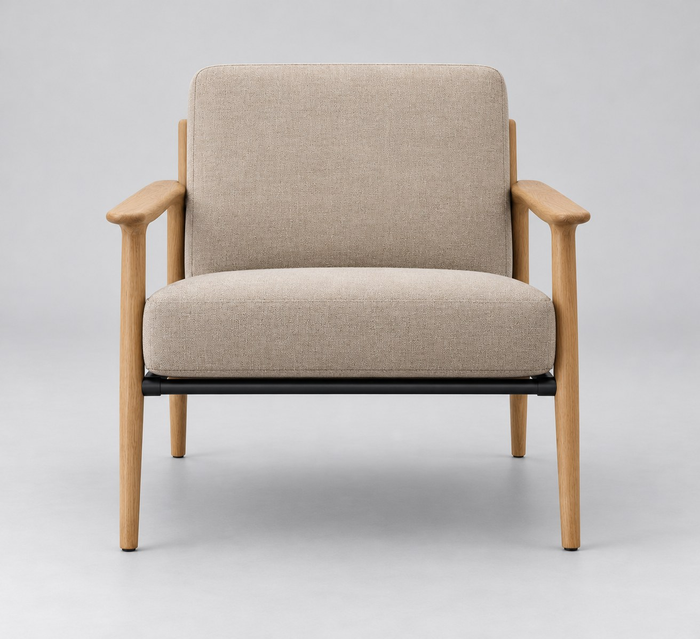
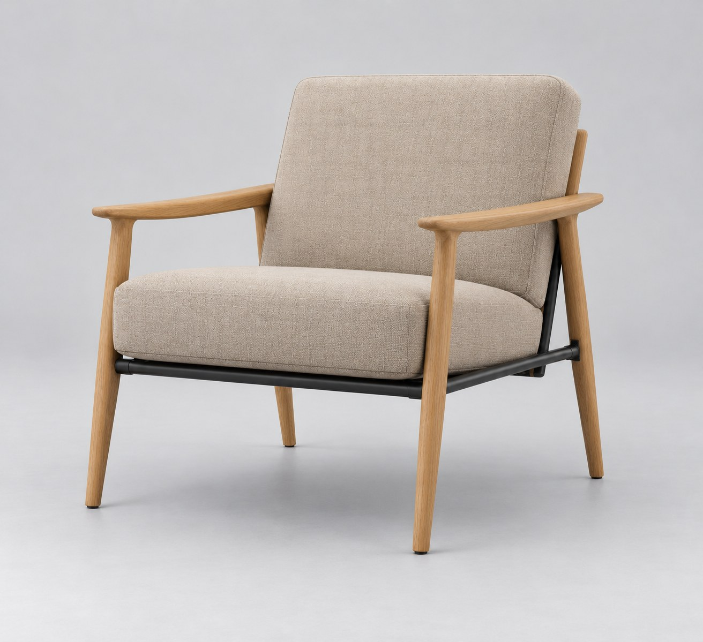
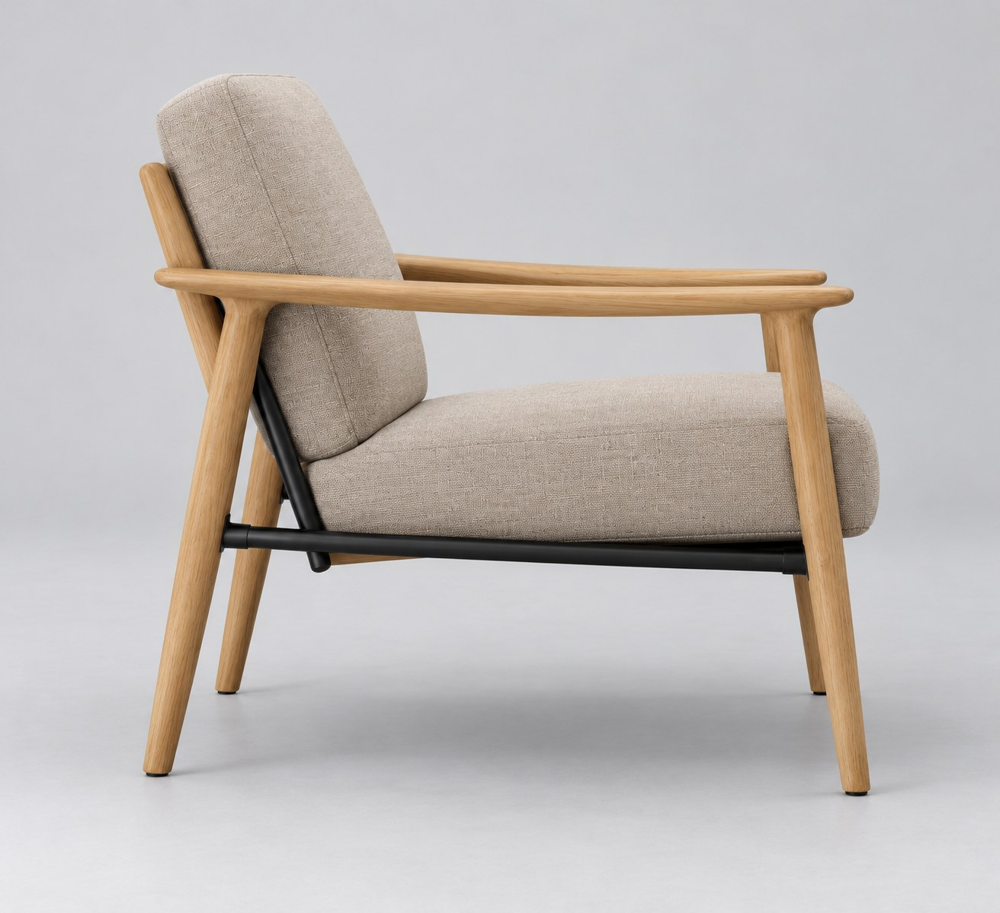
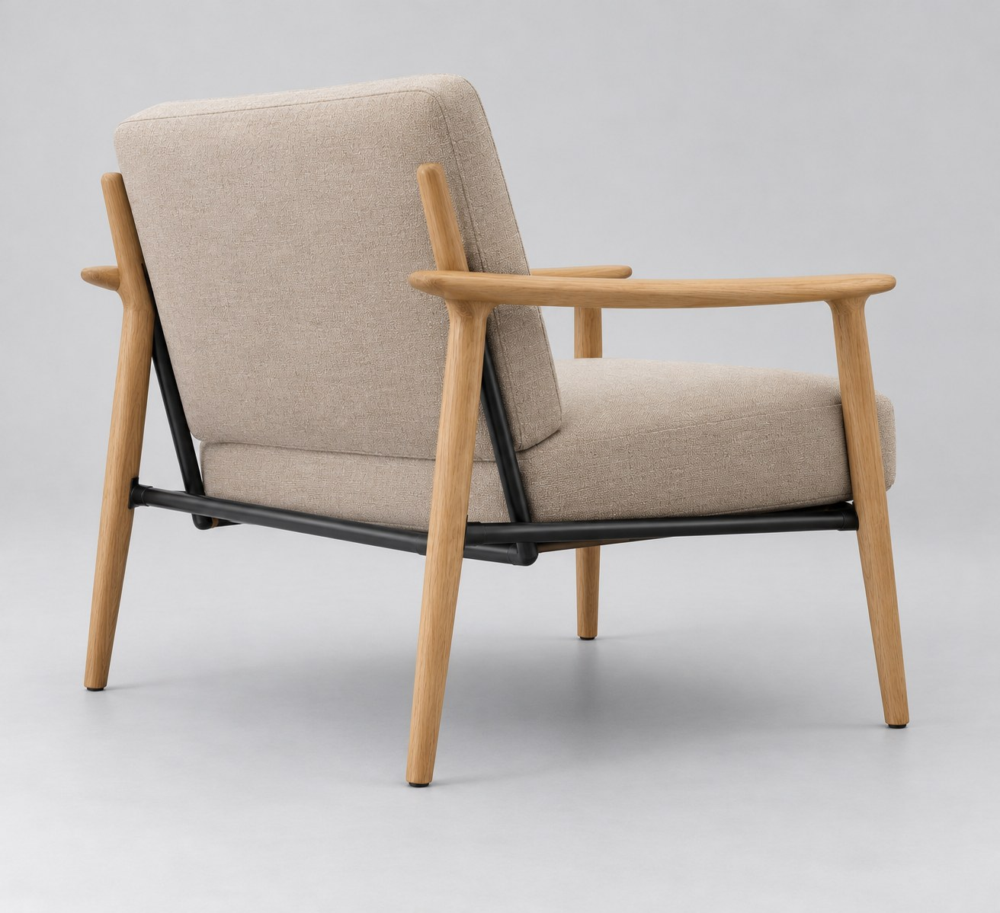
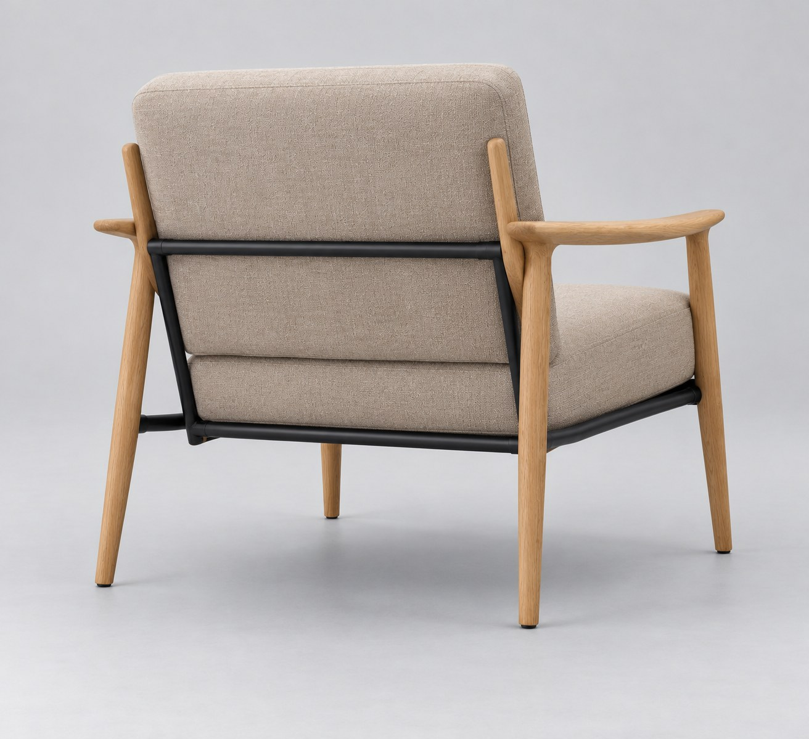
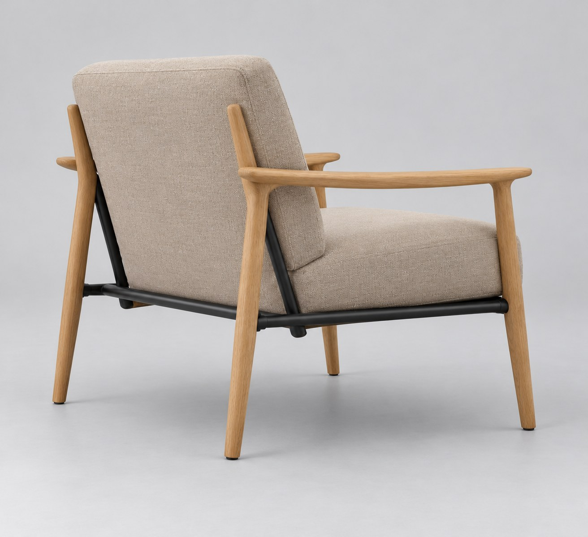
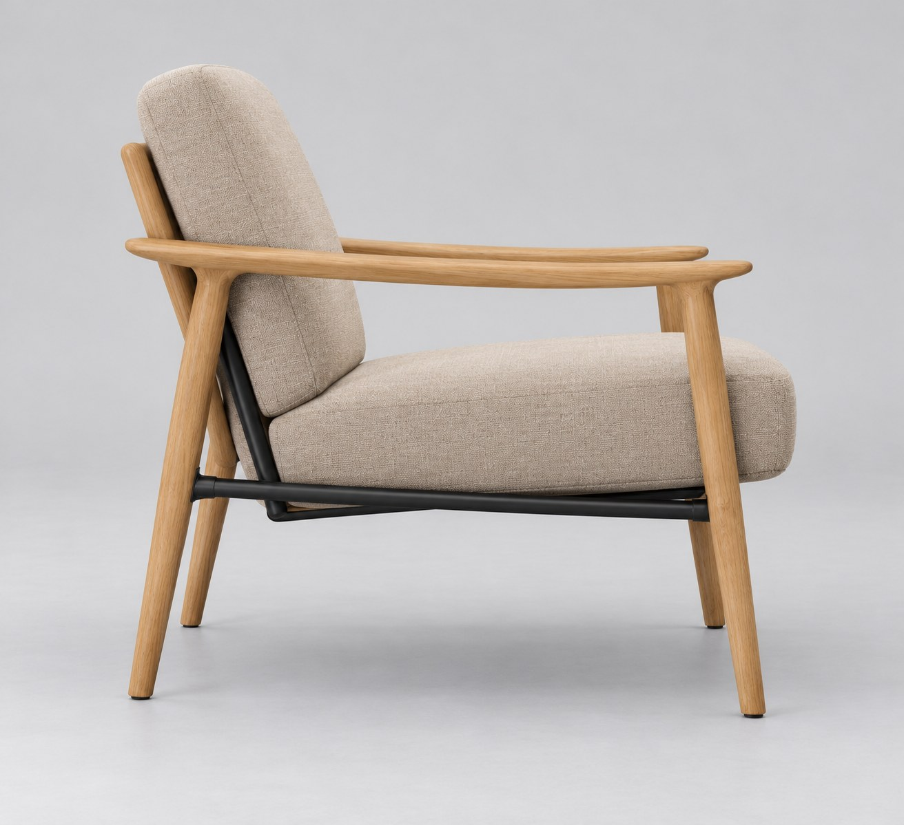
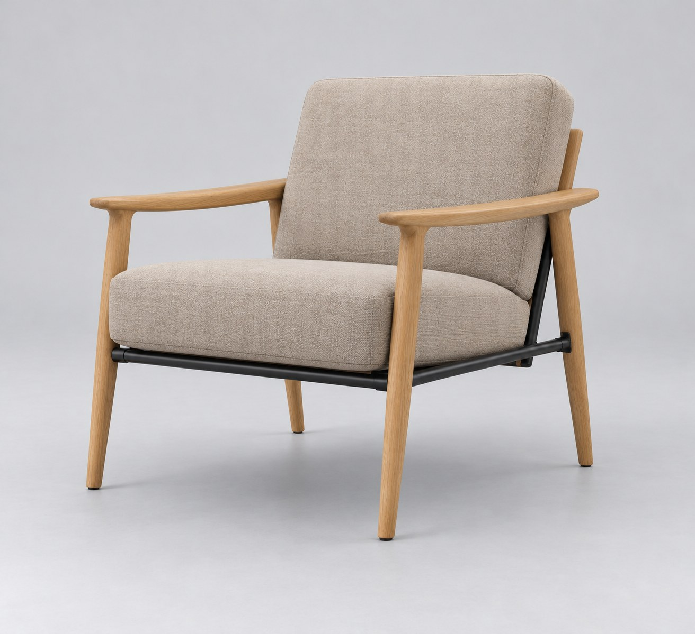
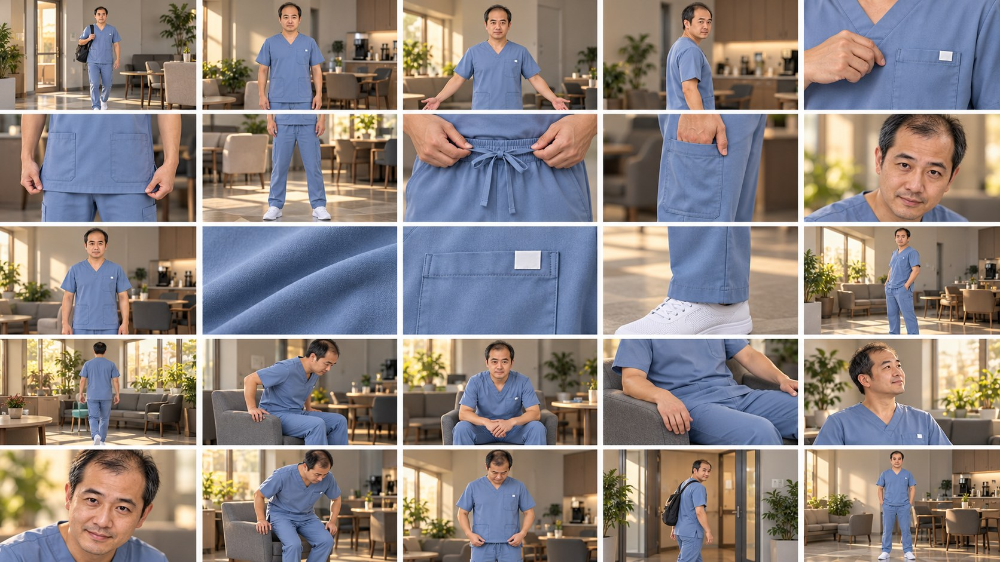
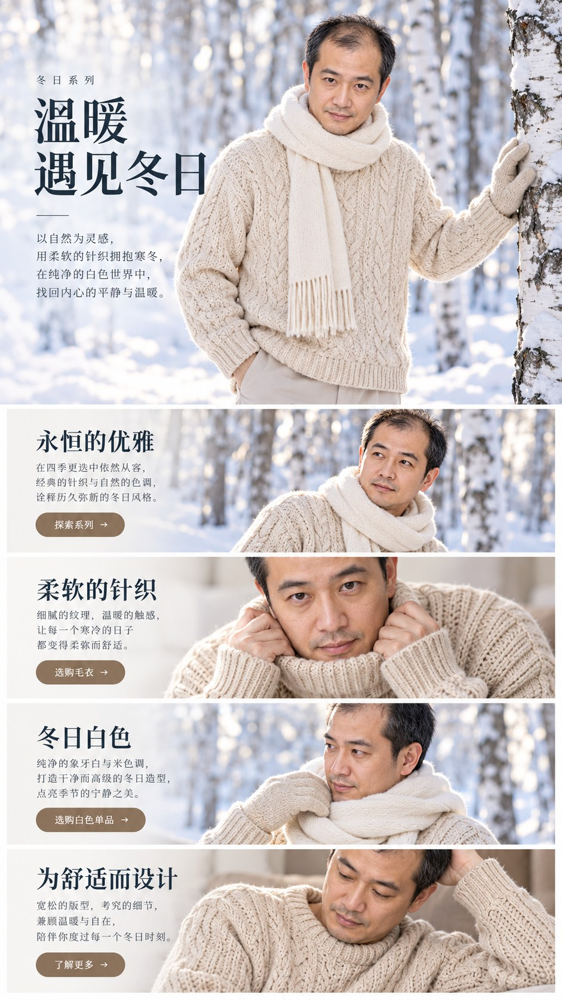

# 第3批：实际生成图片

[返回测试总览](../README.md)

所有下列图片均为本轮新生成，浏览JPEG副本用于GitHub显示，原始PNG保留在下载分包。

## W011 / T092 view-01

96组角度提示词。状态：存在问题。
[输入与最终提示词](../results/W011/test.json) · [逐项检查](../results/W011/inspection.json)

## W011 / T092 view-02

96组角度提示词。状态：存在问题。
[输入与最终提示词](../results/W011/test.json) · [逐项检查](../results/W011/inspection.json)

## W011 / T092 view-03

96组角度提示词。状态：存在问题。
[输入与最终提示词](../results/W011/test.json) · [逐项检查](../results/W011/inspection.json)

## W011 / T092 view-04

96组角度提示词。状态：存在问题。
[输入与最终提示词](../results/W011/test.json) · [逐项检查](../results/W011/inspection.json)

## W011 / T092 view-05

96组角度提示词。状态：存在问题。
[输入与最终提示词](../results/W011/test.json) · [逐项检查](../results/W011/inspection.json)

## W011 / T092 view-06

96组角度提示词。状态：存在问题。
[输入与最终提示词](../results/W011/test.json) · [逐项检查](../results/W011/inspection.json)

## W011 / T092 view-07

96组角度提示词。状态：存在问题。
[输入与最终提示词](../results/W011/test.json) · [逐项检查](../results/W011/inspection.json)

## W011 / T092 view-08

96组角度提示词。状态：存在问题。
[输入与最终提示词](../results/W011/test.json) · [逐项检查](../results/W011/inspection.json)

## W012 / T004 scrubs-ad

广告创意。状态：符合要求。
[输入与最终提示词](../results/W012/test.json) · [逐项检查](../results/W012/inspection.json)

## W013 / T007 ad-25

商业广告25分镜。状态：存在问题。
[输入与最终提示词](../results/W013/test.json) · [逐项检查](../results/W013/inspection.json)

## W014 / T011 fashion-01

AI时尚丨JSON人物场景动作丨LLM提示词优化。状态：存在问题。
[输入与最终提示词](../results/W014/test.json) · [逐项检查](../results/W014/inspection.json)

## W014 / T011 fashion-02

AI时尚丨JSON人物场景动作丨LLM提示词优化。状态：存在问题。
[输入与最终提示词](../results/W014/test.json) · [逐项检查](../results/W014/inspection.json)

## W014 / T011 fashion-03

AI时尚丨JSON人物场景动作丨LLM提示词优化。状态：存在问题。
[输入与最终提示词](../results/W014/test.json) · [逐项检查](../results/W014/inspection.json)

## W014 / T011 fashion-04

AI时尚丨JSON人物场景动作丨LLM提示词优化。状态：存在问题。
[输入与最终提示词](../results/W014/test.json) · [逐项检查](../results/W014/inspection.json)

## W015 / T017 winter-page

【服装展示】冬季时尚系列落地页设计，雪景。状态：符合要求。
[输入与最终提示词](../results/W015/test.json) · [逐项检查](../results/W015/inspection.json)

