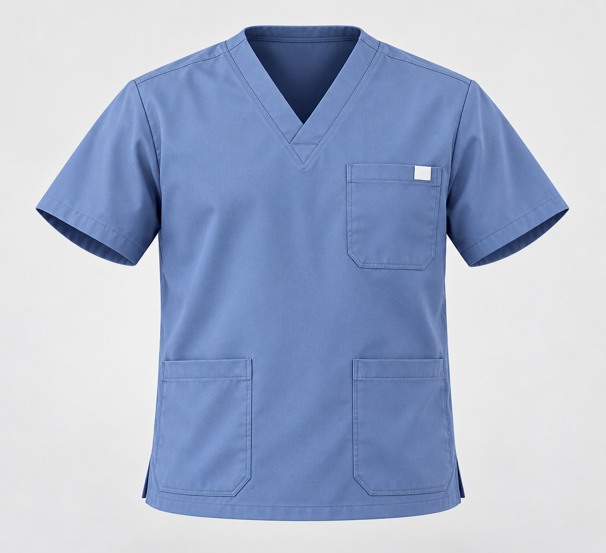
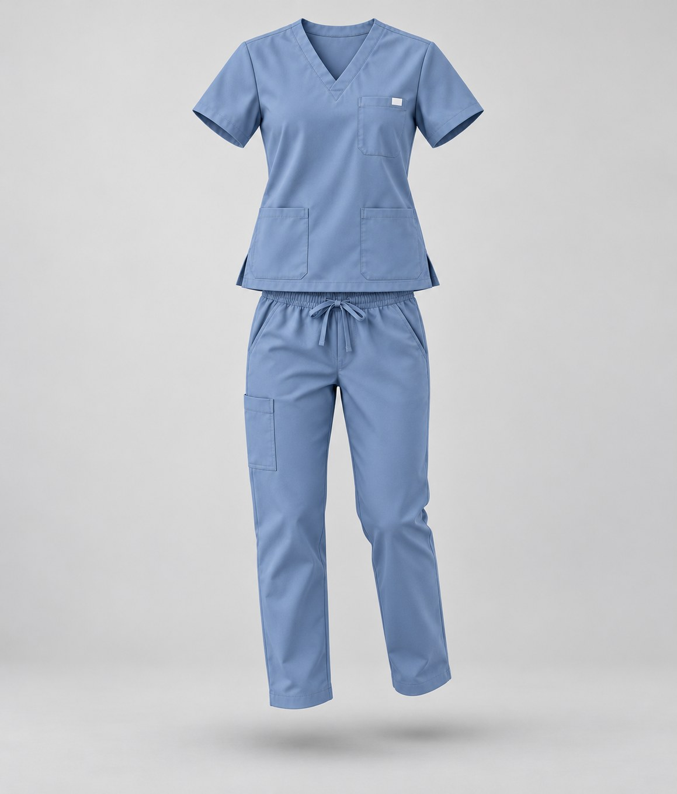

# 第4批：实际生成图片

[返回测试总览](../README.md)

所有下列图片均为本轮新生成，浏览JPEG副本用于GitHub显示，原始PNG保留在下载分包。

## W016 / T019 model-grid

电商模特组图生成-根据需要修改。状态：符合要求。
[输入与最终提示词](../results/W016/test.json) · [逐项检查](../results/W016/inspection.json)

## W017 / T020 pose-01

【元提示词】商业摄影。状态：存在问题。
[输入与最终提示词](../results/W017/test.json) · [逐项检查](../results/W017/inspection.json)

## W017 / T020 pose-02

【元提示词】商业摄影。状态：存在问题。
[输入与最终提示词](../results/W017/test.json) · [逐项检查](../results/W017/inspection.json)

## W017 / T020 pose-03

【元提示词】商业摄影。状态：存在问题。
[输入与最终提示词](../results/W017/test.json) · [逐项检查](../results/W017/inspection.json)

## W017 / T020 pose-04

【元提示词】商业摄影。状态：存在问题。
[输入与最终提示词](../results/W017/test.json) · [逐项检查](../results/W017/inspection.json)

## W018 / T024 clothes-swap

换装提示词示例。状态：符合要求。
[输入与最终提示词](../results/W018/test.json) · [逐项检查](../results/W018/inspection.json)

## W019 / T051 ghost-top

【元提示词】服装立体化lora：3Dghostmannequin。状态：符合要求。
[输入与最终提示词](../results/W019/test.json) · [逐项检查](../results/W019/inspection.json)

## W020 / T055 floating-clothes

衣服悬浮在空中。状态：符合要求。
[输入与最终提示词](../results/W020/test.json) · [逐项检查](../results/W020/inspection.json)

