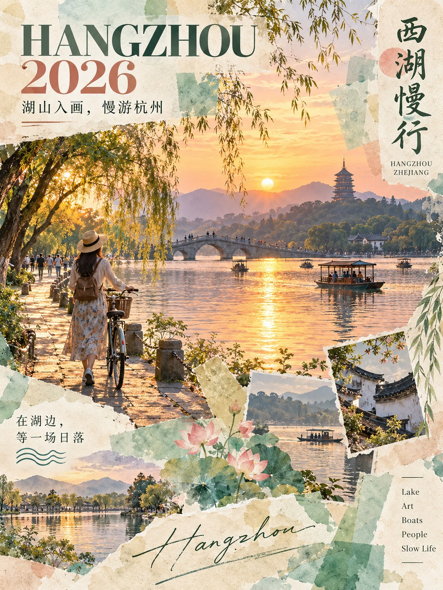
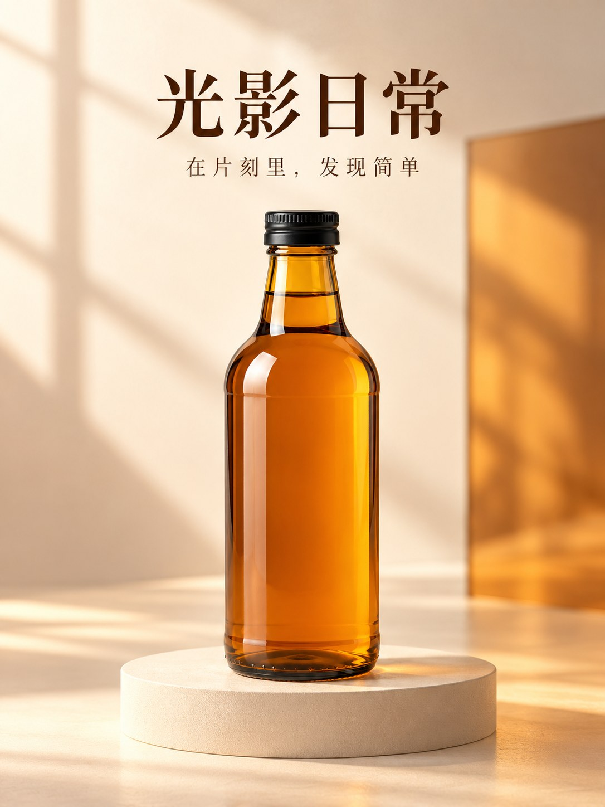

# 第5批：实际生成图片

[返回测试总览](../README.md)

所有下列图片均为本轮新生成，浏览JPEG副本用于GitHub显示，原始PNG保留在下载分包。

## W021 / T030 hangzhou-watercolor

image-2水彩拼贴旅行海报提示词！。状态：符合要求。
[输入与最终提示词](../results/W021/test.json) · [逐项检查](../results/W021/inspection.json)

## W022 / T074 cover-negative-space

封面常用提示词。状态：存在问题。
[输入与最终提示词](../results/W022/test.json) · [逐项检查](../results/W022/inspection.json)

## W023 / T081 type-cover-01

封面大师。状态：符合要求。
[输入与最终提示词](../results/W023/test.json) · [逐项检查](../results/W023/inspection.json)

## W023 / T081 type-cover-02

封面大师。状态：符合要求。
[输入与最终提示词](../results/W023/test.json) · [逐项检查](../results/W023/inspection.json)

## W024 / T084 expanded-poster

电商海报生成元提示词。状态：符合要求。
[输入与最终提示词](../results/W024/test.json) · [逐项检查](../results/W024/inspection.json)

## W025 / T002 leaf-story-grid

NanoBananaPro 分镜拆解助手（未测试）。状态：符合要求。
[输入与最终提示词](../results/W025/test.json) · [逐项检查](../results/W025/inspection.json)

