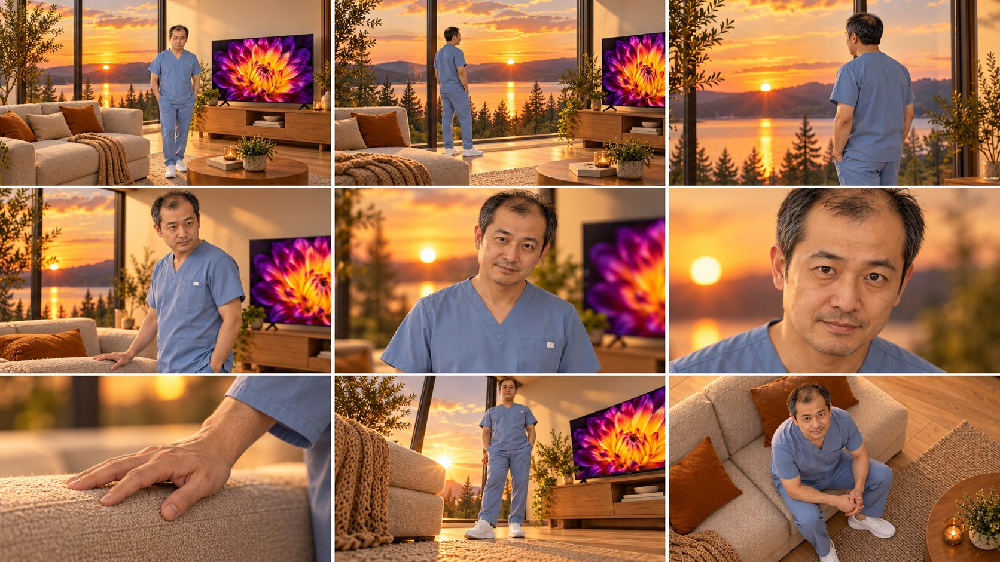
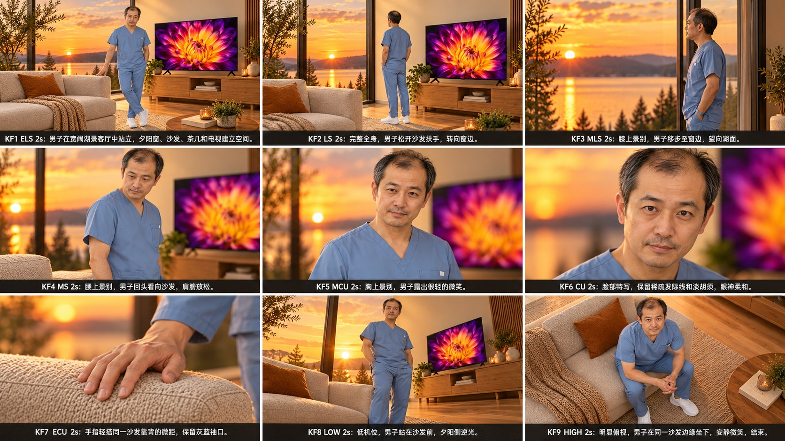
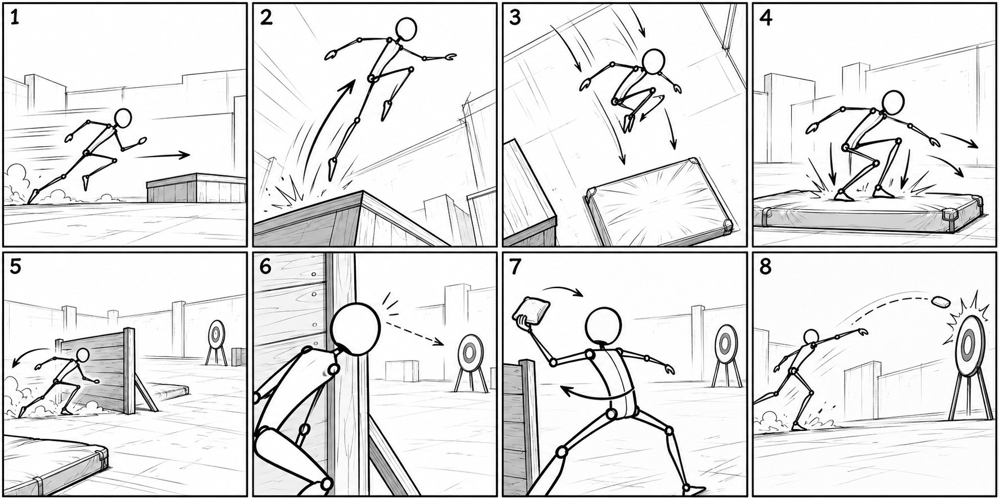

# 第6批：实际生成图片

[返回测试总览](../README.md)

所有下列图片均为本轮新生成，浏览JPEG副本用于GitHub显示，原始PNG保留在下载分包。

## W026 / T003 action-01

LLM动作引擎（各类提示词示例）。状态：存在问题。
[输入与最终提示词](../results/W026/test.json) · [逐项检查](../results/W026/inspection.json)

## W026 / T003 action-02

LLM动作引擎（各类提示词示例）。状态：存在问题。
[输入与最终提示词](../results/W026/test.json) · [逐项检查](../results/W026/inspection.json)

## W026 / T003 action-03

LLM动作引擎（各类提示词示例）。状态：存在问题。
[输入与最终提示词](../results/W026/test.json) · [逐项检查](../results/W026/inspection.json)

## W027 / T005 anime-four

四宫格分镜。状态：符合要求。
[输入与最终提示词](../results/W027/test.json) · [逐项检查](../results/W027/inspection.json)

## W028 / T036 continuity-nine

【9宫格分镜】人物一致性分镜提示词。状态：存在问题。
[输入与最终提示词](../results/W028/test.json) · [逐项检查](../results/W028/inspection.json)

## W029 / T037 labeled-story-grid

【九宫格】1图转电影分镜图提示词。状态：存在问题。
[输入与最终提示词](../results/W029/test.json) · [逐项检查](../results/W029/inspection.json)

## W030 / T039 action-previs-eight

分镜导演与动作编排专家。状态：存在问题。
[输入与最终提示词](../results/W030/test.json) · [逐项检查](../results/W030/inspection.json)

