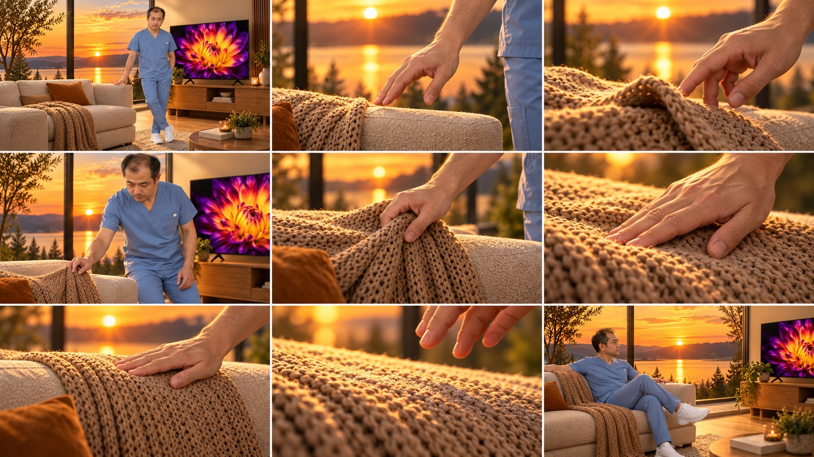
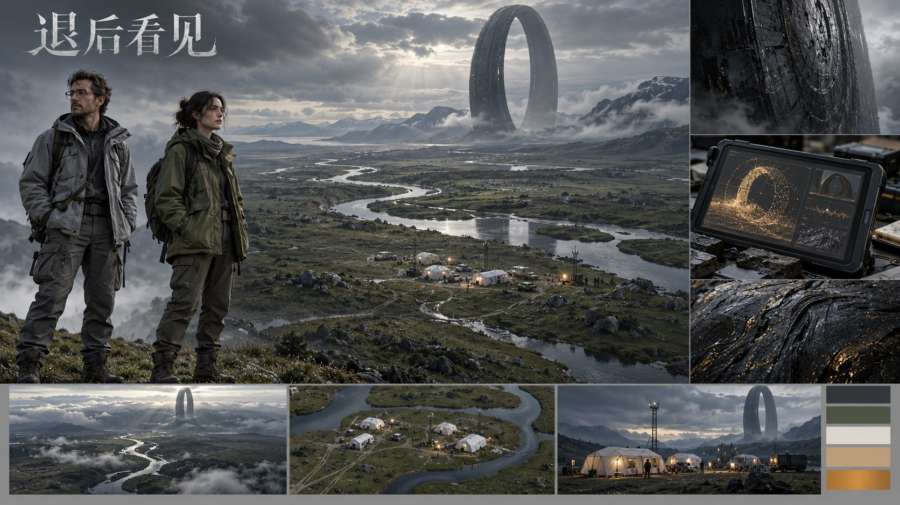

# 第7批：实际生成图片

[返回测试总览](../README.md)

所有下列图片均为本轮新生成，浏览JPEG副本用于GitHub显示，原始PNG保留在下载分包。

## W031 / T040 focus-relay-nine

视觉连续性导演。状态：符合要求。
[输入与最终提示词](../results/W031/test.json) · [逐项检查](../results/W031/inspection.json)

## W032 / T161 scene-initial

工业级影视生成流程。状态：存在问题。
[输入与最终提示词](../results/W032/test.json) · [逐项检查](../results/W032/inspection.json)

## W032 / T161 scene-after

工业级影视生成流程。状态：存在问题。
[输入与最终提示词](../results/W032/test.json) · [逐项检查](../results/W032/inspection.json)

## W033 / T162 production-design

故事版提示词。状态：存在问题。
[输入与最终提示词](../results/W033/test.json) · [逐项检查](../results/W033/inspection.json)

## W034 / T164 next-01

QWEN3分镜元提示词。状态：存在问题。
[输入与最终提示词](../results/W034/test.json) · [逐项检查](../results/W034/inspection.json)

## W034 / T164 next-02

QWEN3分镜元提示词。状态：存在问题。
[输入与最终提示词](../results/W034/test.json) · [逐项检查](../results/W034/inspection.json)

## W034 / T164 next-03

QWEN3分镜元提示词。状态：存在问题。
[输入与最终提示词](../results/W034/test.json) · [逐项检查](../results/W034/inspection.json)

## W035 / T165 char-01

未整理整套分镜提示词。状态：符合要求。
[输入与最终提示词](../results/W035/test.json) · [逐项检查](../results/W035/inspection.json)

## W035 / T165 char-02

未整理整套分镜提示词。状态：符合要求。
[输入与最终提示词](../results/W035/test.json) · [逐项检查](../results/W035/inspection.json)

## W035 / T165 char-03

未整理整套分镜提示词。状态：符合要求。
[输入与最终提示词](../results/W035/test.json) · [逐项检查](../results/W035/inspection.json)

