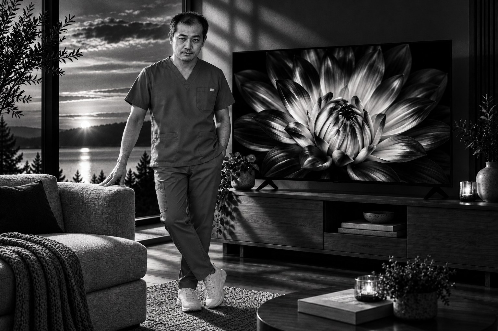
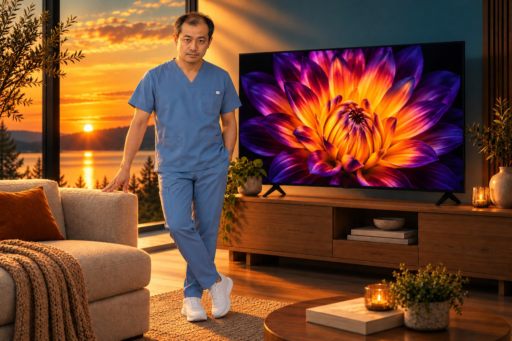
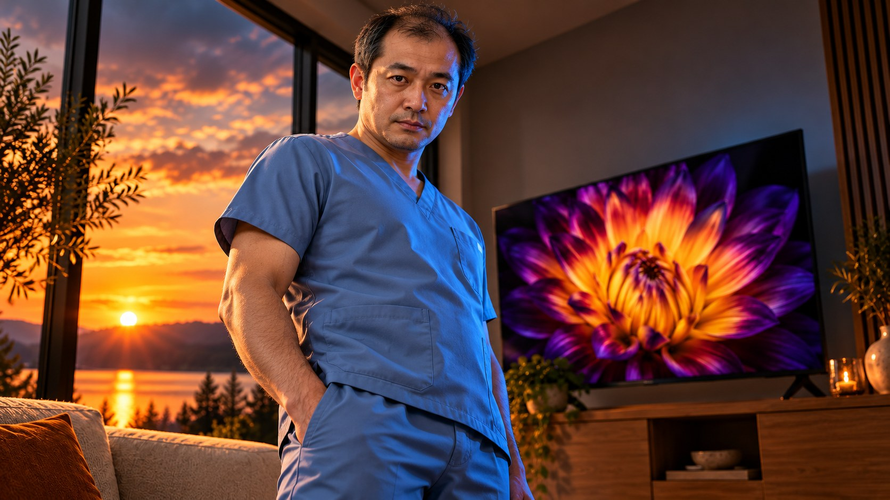
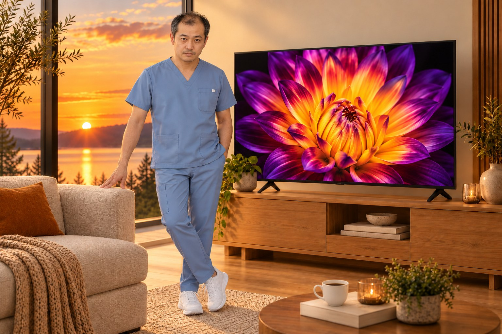
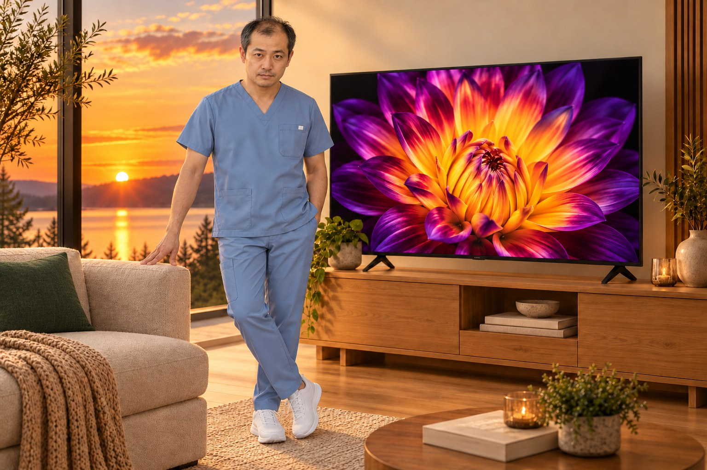
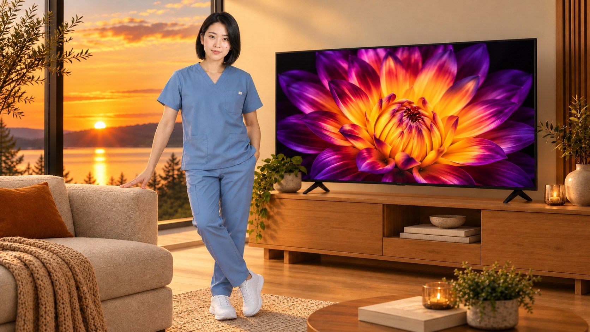

# 第10批：实际生成图片

[返回测试总览](../README.md)

所有下列图片均为本轮新生成，浏览JPEG副本用于GitHub显示，原始PNG保留在下载分包。

## W046 / T025 look-01-noir

22种AI调色提示词22种AI调色提示词。状态：符合要求。
[输入与最终提示词](../results/W046/test.json) · [逐项检查](../results/W046/inspection.json)

## W046 / T025 look-17-teal-orange

22种AI调色提示词22种AI调色提示词。状态：符合要求。
[输入与最终提示词](../results/W046/test.json) · [逐项检查](../results/W046/inspection.json)

## W047 / T093 cool-low

动态光影超精细写真。状态：符合要求。
[输入与最终提示词](../results/W047/test.json) · [逐项检查](../results/W047/inspection.json)

## W047 / T093 warm-high

动态光影超精细写真。状态：符合要求。
[输入与最终提示词](../results/W047/test.json) · [逐项检查](../results/W047/inspection.json)

## W048 / T095 add-mug

【图片提示词】添加、删除、替换提示词增强。状态：符合要求。
[输入与最终提示词](../results/W048/test.json) · [逐项检查](../results/W048/inspection.json)

## W048 / T095 remove-tv

【图片提示词】添加、删除、替换提示词增强。状态：符合要求。
[输入与最终提示词](../results/W048/test.json) · [逐项检查](../results/W048/inspection.json)

## W048 / T095 replace-cushion

【图片提示词】添加、删除、替换提示词增强。状态：符合要求。
[输入与最终提示词](../results/W048/test.json) · [逐项检查](../results/W048/inspection.json)

## W049 / T099 pose-transfer

换姿势。状态：存在问题。
[输入与最终提示词](../results/W049/test.json) · [逐项检查](../results/W049/inspection.json)

## W050 / T134 replace-person

人物一致性。状态：符合要求。
[输入与最终提示词](../results/W050/test.json) · [逐项检查](../results/W050/inspection.json)

