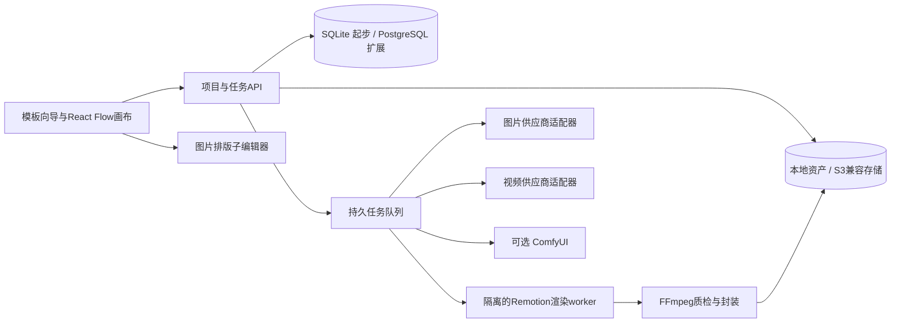

# 面向电商与长视频的简易创作画布：产品规划

## 产品决策

做一个“模板先行、画布承载、分镜生产、时间线交付”的创作工作台。初期以单人本地或私有部署为目标，降低上手与运维成本。默认用户不需要懂节点、工作流或API；选择“商品素材 / 影视分镜 / 长视频 / 口播动效”后，工具自动铺好流程。

**第一版重点是让一条素材链可靠地跑通，并可复制，而不是堆满全部生成模型。** 本交付包含研究、模板、规划、可交互原型和真实Remotion样片；不是已经接好付费供应商的生产系统。

## 用户路径

| 模板 | 最短路径 | 首次交付物 | 易用性目标（待用户测试） |
|---|---|---|---|
| 商品套图 | 上传商品 → 选场景/画幅 → 单图预览 → 批量套版 | 主图/场景图/卖点图 | 新用户5分钟内理解并提交首个任务 |
| 影视素材 | 角色+场景 → 挑选定稿 → 写一个动作 → 生成镜头 | 5–8秒可用素材 | 首个任务只出现必需参数 |
| 长视频 | 简报 → 章节 → 镜头表 → 资产 → 批准一镜 → 批量 → 合成 | 5–10分钟时间线与成片 | 不在一个大画布上同时展示上百节点 |
| 口播动效 | 粘贴口播/字幕 → 标时间码 → 选卡片/图表 → 渲染 | 3–10秒插入素材 | 用真实字体与代码图形保证可读性 |

这些是规划指标，没有把原型操作当成真实新手测试结果。

## 页面与交互

首页只有四个模板和最近项目。项目页为左侧资产/模板库、中间画布、右侧当前节点设置；底部“镜头表/时间线”可折叠。顶部常驻项目名、保存状态、预算与导出。

初学模式：只显示“简报 → 参考资产 → 结果”；提示词、模型参数、错误详情折叠。高级模式：展示真实节点和连线，可替换模板。两种模式操作同一个数据结构。

关键交互：

- 卡片点开即可改文本、换图、查看结果；连线同时支持拖动和“引用素材”选择器。
- 双击空白处搜索添加，空格拖动，滚轮缩放，适应画布，自动整理，撤销/重做。
- 角色/商品/场景各有“定稿”标记；只允许批准的版本进入批量生产。
- 生成前明确本次任务数、估算费用、画幅/时长与参考资产；先运行一个，批量入口随后出现。
- 失败留在节点，可重试、取消或替换模型；已完成镜头保留，支持失败项续跑。
- 自动保存给出成功/失败状态；支持工程JSON导出与版本备份，不把浏览器缓存当唯一备份。

## 参考项目怎么借鉴

按star排序的表见 [画布Top10](../research/01-canvas-top10.md)。这些项目既有成品也有框架，不应整体混装。

| 参考 | 借鉴对象 | 在本产品中的取舍 |
|---|---|---|
| xyflow / React Flow | 自定义节点、端口、选择、缩放、连线 | 推荐主编辑器底座；MIT，TypeScript生态，做媒体卡片而非暴露底层张量节点 |
| Excalidraw / Drawnix | 简洁工具栏、直觉操作、分组与本地保存 | 学交互，不直接把白板数据模型当执行引擎 |
| tldraw | 无限画布交互与自定义形状 | 技术候选；当前自定义许可证，商用条件需核对，不当作MIT组件 |
| ComfyUI | 图执行、状态反馈、工作流复用 | 作为后端可选执行器，封装复杂节点；GPL边界与部署方式另评估 |
| Toonflow | 剧本、分镜、角色与场景资产串联 | 影视工作流优先参考；先做一场戏，再扩整集 |
| basketikun/infinite-canvas | 媒体卡片、提示词库与创作入口 | 功能相近的补充案例，查看实现后决定是否二开 |
| vue-fabric-editor / Fabric | 商品图文字、裁切、对齐与套版 | 独立“图片排版”子编辑器，避免与主工作流画布混为一套坐标系 |
| Remotion | 帧驱动组件、参数化视频合成 | 用于文字/图表/素材拼接与最终渲染，不负责AI生成人物动作 |

**推荐从 React Flow + 自有项目模型开始**。若追求最快验证，先手动走通 Toonflow 的影视流程与一个电商流程，再决定二开或自建。无需同时部署榜单全部项目。

## 技术结构

前端 React/TypeScript；主节点编辑使用 `@xyflow/react`。API可用同语言Node服务，减少团队负担。单机首版用SQLite与受控并发worker；多人版再迁移PostgreSQL与Redis/BullMQ。不为首版预先引入Kubernetes。

供应商密钥只保存在服务端环境配置。前端获得模型能力描述与任务状态，不能获得密钥。队列记录provider请求ID、幂等键、重试次数和费用；超时不立即重复计费请求，先查询供应商状态；只重试可恢复错误。回调必须校验签名并防重复。

渲染worker只运行批准的组件与校验过的props，不能把外来提示词或任意生成TS直接在主服务执行。限制文件路径、网络、CPU、内存、运行时间，清理临时文件。静态图片和视频在出队前检查实际类型与大小。

## 数据模型与执行语义

| 实体 | 关键字段 |
|---|---|
| Project | id、template、aspectRatio、targetDuration、fps、budgetLimit |
| AssetVersion | assetId、versionId、sha256、mime、storageKey、来源、引用许可、approved |
| Node | id、type、position、groupId、config、promptTemplateId |
| Edge | sourcePort、targetPort、绑定的assetVersionId |
| Shot | id、chapterId、startFrame、durationFrames、assetRefs、prompt、status |
| Job | id、idempotencyKey、providerJobId、状态、attempt、费用、错误 |
| Timeline | fps、tracks、clips、audio、captions、renderPreset |

引用绑定不可变资产版本。编辑源素材产生新版本并标记受影响下游 `stale`；历史结果不变，也不自动触发收费任务。图必须无环；端口按text/image/video/audio类型校验；上游未批准、缺文件或模型不支持输入时，任务不能进入队列。

状态流：draft → ready → queued → running → succeeded/failed/cancelled。stale表示结果与当前配置不一致。任务取消不等于供应商一定退款，显示实际返回状态。

## 5–10分钟生产方式

长视频按“项目 → 章节 → 场景 → 镜头”分层，使用镜头表作为生产台账。画布只展开当前场景，时间线负责总时长。不要让模型一次生成5–10分钟。

提供 [5分钟镜头计划](../examples/longform-5min.json) 与 [10分钟镜头计划](../examples/longform-10min.json)：分别60/120个5秒片段，合计300/600秒；硬切示例，无重叠转场扣时。AI短片、Remotion、静态轻运动三类混合。**它们是计划数据，不是已生成长片**。

流程：项目圣经 → 完整旁白与章节 → 分镜和时间预算 → 角色/商品/场景定稿 → 试产1镜 → 分场景批量 → 人工连续性质检 → 配音/音乐/字幕 → Remotion或剪辑器拼接 → 检查时长、静音、黑帧、编码与字幕安全区。

先完成30秒试片并验收，再放行5分钟，最后扩大到10分钟。所有镜头都要能回溯当时的提示词、资产版本、模型和执行参数。

## 成本与性能

用实际供应商价格代入公式，不在这里编造报价：

`生成成本 = Σ(各任务尝试次数 × 当次实际单价) + 音频费用 + 渲染资源费用`。

若按生成秒数计费，演示预算可用 `AI目标秒数 × 预计尝试系数 × 每生成秒单价`，另计被拒绝任务和缓存策略。尝试系数只是项目估算，先用10个代表镜头测量再定。

优先低分辨率试产、只重跑失败镜头、缓存已批准资产、限制并发与总预算。目标体验为200个卡片平移仍可交互，具体性能需在目标机器上实测，不能由框架宣传推断。

## 分阶段实施与验收

| 阶段 | 范围 | 验收门槛 |
|---|---|---|
| P0 需求与试产 | 模板、资产规范、30秒手工试片 | 人/物/场景可复用，记录真实耗时和成本 |
| P1 画布MVP | 节点编辑、连接、保存、JSON、真实图片适配器一个 | 关闭重开不丢；断网明确报错；一张真实参考图生成并可追溯 |
| P2 影视镜头 | 视频适配器一个、角色定稿、镜头表、队列 | 单镜头可生成/取消/失败恢复；不重复计费提交 |
| P3 口播动效 | 三类Remotion模板、props编辑、渲染与下载 | 真实MP4、字幕安全区、无丢字、时长准确 |
| P4 长片闭环 | 章节、旁白、镜头替换、混音与总片导出 | 5分钟合成通过，再验10分钟；可追溯且重启恢复 |
| P5 多人可选 | 权限、版本、远端存储、协作 | 冲突不覆盖、存储授权正确、任务隔离 |

如由一名熟悉React的工程师加一名内容设计者推进，P0–P3可先按4–6周做排期假设，P4再预留2–4周；供应商授权、质量返工和已有代码复用会改变工期。这是范围估算，不是交付承诺。

## 这次交付与下一步

原型证明模板/编辑/引用/保存交互；三张生成图证明三条原创提示词的单次表现；三个Remotion模板提供可渲染起点。真实供应商接入、服务端队列、多人协作和5–10分钟完整成片仍属后续开发，不在本次研究交付中冒充完成。

可执行开发任务清单见 [MVP任务CSV](04-MVP开发任务.csv)；供应商能力字段示例见 [capability模板](../examples/provider-capability.template.json)。后者未连接任何真实模型，空值表示尚未核实。
