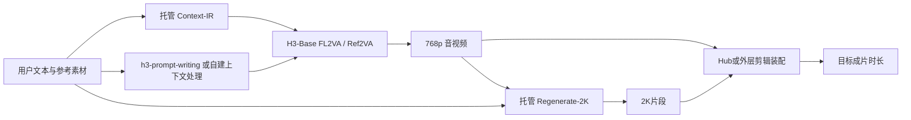

# MiniMax H3 全仓库只读技术审计

审计日：2026-10-28（北京时间）。基线 `093f3129a3f7bd27c74928b1cd31a54fbdebe057`；本次取得并在结束前复核的 main 为 `d21241f0a4b3acbb34c97dae47fa417b7065e438`。main 最后提交作者日期为2026-08-15；issue/PR讨论延续至之后，不能把较新的讨论或第三方版本倒写成主线已发布功能。

## 1. 审计结论与证据规则

H3 仓库提供模型组件配置/部分远程代码、推理请求示例、提示词规范，以及1个可移植提示词Skill和8个依赖Hub的生产流程Skill。它不是一个 clone 后即可用同一运行时完成全部风格成片的独立应用。**生产流程中的“必须”“锁定”“无缝”“精确”是指令和验收目标，不是生成结果已保证。**

核心结论：

1. 【官方仓库事实】本地公开Base主流程是768p，输出规格4–15秒、24fps、32kHz立体声。Context-IR及Regenerate-2K托管系统没有随该GitHub代码完整开源。[系统规格与架构](https://github.com/MiniMax-AI/MiniMax-H3/blob/d21241f0a4b3acbb34c97dae47fa417b7065e438/README.md)
2. 【静态差异】基线之后共30个提交，最终30个文件变更记录；8个风格Skill的英文生产正文没有新增60秒能力，主要是compatibility一行及MV路径迁移；全部技能references与8份中文正文没有实质更新。不能把已有长片工作流当成最近新增的模型能力。
3. 【官方流程文本】品牌Skill常规15–30秒、先核验资产、精确节拍、生成片段、编辑装配；**60秒专用拆分算法、单次60秒生成、跨片段音乐/身份保证均未提供**。60秒方案只能明确标注为基于这些流程的外层编排实验。
4. 【社区报告】多说话人串音、参考音频重复/截音、参考保真回归、保存音频失败、高动态破碎等均有公开报告，但后端、权重和证据强度不同，不能合并成“官方模型全都必现”。
5. 【维护者说明】#51音频边界问题被承认且issue关闭，回复原文为“这个问题我们已经发现，下个版本会修复”。没有在本次main历史找到该质量问题的可关联修复；关闭不等于当前基线或main已修好。
6. 【静态发现】main依然存在异步脚本只查一次、依赖表非锁定且漏直接依赖、中文品牌工具白名单不完整、Skill安装副本落后、纸艺快捷步骤索引错误、品牌30fps规划与24fps模型规格冲突等可执行性风险。

全文标记约定：**【仓库事实/官方流程】**仅表示文件存在并这样声明；**【维护者说明】**有账号与链接；**【社区报告】**是他人结果或主张；**【静态推断】**是本次审计推导；**【未验证】**是没有获得实验证据的能力。8个风格Skill的meta包含community、official-featured和official，不能一律把社区流程写成模型团队的质量承诺。

没有执行模型、加载权重、调用生成API、运行技能生产流程或修改现有H3环境。仅从临时Git镜像导出两版本，读文件、比较历史、抓公开讨论、做AST/JSON/bash语法检查以及读取已有样片元数据。现有 `/workspace/prompt` 未改动；报告保存在独立审计目录。

## 2. 覆盖范围与全仓库地图

main共229个受版本控制文件。`全文件覆盖清单.csv`列出每个文件、字节数、SHA256、审计方式和固定commit链接。全量技能阅读包括：9份SKILL.md、8份SKILL.cn.md、9个references文件（其内包含模板与完整示例）、8份meta.yaml、1份agents/openai.yaml及skills/README，共6051行；另查`.agents`/`.claude`两套安装副本。基线不同部分由完整patch逐项核对；未改的references沿用同一内容，不重复假称新增。

| 区域 | 实际内容/作用 | 审计边界 |
|---|---|---|
| `skills/` | 1个提示词改写器+8个风格生产规范 | 全文阅读，中英差异与跨文件冲突检查 |
| `.agents/`、`.claude/` | h3-prompt-writing安装副本 | 与canonical对比；副本35行，canonical40行 |
| `FL2VA/`、`Ref2VA/` | 原始格式模型清单、processor/tokenizer、编码器配置、视频/音频VAE远程代码 | 追踪加载、import、配置与变更；未推理 |
| 根`model_index.json`/`modular_model_index.json` | Diffusers模块式管线，组件按子目录和远程模型ID装载 | 与原始树不可混为一个权重布局 |
| 根`transformer*`、`vae`、`audio_vae`等 | Diffusers格式配置和权重分片索引 | GitHub树中没有实际safetensors权重分片；未下载HF权重 |
| `scripts/readme/` | 18份SGLang/Open Platform请求示例 | 全部审查控制流和参数、bash -n；未执行网络生成 |
| `assets/` | 14个MP4、9个GIF、2张PNG | 25项媒体ffprobe元数据；没有据演示图判定能力成功率 |
| `requirements.txt` | 最低版本依赖表 | 非锁文件，没有全套推理后端的可复现安装合同 |

48份Python源码AST解析、77份JSON解析、18份shell语法检查均无错误；这只证明静态语法，不证明依赖能装、模型能加载或生成质量合格。没有根级完整测试套件或CI回归矩阵来支撑8个风格Skill逐项保真。CSV覆盖清单中的“静态结构+重点审读”不表示每个数学算子都做过数值正确性验证。

### 2.1 系统数据流

【仓库事实】H3-Encoder采用Qwen3-VL-32B的第50层隐藏状态；VideoVAE标称f16t4d24，再以1×2×2 patch使视觉token有效空间降采样32倍；AudioVAE左右声道独立处理后重组，32kHz每声道40Hz latent；Omni Transformer为33B dense单流，约13B在可预计算AdaLN相关分支。初版公开路径是full attention，原生稀疏实现尚未包含。上述是架构声明，不是本次显存/速度测量。[README架构](https://github.com/MiniMax-AI/MiniMax-H3/blob/d21241f0a4b3acbb34c97dae47fa417b7065e438/README.md)

根索引指向Diffusers的MiniMaxH3ModularPipeline/MiniMaxH3Blocks，文本编码器、两个transformer、VAE及两个scheduler分别加载；原始树是另一套类名和参数布局。`revision:null`没有固定外部HF快照；**固定GitHub源码commit并不自动固定HF权重、Diffusers、ComfyUI和托管API模型**。#48用户比较原始/转换权重QKV、后来又提Ref2VA MLP差异，官方布局结论尚未取得，不自行用简单concat宣布权重坏了。[模型索引](https://github.com/MiniMax-AI/MiniMax-H3/blob/d21241f0a4b3acbb34c97dae47fa417b7065e438/model_index.json) / [#48](https://github.com/MiniMax-AI/MiniMax-H3/issues/48)

## 3. 模式与规格：保证边界逐项核对

| 项目 | 仓库明确声明 | 容易被误读的内容 | 审计结论/执行边界 |
|---|---|---|---|
| 生成时长 | 4–15秒 | 纸艺60秒、3D180秒、MV30秒代表一次输出 | 前者是片段规格，后者为成片编排目标；第三方20–30秒自述不扩展官方规格 |
| fps | 24fps | 品牌默认30fps规划=模型30fps | 规划时钟与素材fps分开，转码不能追溯成原生30fps |
| 分辨率 | 默认短边768；Regenerate-2K实现2K | 任意1080p/21:9精确像素、纯本地2K、4K都已保证 | Skill格式菜单是交付意图；检查具体接口尺寸/对齐；2K示例为2560×1440，不推广到所有比例 |
| 比例 | 21:9、16:9、4:3、1:1、3:4、9:16等 | 宽高比及像素必然完全精确 | 演示768p为1344×768（1.75），不等于精确16/9；归一化/裁切单记 |
| 声音 | 32kHz stereo，原生音视频 | 独立可编辑BGM/人声/SFX stems；原生无爆音 | stereo是两个声道而非分离音轨；逐项听检/测量 |
| 对白语言 | 稳定支持列出11语种 | 任意方言、逐字朗读、跨语种配音/翻译保证 | #80粤语转换失败报告；11语种不含“任何方言必可” |
| FL2VA图像 | 0/1/2张；T2VA/首帧/尾帧/首尾帧 | 3锚点广告能直接走首尾帧模式 | 多独立参考需匹配Ref2VA语义，不能只把三张塞进FL2VA |
| Ref2VA图像 | ≤9张 | 九图同时任意角色/包装/文字都高保真 | 只是输入容量；角色隔离和质量需验收 |
| Ref2VA视频 | ≤3段，各2–15秒，总≤15秒 | 能直接吃60秒参考长片并完整模仿 | 超限需预切，输入时间窗和全片时间轴另建映射 |
| Ref2VA音频 | ≤3段，各2–15秒，总≤15秒 | 60秒master可以整条作为模型参考，或声线永不串用 | full master属外层编辑资产；每次调用只能传合法窗口 |
| 混合输入 | 总文件数≤12 | 9图+3视频+3音频都可同时满额 | 各类上限与总数同时生效 |
| audio-only | 基线英文明确禁止单独音频；main英文移除该句 | 删掉限制=所有后端已支持并质量保证 | 仅确认文档限制移除；其他语言/接口未同步，需单独能力验证 |
| 原音复用 | prompt规范有fully_copy/partially_copy/reference | 标记fully_copy就是输出波形逐样本一致 | 关系标记表达意图；精确复用应由编辑音轨直接装配并核对 |
| 口型/对白 | 规范写Sx、d标签、闭嘴旁白、跨切台词 | lip-sync、身份、语速、停止时刻均有硬保证 | #17/#68/#95反例报告；必须设输出检查 |
| 可见文字 | 保留原文并放双引号；广告要求单行3–5英文词 | 字体文件被精确渲染、OCR零错误、单行时序必达 | 生成式字体/像素位移不是排版引擎；原生文字与后期叠字分组 |
| 参考保留 | fully_preserved等标签 | 不新增戒指、不换脸、不改瓶形有确定保证 | #84/#86报告提示需要局部比对；禁止用标签自证 |
| 负提示 | 风格与排除词清单 | 模型或宿主必有negative_prompt参数 | 多为写作规范；是否独立API字段未由本仓库统一定义 |

仓库列出的11种对白语言为：阿拉伯语、中文、英语、法语、德语、意大利语、日语、韩语、葡萄牙语、俄语、西班牙语；其他语言仅称支持程度不一。该列表不等于每一种方言或任意声线绑定都稳定。

### 3.1 本次读取现有样片得到的具体证据

14个MP4均读到24fps、32kHz双声道AAC。768p样片为1344×768，2K样片为2560×1440。`t2va.mp4`容器时长10.125秒（示例请求10秒）；`ref2va.mp4`为5.175秒、`r2va_2k.mp4`为5.167秒（请求5秒）；I2VA样片8秒。**这证明演示文件元数据与请求参数不总逐帧一致，不证明所有任务同样取整，也不应只靠容器duration归因模型。**完整机器结果见`sources/demo-media-metadata.json`；后续测试应分别记录视频帧数、stream duration、音轨长度和容器长度。

## 4. 基线到main：实质变化与未变化

完整逐文件差异见B，完整patch见`sources/baseline-main.diff`，30个中间提交见F。

| 变化组 | 提交/PR | 实际意义 | 不应得出的结论 |
|---|---|---|---|
| MV目录更名 | 5970421 / #12，e4a0b9c合并 | mv-subtitle-skill-confirmed迁到公开名称 | 新增MV长片能力 |
| 依赖表+audio VAE init | 8e1fa26 / #10，8317f43合并 | 新requirements；两份dac_audio_vae初始化修改 | 声线串音或边界音已修复 |
| BigVGAN helper init | c22aafa / #14，3f192aa合并 | 两份dac_utils初始化修改 | 训练/推理数值正确性已完整证明 |
| 通用提示词可移植说明 | b731d88 / #13，05d91ff合并 | 明确openai.yaml仅UI元数据 | 其他8个风格Skill可直接跨宿主成片 |
| 8个风格compatibility | 743d51e / #22，fa6891f合并 | 明确Hub依赖；英文正文未改 | 执行器/API工具实现已开源 |
| 提示词写作Tips | a107547 / #44，d21241f合并 | 总时长4–15秒、标签、具体描写、关键帧四条提示 | 生成质量有新的实验保证 |
| README本地文件说明 | 9176a26 / #45，6da473b合并 | file://由SGLang服务端解析；容器挂载要求 | 本仓库真的增加image loader代码，或公网API支持file:// |
| 英文输入限制更动 | README差异及相关更新提交 | 删掉audio必须伴随视觉输入的句子 | 所有运行后端已通过audio-only回归 |
| 多语言/排版/安装产物 | b7227fa、#7/#8/#27/#35等 | 新译文、局部排版、隐藏副本、lock记录 | 模型checkpoint或8个风格生产流程都升级了 |

**静态未变项**：品牌的15–30秒目标、30fps规划、原生音频默认；MV >15秒拼接规则；纸艺15/30/60秒规划；3D长片镜头表与回退；全部技能references；18个示例脚本；根模型/权重索引和主架构配置。这些能力和缺陷在用户给定基线已可讨论，无需为了追新升级本地。

## 5. 技能生产流程中的实际合同

9个Skill逐一输入/输出、组合关系、8张执行约束卡在D。它们共用“简报→资产角色→镜头/节拍→确认→生成→装配→验收”的组织方式，但不存在统一机器可执行schema或自动调用链。不能把一个Skill输出任意拷入另一个而假定字段兼容。

特别需要隔离：

- **知识MV**不是仓库里的第10个独立Skill：教育内容可以采用MV镜头语言，学习目标应另加事实审查；有歌词才进入MV的歌词/口型合同。无歌词讲解不能被自动改成唱词。
- **纸艺与拼贴**不是可互换预设：纸艺允许微缩多平面运镜、纸标签/旁白；拼贴默认固定镜头、无文字、SFX-only。把纸艺运镜/BGM默认套给拼贴会违背其合同。
- **产品广告与品牌片**的身份资产政策不同：产品Skill从原图生成3张独立锚点，视频不传原商品图；品牌Skill禁止重绘身份资产、必须用真实来源。品牌任务不能不声明就走生成式产品锚点替换官方UI/包装。
- **手绘语言规则**要求整段用户主语言且不混排；h3-prompt-writing最终结构用英文、台词/画面字保持原语言。可保留原语言创意稿，另写英文后端编译稿；这是外层适配，不能称两个规范原样同时满足。
- **3D故事板**的标签/草图仅供规划；生视频必须清除；文本分镜是权威。不能因为图像卡有精确名字就将那些字一起生成进成片。

## 6. brand-promo-video-generator 的60秒扩展审计

### 6.1 哪些有官方仓库依据

[英文Skill](https://github.com/MiniMax-AI/MiniMax-H3/blob/d21241f0a4b3acbb34c97dae47fa417b7065e438/skills/brand-promo-video-generator/SKILL.md) 与 [中文Skill](https://github.com/MiniMax-AI/MiniMax-H3/blob/d21241f0a4b3acbb34c97dae47fa417b7065e438/skills/brand-promo-video-generator/SKILL.cn.md) 支持：可核验素材与品牌事实表、来源manifest、2–3个创意方向、分秒/分帧节拍、片段图像/视频生成、可选音频、编辑装配、可读CTA与身份资产核查。常规时长15–30秒；15秒5–8拍、30秒8–12拍。默认30fps只是规划惯例。声音通常优先视频原生音频（文本写`generate_audio=true`）；用户要求可控旁白、独立BGM/精确独立时长或原生音频不适合时才分轨生成。没有证明该参数可原样用于每个SGLang/Comfy/API接口。

官方文本没有给出“总成片不得超过30秒”的硬禁令，但也没有60秒专用recipe、数量/预算/质量基准或完整60秒示例。因此：**60秒外层成片是合理可研究的扩展，不能从“通常15–30秒”推出官方已验证60秒。**

### 6.2 哪些属于我们的编排实验

| 扩展 | 定性 | 必须补上的合同 |
|---|---|---|
| 60秒分章、8段短片或更多片段 | 外层编排实验 | 每次请求4–15秒，素材可用区间与总片长分开 |
| 从3D借六列shot table/空间锚点 | 官方已有规划思想的跨Skill复用实验 | 不继承3D风格；人物/品牌事实不能被故事化改写 |
| 从MV借master音轨与切点 | 官方MV有此流程，移到品牌60秒是我们的适配 | 音频所有权、总长、剪辑mapping；不默认让品牌变歌词MV |
| 跨片身份、产品色、UI和Logo恒定 | 验收目标，尚未保证 | 授权原件、固定资产ID、局部帧对照、错误片不得拼入 |
| 连续60秒原生配乐 | 未保证 | 每段原生音乐分离风险；整片master或按需分轨须显式选择 |
| 60秒准确口播且逐句对嘴 | 未保证/高风险实验 | 台词先锁、声线A/B、时长缓冲、口型逐句检验 |
| 60秒长镜头首尾延续 | 未验证实验 | 首尾帧只有边界条件，不保证动作速度/人物拓扑/音频连续 |
| 60秒全2K且纯本地 | 本仓库不能支撑该完整能力 | Base与托管Regenerate分开，记录每段后端及实测尺寸 |

### 6.3 可审查的60秒编排草案（未执行）

**项目约束示例**：16:9；交付时长60.000秒；生成素材按24fps验收；品牌原件不重绘；不要求出镜口型；中文旁白只有用户明确需要时才制作；完整master音轨仅作为外层编辑资产，不整条塞入Ref2VA。

建议先做8个7.5秒的**编辑窗口**：0–7.5品牌钩子，7.5–15用户情境，15–22.5交互机制，22.5–30能力A，30–37.5能力B，37.5–45真实输出，45–52.5可核对证据/收益，52.5–60Logo与CTA。每个窗口具体生成时长由实际后端合法值与输出取整确定，可能8秒或更长，选用180个24fps素材帧组成窗口；这不是声称7.5秒请求在所有后端都合法。

硬切方案总计8×180=1440帧=60秒。若7个连接处各重叠6个**24fps素材帧**，总共减少42帧，必须补42帧可用handles，最终才仍是1440帧；不能简单8×7.5后再叠转场还称60秒。Skill中的6–12**30fps规划帧**实际为0.2–0.4秒，不是直接复制成6–12个24fps帧。旁白段不靠任意speed-ramp救时长，先修台词/剪辑窗口。

最低试产次序：先验一个身份/产品高风险镜头，再验一对接缝，再验30秒小装配，再研究60秒；每次都保留原生音轨与修后音轨，不用后期成功掩盖原生问题。这里的阶段和1440帧验收值是本审计提出的实验设计，不是H3官方承诺。

### 6.4 预期故障与降级

- 身份资产认证不完整：按品牌Skill停在前期包，不生成“近似Logo”。
- 宿主缺生成/编辑工具：英文Skill明确降级为pre-production；可写文件不等于具备Hub成片执行器。
- 某段原生音乐不可用：根据需求改独立master/后期混音，标记实验；保持SFX与BGM策略一致，不双重铺同一曲。
- 跨镜产品或手部漂移：只替换失败镜并重验上下接缝；不要靠LUT宣称修复结构。
- 文字未通过：先减少字数/频次；后期品牌锁定素材作为单独路线，不能把它记成H3原生文字通过。

## 7. 故障证据：已修、承诺修、仍开放、外部修复

完整45条见C。这里优先列真正影响生产判断的条目。

| 状态类别 | 证据 | 可以说什么 | 不能说什么 |
|---|---|---|---|
| 已合并本仓库修复 | #12目录更名；#45本地URI说明；#10/#14初始化代码 | 这些变更进入main | 生成声线/保真/音频都因此改善 |
| 维护者承诺，缺发版对应 | [#51回复](https://github.com/MiniMax-AI/MiniMax-H3/issues/51#issuecomment-5364674789) | 问题已被维护者发现，拟下版修复 | issue Closed即现有权重已修 |
| 用户局部workaround | [#17](https://github.com/MiniMax-AI/MiniMax-H3/issues/17)改时长/去笑声/重分speaker ID；[#85](https://github.com/MiniMax-AI/MiniMax-H3/issues/85)去t_emb下转 | 可设计单因素对照 | 已获官方通用修复或量化是确定根因 |
| 证据受限的历史报告 | [#95](https://github.com/MiniMax-AI/MiniMax-H3/issues/95)重复/开头截音 | 作者历史遇到；附工作流未GPU执行 | 附件构成成功复现或有失败率 |
| 后端/框架问题 | [#70](https://github.com/MiniMax-AI/MiniMax-H3/issues/70)AAC保存；[#56](https://github.com/MiniMax-AI/MiniMax-H3/issues/56)MPS INT8 | 按阶段与精度隔离诊断 | 服务起得来就是模型能跑，Mac一概不能跑 |
| 外部真实修复 | [PyTorch #195147](https://github.com/pytorch/pytorch/pull/195147)，bot落地[72bca5e](https://github.com/pytorch/pytorch/commit/72bca5e6d542341e6bcd795aaa293968843c29b2) | temporal padding相关修复存在于上游提交 | 用户当前安装轮子含修复，或H3所有Mac路径已正常 |
| 开放的候选修复/研究 | #37依赖、#38polling、#67角色评测、#91LoT Draft | 阅读其方案并记录未合并状态 | 当前main具备第10个Skill或2.6×稳定提速 |

PyTorch #194922后续用户称稳定2.14.1仍可重现、nightly已修；本次仅核查讨论和落地提交，未验证轮子内容。Comfy PR15902抓取仍Open。**这正说明需要按现有commit/库版本判断是否命中，不应为了追新而直接升级生产环境。**

### 7.1 多角色音色的特殊风险

官方ref-en要求每个真实发声源按目标视频发声顺序一次分配Sx并跨镜复用，视觉Subject与声音Sx不同编号空间。#17有用户把A-B-A改为S1/S2/S3并重复A音频槽获得局部改善，这与官方稳定ID规则冲突；不能把它作为默认“修正规范”。同帖还有将时长±1–2秒或去非对白笑声改善的经验；多种报告同时存在，说明要分别测试，不能叠加所有修改后归因某个因素。

#95尤其不能过度引用：原异常视频已删，附件A/B/C只做结构校验；作者说没有跑GPU。其B仍有悬空Audio标签，因此需要C来隔离“无参考音频”和“无效提示”的混淆。记录的13秒请求、328帧约13.667秒也是该工作流设置，不可推广成所有后端帧数公式。

### 7.2 本次静态发现中最值得先修订测试的项目

1. **异步示例不是完整执行器**：18份脚本没有真正循环等待终态；注释“Query again”不等于代码会重试。后续curl部分没有`--fail`，HTTP错误可能被保存成mp4；jq成功也不是视频正确。PR38尚未合并。[示例](https://github.com/MiniMax-AI/MiniMax-H3/blob/d21241f0a4b3acbb34c97dae47fa417b7065e438/scripts/readme/reproducible-768p-fl2va-request.sh)
2. **分阶段脚本跨进程变量问题**：Context脚本赋`EXPANDED_PROMPT`，不持久化、不export；独立bash运行不会回传父shell。README凭证/URL示例也未export。按shell执行方式可能unbound或丢数据；属控制流风险，未实际向模型发请求。
3. **requirements不是已验证安装锁**：最低版本范围未封顶、H3分支引用可漂移，直接import的einops、yaml、torchvision未在表中声明；根模型索引又标`0.36.0.dev0`。PR37提出提升/固定版本，仍Open。安装命令成功不证明H3类可导入。
4. **weight_norm“修复”的API疑点**：四处修改都检查legacy `weight_g/weight_v`，实际import是`torch.nn.utils.parametrizations.weight_norm`。PyTorch固定源码存储`parametrizations.weight.original0/original1`，因而现代路径可能仍走对临时`m.weight`赋值的旧分支。这是有源码依据的静态问题，**没有运行参数初始化测试，也没有证明预训练推理输出受影响**；加载checkpoint覆盖参数后，不能把此构造期变更说成音频质量修复。[H3代码](https://github.com/MiniMax-AI/MiniMax-H3/blob/d21241f0a4b3acbb34c97dae47fa417b7065e438/FL2VA/audio_vae/dac_audio_vae.py) / [PyTorch固定源码](https://github.com/pytorch/pytorch/blob/d990dada86a8ad94882b5c23e859b88c0c255bda/torch/nn/utils/parametrizations.py)
5. **中文合同不同步**：品牌中文allowed-tools只有7项、缺英文显式生成/编辑工具和Tool Coverage降级段；游戏中文没有英文强制加载两个模板的合同；8份中文无新增compatibility说明。不是简单翻译措辞差异。
6. **纸艺步骤与时长冲突**：称18步但实际至19；单资产捷径STEP17现在是旁白，负向/审核在18/19；60秒Step12为7–9镜，Step13为8–12镜。测试应引用阶段名并先生成唯一时间表，避免机械按数字跑。
7. **短剪辑镜头不等于生成请求**：MV2–5秒、3D3秒故事板例子与4秒输出下限冲突；必须将编辑窗口、生成段长度分别记录。
8. **角色/UI模板带默认残留**：游戏模板在动态风格下仍写“黄色平面环境”，负约束默认无女性除非明示；按钮统一尺寸与宽度适配文字也需明确优先级。产品Step8/9原生优先与Step10无条件替音乐，以及固定找8–12秒片段和5/15秒广告选项不完全一致。

## 8. 下一步应怎样使用这些交付

不改变本地基线。先登记当前H3/后端/权重/节点/运行库精确版本、实际加载Skill路径及hash；将B当作“需要单独评估的差异”，不是升级清单。按E先修订测试合同、来源记录和失败分类，后续生成实验需要另行执行并留全部原件。

E暂未取得用户原V01–V12方案：工作区检索无结果，已发异步澄清。文件给出12项可直接转入测试表的临时映射和具体判据，明确未与原方案逐项对齐，不伪造其原始内容。已有源文件、历史、讨论、媒体元数据和静态风险全部可供现在审阅；模型运行效果仍未验证。

交付导航：B逐文件差异；C故障地图；D技能合同/关系/执行约束卡；E测试方案修订；F逐文件固定链接、全部30个提交和50个issue/37个PR来源索引。所有“完成”“通过”的静态检查均限定在本报告所列范围，不用于替代模型实测。
