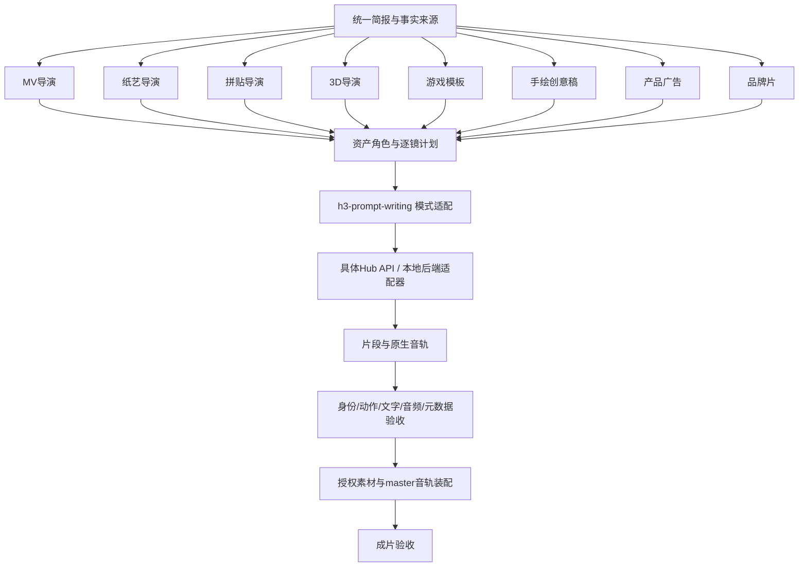

# 9个Skill的输入输出、依赖、组合关系与执行约束卡

固定版本：`d21241f0a4b3acbb34c97dae47fa417b7065e438`；比较基线`093f3129a3f7bd27c74928b1cd31a54fbdebe057`。本文依据完整技能树及references；所有实际生成能力未运行验证。“必须”表示仓库流程要求，“建议验收值”表示本次审计提出的测试标准。

## 1. 九个Skill逐一合同

### S01｜h3-prompt-writing：通用后端提示词编译层

- **输入**：用户目标、T2VA/I2VA/FL2VA/L2VA/Ref2VA模式、时长、图像/视频/音频的角色与顺序、用户原始对白/歌词/可见字。
- **依赖**：可读本地文件的Agent；base-en.txt和ref-en.txt。无需Hub/模型API；openai.yaml只是可选UI metadata。它不分析二进制素材并自动获得事实，素材内容需调用者或上游分析提供。
- **输出**：英文结构化改写文本，保留对白/歌词/画面文字原语言；不生成视频、不自动渲染字、不保证模型质量。
- **Base四模式**：T2VA直接三字段；I2VA先写0.00秒首帧指令；FL2VA先写两图对齐开头/结尾；L2VA末帧属于最终Shot而非默认Shot1。随后固定`integrated_multimodal_description`→`overall_soundscape`→`non_diegetic_music`。
- **Ref2VA**：固定`subject_definitions`→`summary`→`retention_analysis`→`detailed_description`→`overall_soundscape`→`non_diegetic_music`。可见内容用Subject，图片关键帧用Picture，整体视频结构/编辑源用Video，声音独立用Audio。不同种类编号独立，Video1不必等于Audio1。
- **说话人**：按实际发声顺序一次分配S1/S2；跨镜复用。非发声角色无Sx。`<d>[Language] ...</d>`只放实际台词，发声方式/动作写在外；旁白使用`says in an off-screen voiceover`并注明画面嘴闭合。跨切用scenetrans，截断用cutoff，均为文本规范，不是确定执行器。
- **例子与内在差异**：base有4种完整案例；ref有咖啡店多角色完整例子。base要求原对白标点逐字保留，ref的复用音频台词又要求去装饰标点/规范句末；应保存原稿和编译稿并记录改动，不能悄悄以“逐字保留”描述规范化后的文本。
- **风险**：fully_preserved/fully_copy是请求关系而非测量结果；350–500英文词是ref普通生成描述建议，不是模型token上限。后端与Skill版本必须分别登记；hidden安装副本缺最新Tips。

来源：[SKILL](https://github.com/MiniMax-AI/MiniMax-H3/blob/d21241f0a4b3acbb34c97dae47fa417b7065e438/skills/h3-prompt-writing/SKILL.md)、[Base规范](https://github.com/MiniMax-AI/MiniMax-H3/blob/d21241f0a4b3acbb34c97dae47fa417b7065e438/skills/h3-prompt-writing/references/base-en.txt)、[Ref规范](https://github.com/MiniMax-AI/MiniMax-H3/blob/d21241f0a4b3acbb34c97dae47fa417b7065e438/skills/h3-prompt-writing/references/ref-en.txt)。

### S02｜music-video-subtitle-generator（meta 0.6.6，official-featured）

- **输入**：音乐/beat、歌词及所有权、人物/场景/文字风格参考、情绪、平台、ratio、目标时长、音乐窗口。已有歌词未经授权不改写；无歌词且要求完整音乐美学MV时，流程要求原创歌词先锁。
- **依赖**：Hub画布与image/video/music/editing agents；媒体分析；提取末帧与master音轨对齐。可只交prompt，此时不进入生成。
- **中间产物**：creative contract、三类隔离参考卡、逐镜time window/vocal line/typography/action/camera/transition，权威节点`Complete MV Prompt`。
- **输出**：prompt方案，或确认后的MV片段与最终装配。10秒测试、15秒hook、30秒及以上多镜剪辑；长于15秒按镜头拆解。
- **音频/口型**：一条Master Audio，文字与锁定唱词逐字对应，切点避元音/句中；按拍网格组接。流程要求不能说明生成口型已可靠。
- **限制**：2–5秒编辑镜头不全是合法H3单次生成长度；连续镜头用上段末帧，会形成顺序依赖，不能所有镜一律并行；严格hard-cut/颗粒LUT是其特定美学，不宜强加给纸艺、品牌片。

来源：[SKILL](https://github.com/MiniMax-AI/MiniMax-H3/blob/d21241f0a4b3acbb34c97dae47fa417b7065e438/skills/music-video-subtitle-generator/SKILL.md)。基线目录是`mv-subtitle-skill-confirmed`，正文长片规则基线已具备。

### S03｜papercraft-stop-motion-explainer（meta 0.6.5，official）

- **输入**：知识主题、领域原词、科学材料、学习目标、受众、方向、时长、ratio、所要交付物。
- **依赖**：完整流程用Hub画布/选项卡/生成工具；实际视频默认H3；没有图片生成时可交preview briefs和prompts。可按轻量请求只交某一生产资产。
- **产物链**：主题理解→Style DNA→3–5方向与时长→纸角色→纸场景→4–7层布景表→资产表→1–3预览→单图/系列/5秒I2V提示→分镜→节奏/运镜/纸物理转场→SFX/BGM→需要时配音清理→负向与审核。
- **默认**：信息缺失时30秒、16:9、泛知识观众、一个纸讲解员+核心模型；仍按方向/时长/预览阶段确认。15/30/60秒是创作包/分镜总长。
- **音频**：旁白脚本确认后生成；与目标偏差>20%按原文需决策，不自动拉伸；检查尾杂音，优先裁尾+短淡出；BGM服从主题文化并duck旁白。
- **限制**：纸质厚度、4层深度、标签、parallax、stop-motion都是风格目标，不提供可编辑层文件。快捷路径引用STEP17有错位，见A/C，不机械触发旁白。

来源：[SKILL](https://github.com/MiniMax-AI/MiniMax-H3/blob/d21241f0a4b3acbb34c97dae47fa417b7065e438/skills/papercraft-stop-motion-explainer/SKILL.md)、[中文全文](https://github.com/MiniMax-AI/MiniMax-H3/blob/d21241f0a4b3acbb34c97dae47fa417b7065e438/skills/papercraft-stop-motion-explainer/SKILL.cn.md)。

### S04｜paper-collage-explainer-generator（meta 0.3.9，official-featured）

- **输入**：原句/知识点/观点/故事节拍；可选ratio、时长、色板、音频需求；不把“讲解”自动等同旁白。
- **依赖**：Hub图像/视频/可选后期；默认MiniMax-H3。纯prompt-only、精确图层/透明切片/准确长字排版不属它的默认交付。
- **中间产物**：制作方案Gate1→每段静帧规格→每段一张“未来完成尾帧”→静帧Gate2→逐片组装动效→视频QA。
- **默认**：16:9、每段约4秒、3–6大物件组；SFX-only，无BGM/旁白/字幕；固定镜头、无zoom/换景/形变/新物体。背景必须与批准尾帧同色，不默认牛皮纸、钴蓝或做旧。
- **输出**：批准静帧及B-roll视频；用户要求时按顺序装配，保留原SFX；BGM/旁白/字幕需明确需求。
- **限制**：“尾帧锚点”需实际后端支持L2VA/FL2VA/参考尾帧语义，不能错误把完成图当I2VA首帧。只把图片作为普通Ref不等于尾帧像素保证。

来源：[SKILL](https://github.com/MiniMax-AI/MiniMax-H3/blob/d21241f0a4b3acbb34c97dae47fa417b7065e438/skills/paper-collage-explainer-generator/SKILL.md)。

### S05｜3d-animation-short-generator（meta 0.5.4，community）

- **输入**：故事premise、产物范围、ratio与总时长、台词模式与语言；不默认英文对白。总长选项30–60、15–30、60–90、90–180秒及自定义，全部为多镜成片规划。
- **依赖**：Hub画布/choice cards/image/video/editing/audio能力；5个references均是运行合同，不是可忽略附件。
- **产物**：简报→8拍因果大纲→带名字/多视图/道具的角色卡→绝无人影的环境卡→六列镜头表→Step5.5自检→单一文本分镜文档（必要镜抽取节点；铅笔图仅opt-in）→模型/分辨率选择→逐镜片段→全片+BGM→复查。
- **六列**：Shot ID & Duration；Continuity Handoff；Reference Anchors (Spatial + Identity)；Hook Type；Shot Description (Per-Second Directives)；Audio & Dialogue Track。
- **自检**：每镜hook、任意连续三镜至少reveal/reversal/callback之一；单镜≤15秒；重要角色≤3；地标/光继承；每秒五要素完整；跨镜无未解释状态冲突。注意≤15秒自检没写4秒下限，外层还要补API合法性。
- **模型**：H3默认，Seedance2.0性能fallback，混合需每行标model。768P/2K等选项是分后端选择，比较优势/成本描述未附受控基准，不视为稳定价目表。
- **回退**：强化锚点→缩到≤6秒并重跑镜头自检→尝试其他模型/放宽/跳过/用户供参考。第三次尝试和“连续3次失败后”措辞存在计数歧义，应在执行器明确初次+重试计数。
- **输出清洁**：权威是文本分镜；铅笔多格只审稿，不能覆盖。去char/scene/shot/dur/hook标签、箭头/线稿，剪辑只用最新已批资产；原SFX保留，BGM一条整曲。

来源：[SKILL](https://github.com/MiniMax-AI/MiniMax-H3/blob/d21241f0a4b3acbb34c97dae47fa417b7065e438/skills/3d-animation-short-generator/SKILL.md)、[镜头表](https://github.com/MiniMax-AI/MiniMax-H3/blob/d21241f0a4b3acbb34c97dae47fa417b7065e438/skills/3d-animation-short-generator/references/shot-table-spec.md)、[故事板](https://github.com/MiniMax-AI/MiniMax-H3/blob/d21241f0a4b3acbb34c97dae47fa417b7065e438/skills/3d-animation-short-generator/references/storyboard-guidelines.md)、[选模型](https://github.com/MiniMax-AI/MiniMax-H3/blob/d21241f0a4b3acbb34c97dae47fa417b7065e438/skills/3d-animation-short-generator/references/model-selection.md)、[回退](https://github.com/MiniMax-AI/MiniMax-H3/blob/d21241f0a4b3acbb34c97dae47fa417b7065e438/skills/3d-animation-short-generator/references/fallback-policy.md)、[QC](https://github.com/MiniMax-AI/MiniMax-H3/blob/d21241f0a4b3acbb34c97dae47fa417b7065e438/skills/3d-animation-short-generator/references/qc-checklist.md)。

### S06｜co-op-game-intro-generator（meta 0.1.5，official）

- **输入**：两玩家名、游戏名、风格、可选两人身份参考；视频模板另有ui_ref、player1_ref、player2_ref、height_ref。
- **依赖**：Hub图像+H3；英文要求两个references模板必须可读，缺任何一份停止，不即兴替结构。中文入口未重复此硬规则，审计应明确采用哪种合同。
- **输出**：一张16:9菜单确认图→批准后回填的15秒开场prompt/视频；不是可玩游戏或真实交互UI。
- **固定事件**：0–2菜单；2–4玩家1右臂；4–7玩家2重臂；7–8.5确认；8.5–10加载；10–15进入城市+HUD。玩家1左/高挑，玩家2右/矮壮；图像只贡献身份，渲染随选风格。
- **限制**：UI精确字、昵称/装备名、四级状态变更、两人同时连续动作极密集；模板负约束不保证模型按字符排版。动态风格必须清理黄色、工业/霓虹等残留默认。

来源：[SKILL](https://github.com/MiniMax-AI/MiniMax-H3/blob/d21241f0a4b3acbb34c97dae47fa417b7065e438/skills/co-op-game-intro-generator/SKILL.md)、[确认图模板](https://github.com/MiniMax-AI/MiniMax-H3/blob/d21241f0a4b3acbb34c97dae47fa417b7065e438/skills/co-op-game-intro-generator/references/h3-confirmation-image-template.md)、[视频模板](https://github.com/MiniMax-AI/MiniMax-H3/blob/d21241f0a4b3acbb34c97dae47fa417b7065e438/skills/co-op-game-intro-generator/references/h3-video-prompt-template.md)。

### S07｜handdrawn-live-video-generator（meta 1.0.2，official-featured）

- **输入**：生活空间、接触手/物件、情绪、可选参考风格和主语言；每次新发明空间/实体/色彩/形变链/路线/反应/结尾。
- **依赖**：写prompt无需先派planner/executor；成片在用户确认H3后执行Hub/H3生成。15秒16:9固定结构。
- **输出**：同用户主语言的完整prompt，按11段顺序，不加标题；随后恰好一行同语种H3建议；确认后才视频。
- **内容硬约束**：0–3接触、3–6/6–10/10–13继续动作、13–15空间级变形；一个实体连续保留母题；同一或相邻空间；手机相机落后追拍。
- **排除**：CG/毛绒/均匀矢量/光滑霓虹/恐怖跳吓/突然多角色/多场景硬切。环境音有要求，BGM不应凭空强加。
- **限制**：这是实拍质感生成融合，不保证对用户原始实拍做像素级可控合成，也不交可编辑alpha/mask。

来源：[SKILL](https://github.com/MiniMax-AI/MiniMax-H3/blob/d21241f0a4b3acbb34c97dae47fa417b7065e438/skills/handdrawn-live-video-generator/SKILL.md)。

### S08｜minimalist-product-ad-generator（meta 0.5.6，community）

- **输入**：至少一张产品图/资产；单款或多款、主推款/具体色名；5/10/15秒（10推荐）、ratio、四种风格、英语画面copy。
- **依赖**：Hub素材分析/图片/H3/剪辑；音乐差时music-2.6；ElevenLabs仅明确严格时长并按费用规则。名称出现不表示本仓库实现了对应服务或费用确认工具。
- **产物**：start gate→产品事实/叙事脊柱→动效语言→2–3条3–5词英文copy并锁定→三张独立锚点→精确beat表→一条H3全画幅广告→按需换音乐/卡点→验证。
- **三锚点**：hero、材质/功能、结尾copy，严禁拼三宫格/四宫格；原商品图只用于分析/锚点，视频不传原图。三图不等于三段镜头，顺序由beat表控制。
- **字与色**：同一时刻一行、3–5英文词、尽量≤32字符；SF Pro Display Semibold是提示风格，不是字体文件排版保证；白底前半黑/深灰，后半具体产品色；二段同一行轻移动，不能改白/银产品本体。
- **音频**：原生优先；差才独立音乐替换。Step10无条件替换的表述与此存在张力，实际测试应分native/replace两条路线。
- **限制**：三图意味着需要能多参考的后端；新锚点可能先已改坏产品，必须原图→锚点→视频逐级检验。无品牌原件不生假Logo；后期字只能在明确接受fallback时单记。

来源：[SKILL](https://github.com/MiniMax-AI/MiniMax-H3/blob/d21241f0a4b3acbb34c97dae47fa417b7065e438/skills/minimalist-product-ad-generator/SKILL.md)。

### S09｜brand-promo-video-generator（meta 0.1.9，official-featured）

- **输入**：Logo/字体/色彩/产品照片/真实UI/资料来源；功能、主张、证据、CTA、免责声明、受众、渠道、旁白/文案语言、15–30秒常规目标和ratio。
- **依赖**：英文allowed-tools列13项，覆盖webfetch、搜索/分析/画布、图片/视频/音频/音乐/语音/剪辑以及task；中文列7项，覆盖不完整。宿主缺生产工具应显式只交pre-production。
- **产物**：brand truth sheet、provenance manifest、叙事方向、精确beat plan、画面copy/CTA/旁白/音频计划→生成前确认→视频片段+装配→最终视频/来源说明。
- **资产合同**：有身份含义的Logo、UI、包装、人物、吉祥物不得用AI近似；程序图形只做抽象层。用户素材用于前期默认可用，记录user-provided；真实性未确定时不能猜替代；manifest不等于商业发布授权。
- **语言**：按品牌/受众/平台，不机械跟聊天；全球英文品牌默认英文，用户要求中文本地化除外。
- **音频/字**：通常视频原生音乐/UI声音，不默认单独BGM；可控旁白/独立BGM/精确独立时长等才分轨。字幕仅明确需要才加，品牌copy不等于普通字幕。
- **限制**：无60秒专门recipe；外层拆片、master、接缝、30→24fps映射见A第6节。不能将品牌真实性要求被“生成更像”替代。

来源：[SKILL](https://github.com/MiniMax-AI/MiniMax-H3/blob/d21241f0a4b3acbb34c97dae47fa417b7065e438/skills/brand-promo-video-generator/SKILL.md)、[中文](https://github.com/MiniMax-AI/MiniMax-H3/blob/d21241f0a4b3acbb34c97dae47fa417b7065e438/skills/brand-promo-video-generator/SKILL.cn.md)。

## 2. 共用结构与可组合接口



这张图是**本审计建议的分层关系**，不是仓库已经实现的调用图。风格Skill多用自然语言Hub派发，未显式逐一调用h3-prompt-writing；跨Skill组合需要编译与字段映射。

建议外层交换结构（本审计设计，非官方schema）：

```json
{
  "project": {"id":"P01", "skill_source_commit":"<sha>", "skill_file_sha256":"<hash>", "backend_revision":"<revision>", "final_seconds":60, "planning_fps":30, "source_fps":24},
  "assets": [{"id":"A01", "path":"<verified file>", "sha256":"<hash>", "role":"identity", "origin":"user-provided", "approved_version":"v1"}],
  "shots": [{"id":"S01", "edit_window":[0,7.5], "requested_generation_seconds":8, "mode":"ref2va", "references":[{"asset_id":"A01","label":"<Subject 1>","role":"identity"}], "dialogue":[], "copy":[], "audio_policy":"native-sfx", "continuity_in":"<state>", "continuity_out":"<state>"}],
  "assembly": {"master_audio_id":null, "timeline_fps":24, "final_frames":1440},
  "evidence": {"raw_request_sha256":"<hash>", "status":"not-run", "postprocess":[]}
}
```

参考清单另加文件类型、媒体时长与是否启用视频原声，确保每次调用满足≤9图/≤3视频/≤3音频/≤12总文件、音视频各自≤15秒。事实来源与资产SHA用于追踪版本，不自动证明内容授权或质量。

| 组合 | 可复用部分 | 必须改写/隔离的部分 | 定性 |
|---|---|---|---|
| 知识内容→MV | 学习目标+歌词/旁白锁定+master节拍 | 不把科普事实任意写成新歌词；无歌词不强迫口型 | 外层内容适配实验 |
| 3D镜头表→品牌60秒 | continuity、landmarks、每秒音频、最新资产失效链 | 去Pixar/夸张表演/剧情8拍默认，换成品牌证据链 | 跨Skill规划复用 |
| 纸艺/拼贴→知识MV某段 | 纸质风格与隐喻 | 拼贴SFX-only、无字/固定镜头，与MV硬切/文字约束冲突需按段立合同 | 有条件组合 |
| 产品广告→品牌片的产品段 | 产品事实、主色、微动作、可读hold | 品牌禁止重绘身份资产；不能把生成锚图当官方证据 | 高保真资产需独立确认 |
| 游戏/手绘→品牌创意段 | 已选风格/固定事件或接触母题 | 两者固定15秒；不得硬拉60秒或承担真实功能证明 | 概念素材实验 |
| 任一导演→prompt-writing | 可见/可闻描述、shot时序、素材标签 | 3段与6段二选一；语言编译；角色参考与关键帧语义明确 | 适配层可行，效果未验证 |

## 3. 八类执行约束卡

以下卡片把“官方流程要求”和“本次建议验证”分开；都未实际运行。失败不无限重试，先按C定位传输、运行时、模型或装配层。

### 卡K1｜知识MV

- **入口/范围**：music-video-subtitle-generator配合外层知识事实清单；仓库无同名知识MV独立Skill。
- **输入锁**：一条可核对知识结论、来源、锁定原歌词/原旁白、master音乐窗口、人物/场景/文字卡隔离、目标时长/ratio。
- **官方流程约束**：已有歌词不擅改；>15秒多镜；one master；每镜单一Typography事件、字来自当前唱词、避眼嘴；按硬切美学审查。
- **调用边界**：2–3秒cut从合法生成段裁出；每次音频参考≤15秒，master只在编辑层全长；连续镜头必须等上段尾帧产生。
- **建议验收**：知识语句零未经批准新增/删改；歌词转写与字逐项核对；切点相对计划误差≤1个交付帧为剪辑目标；口型另评，不能以拍子对齐替代。
- **失败/退出**：重复词、串声、句首丢音先音频A/B；口型不合格可另议无口型B-roll路线，标记降级；不把后期替歌算原生演唱成功。

### 卡K2｜纸艺定格科普

- **输入锁**：领域原词、学习目标、受众、选定方向、15/30/60秒项目时长、16:9默认；旁白是单独选择。
- **官方流程约束**：4–7纸层、厚度/纤维/实体影、前中后远景；纸机关小幅stop-motion；预览确认后再细化；知识节拍一镜一义；声音服从文化、旁白下duck。
- **调用边界**：60秒是多镜，不传60给单次模型；Step12/13镜头数建议不一，必须先锁一份总秒数正确的shotlist。
- **建议验收**：至少可辨4个深度平面、纸厚/层影可见、核心机制无科学错误；核对运镜与字幕牌不遮机制；旁白尾部300ms听检，>20%偏差按原文决策，不自动拉长视频。
- **失败/退出**：塑料/融化/平面化先改preview；不强加更复杂运动；标签错误单列原生文字失败，可用后期替代但另记。

### 卡K3｜纸拼贴讲解

- **输入锁**：每段原句/隐喻、3–6主物件、批准完成静帧、批次色板；约4秒/段、16:9默认。
- **官方流程约束**：Gate1方案、Gate2尾帧；从同色空底逐片slide/pop/press/pause/lock；无镜头移动/zoom/换景/新物体；默认SFX-only，无BGM/旁白/字幕。
- **调用边界**：明确选L2VA/FL2VA或后端支持的最终帧锚定；不把尾帧用作首帧后要求重新组装。
- **建议验收**：能逐个辨认入场顺序；结尾主体布局对应批准静帧；无非请求字/人声/音乐；SFX事件与纸动作偏差≤2交付帧为我们的装配目标。
- **失败/退出**：已有错误字/纸色先重做静帧；缺SFX但视觉好时询问保留/补SFX/重生；需要PSD/透明切片时退出该Skill合同。

### 卡K4｜3D动画

- **输入锁**：故事与时长/ratio、对白语言、角色卡、无人场景卡、六列shot表、唯一文本分镜、逐镜model与resolution。
- **官方流程约束**：6项自检；单镜≤15秒、≤3重要角色、全秒覆盖；新资产使下游引用更新；铅笔图人审、不得进最终视觉。
- **调用边界**：补检查H3≥4秒；多角色音频槽/参考总数上限；不可把“2K”选项当成本地Base已支持。
- **建议验收**：角色身份/道具/地标/光位逐镜矩阵；退场状态至少追踪一镜；重要动作逐秒核对；A-B-A声线独立测；无char/scene文本或面板遗留。
- **失败/退出**：强化锚点→≤6秒拆分并重检→经选择更换模型/简化；记录初次和每次retry，不默默跨模型覆盖结果。

### 卡K5｜双人游戏开场

- **输入锁**：两名、标题、选定风格、两个身份、批准ui_ref、可选身高比较；两个模板必须存在。
- **官方流程约束**：16:9/15秒、固定6段事件；Player1左/高瘦/右臂爪，Player2右/矮壮/重臂；菜单布局固定、色板≤5、Continue焦点；先确认一图再视频。
- **调用边界**：多身份/界面参考应路由Ref2VA；在没有height_ref时显式用文字体型说明，不悬空引用；不额外声称真游戏交互。
- **建议验收**：逐阶段OCR标题/名字/按钮；身份和装备左右0交换；2人始终存在；确认→加载→起身顺序；不允许未批准默认黄色/人物性别约束盖过需求。
- **失败/退出**：文字失败先减字/降事件密度，标记偏离模板；不能以“菜单漂亮”掩盖昵称错或操作事件缺失。

### 卡K6｜手绘实拍

- **输入锁**：一处或相邻生活空间、真实触点、一个实体与贯穿母题、路线、色彩、主语言。
- **官方流程约束**：15秒16:9；0–3秒明确接触；每个时段新事件；相机慢半拍；13–15空间变形；rough glowing笔触、非恐怖；仅确认H3后生成。
- **调用边界**：用户主语言创意稿与英文后端结构若转换需双份留证，不把英文编译稿冒充同语种直接输出合同。
- **建议验收**：接触/遮挡空间逻辑清楚；实体跨形态可追踪；镜头有可见延迟而非完美居中；无新角色/硬切/CG塑料/毛绒；结尾母题能回收。
- **失败/退出**：形态链太长先减少中间形态；原始实拍精确合成/可编辑mask是额外需求，不能默认已支持。

### 卡K7｜极简产品广告

- **输入锁**：原图、主推款/具体体色、5/10/15秒、ratio、4风格之一、已批3–5英文词copy、三独立锚点、精确beat表。
- **官方流程约束**：原图只进分析/锚图；视频用三独立图+完整beat；单一全画幅、非3段锚图幻灯；英文单行二段动字；体色不可改；原生音频优先。
- **调用边界**：三图参考需Ref2VA；原图与锚图逐项保真先过关，错误锚图不能当真值；5/15秒音乐窗口不能机械套8–12秒。
- **建议验收**：原图→锚图→视频三阶段瓶形/开口/端口/材质/颜色/字标核对；每句copy逐字OCR+人审；无额外符号/第二行/产品墙；最终hold可读；不生成假Logo。
- **失败/退出**：文字错先减频、重锚/重视频；后期字路线需单独允许并记录；品牌严格真品证据不可用AI新锚图替代授权实拍。

### 卡K8｜品牌长片（含60秒扩展）

- **输入锁**：品牌事实表、授权或用户提供身份素材、来源manifest、每条claim证据/CTA/语言、目标总长/ratio、音频路线。
- **官方流程约束**：常规15–30秒；生成前展示完整pre-production并确认；身份资产不重绘；缺工具降级；原生音频优先、按需要分轨；字幕非默认。
- **60秒实验约束**：先选择分段编辑窗口，单次4–15秒；每镜带稳定资产ID和版本；fps秒数转换、handles、主音轨、接缝矩阵、逐claim审查由外层提供。可参考A的8×7.5秒编辑窗，不把它写成官方模板。
- **建议验收**：最终1440帧@24fps（若合同选24fps）；每个claim可追来源；Logo与UI使用真实原件；每个接缝看前后0.5秒、音轨全长无dropout；同色/身份/语义回收逐项检查。
- **失败/退出**：原件缺失停前期；音频断续改明确的master路线；局部返修必须重验相邻接缝；60秒无实测只能交方案，不声称正式成片能力通过。

## 4. 默认失效与重做传播

【仓库3D流程明确要求，其他组合建议沿用】角色/品牌原件变更→受影响镜头表/文本分镜/锚图失效→对应片段重验→装配与音频混合重验；只重画人审铅笔故事板不自动要求重生视频；BGM变更只重混音/相关节拍检查。每个路径必须指向最新已批准资产，不能通过同名文件覆盖导致原件与证据失联。

本审计未调用任何hub_*或task生成工具，没有把这些Skill当成本会话生产指令执行；此处仅记录其文件合同。完整来源固定链接与中英文离线副本见F。
